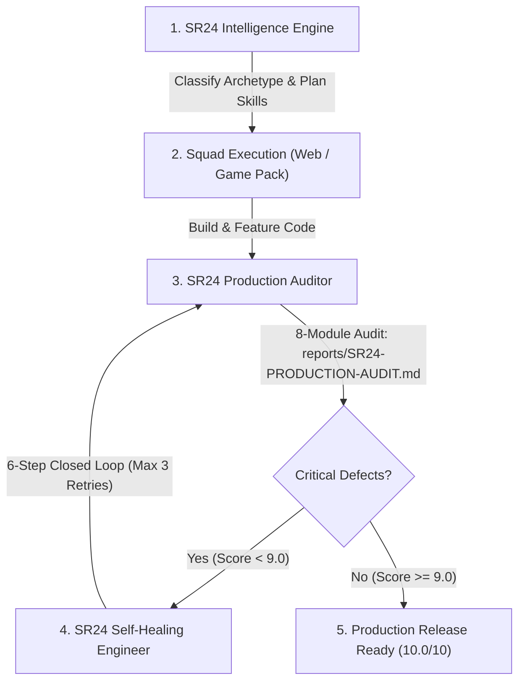

# WORKFLOW: /sr24-auto — AUTONOMOUS PROJECT DETECTION & SQUAD ROUTER (v2.6)

> **Command**: `/sr24-auto [optional task]`  
> **Natural Language Trigger**: `"Auto analyze project"`, `"Select engineering workflow"`, `"Run auto orchestrator"`, `"Detect project requirements"`  
> **Mission**: Autonomously inspect the active project repository, identify the project tech stack and requirements, match it to specialized project profiles, and activate only the minimum sufficient squad of production specialists.

---

## 1. Autonomous Project Detection Heuristics

The `/sr24-auto` command runs the following file and workspace inspection protocol:

```
                          ┌─────────────────────────────┐
                          │   WORKSPACE SCAN PROTOCOL   │
                          └──────────────┬──────────────┘
                                         │
       ┌──────────────────┬──────────────┼──────────────┬──────────────────┐
       ▼                  ▼              ▼              ▼                  ▼
[GullyVerse]        [Vibe Arena]    [ExamLoop]    [Dukaan Saathi]       [Krishi+]
"GullyVerse" or     "Vibe Arena"    "ExamLoop"    "Dukaan Saathi"     "Krishi" or
3D Desi Corridor    or Phaser 2D    Assessment     Offline POS, GST,   Agri-Vision AI,
Browser Gaming      Room Codes      Question Bank  Thermal Receipt     Crop Disease
       │                  │              │              │                  │
       ▼                  ▼              ▼              ▼                  ▼
[SR24-GAME-DEV]     [SR24-GAME-DEV] [SR24-WEB-DEV] [SR24-SAAS]        [SR24-AI]
3D WebGL / R3F      Phaser / Canvas React / Node   SaaS / Fintech     PyTorch / FastAPI
```

---

## 2. Dedicated Project Routing Profiles

### 1. GullyVerse (3D Desi Browser Gaming Platform)
- **Detected Signatures**: Next.js, Three.js, React Three Fiber, Rapier/Cannon physics, 6-character room codes, corridor runners (`auto-rush`, `truck-run`, `giant-rush`).
- **Activated Specialist Squad**:
  1. `component-intelligence` & `impeccable` (UI/UX & Desi Street Arcade Aesthetics)
  2. `threejs-game-engine` & `react-three-fiber` (3D WebGL Scene & Camera Follow)
  3. `web-game-engine` (Deterministic 60 FPS Accumulator Loop & Responsive Virtual Joysticks)
  4. `rapier-physics` & `react-three-rapier` (Vehicle & Runner Physics Collision)
  5. `colyseus-multiplayer` & `socketio-realtime` (Authoritative Multiplayer & Room State Sync)
  6. `gameplay-regression-testing` (Playwright Automated Gameplay & Collision QA)
  7. `threejs-optimization-profiling` (Draw-Call Budgeting & WebGL Performance)
  8. `game-analytics-sdk` & `posthog-analytics` (Progression & Match Completion Telemetry)

### 2. Vibe Arena (2D HTML5 Esports & Room Gaming)
- **Detected Signatures**: React, Phaser 3, Matter.js, Howler.js audio, WebSockets, room lobbies.
- **Activated Specialist Squad**:
  1. `phaser-game-engine` (Phaser 3 2D Game Architecture & Arcade Sprites)
  2. `matter-js-physics` (2D Rigid Body Physics & Constraints)
  3. `howler-js-audio` (Spatial Audio, Sound Sprites & Autoplay Unlock)
  4. `socketio-realtime` (Real-Time Room Synchronization & Low-Latency Events)
  5. `browser-game-anti-cheat-engineer` (Client Memory XOR & Action Rate Limits)
  6. `nakama-backend` (Global & Territorial Leaderboards & Matchmaking)
  7. `umami-game-analytics` (Lightweight Zero-Cookie Game Metrics)

### 3. ExamLoop (Assessment Engine & Adaptive EdTech)
- **Detected Signatures**: Next.js/React, TypeScript, KaTeX, Assessment/Quiz models, Question bank schemas.
- **Activated Specialist Squad**:
  1. `bulletproof-react` (Modular Feature Architecture & Form State Isolation)
  2. `assessment-engine-architect` (Psychometric Scoring, Negative Marking, Timers)
  3. `node-best-practices` (Secure REST API Endpoints & Auth Handshakes)
  4. `prisma-orm` or `drizzle-orm` (Relational Assessment & Question Schemas)
  5. `zod-schema-validation` (Strict DTO Request/Response Validation)
  6. `prompt-injection-security-engineer` (AI Proctoring & Safe LLM Grading Barriers)
  7. `playwright-testing` (Flake-Free Test Runner for Timed Examination Flows)

### 4. Dukaan Saathi (Offline-First Kirana SaaS & POS Billing)
- **Detected Signatures**: POS Billing, Hindi speech voice prompts, Udhaar registers, Indian GST, 80mm thermal receipts.
- **Activated Specialist Squad**:
  1. `offline-first-kirana-architect` (Local SQLite / IndexedDB & Background Sync)
  2. `indian-gst-billing-engineer` (CGST/SGST/IGST Multi-Tier Calculations & Thermal Receipts)
  3. `razorpay-upi-specialist` (Dynamic UPI QR Code Generation & HMAC Webhooks)
  4. `lago-billing` (Subscription & Metered POS Billing Lifecycles)
  5. `agency-security-appsec-engineer` (Data Isolation & Secret Protection)
  6. `posthog-analytics` (Retail Checkout Funnel & Daily Active Store Metrics)

### 5. Krishi+ (AgriTech AI/ML & Computer Vision Platform)
- **Detected Signatures**: Python FastAPI, PyTorch / TensorFlow, plant disease vision models, soil telemetry, crop market APIs.
- **Activated Specialist Squad**:
  1. `agency-engineering-ai-engineer` (Computer Vision Classification & Inference Pipelines)
  2. `api-and-interface-design` (RESTful Sensor Telemetry Ingestion Contracts)
  3. `timescale-database` / `drizzle-orm` (Time-Series Soil & Weather Telemetry)
  4. `docker-containerization` (GPU/CPU Container Builds with CUDA/ONNX Runtimes)
  5. `k6-load-testing` (High-Throughput IoT Ingestion Stress Testing)

### 6. SR24Plus Brand & Corporate Portfolio Website
- **Detected Signatures**: Portfolio, Agency, Next.js, Tailwind CSS, high visual standards, motion graphics.
- **Activated Specialist Squad**:
  1. `impeccable` (Pixel-Perfect Typography & Layout Rhythm Critique)
  2. `antislop` & `antislop-ui` (Zero-AI-Slop Visual Hierarchy & WCAG AA Contrast)
  3. `taste-skill` (Curated Color Palettes, Display Typography & Brand Identity)
  4. `motion-animations` & `gsap-animations` (ScrollTrigger Timeline & Physics Transitions)
  5. `fontsource-typography` (Zero-CLS Self-Hosted Variable Typography)
  6. `programmatic-seo-engineer` (JSON-LD Structured Schema & OpenGraph Cards)
  7. `microsoft-clarity` & `posthog-analytics` (Heatmap & Conversion Tracking)

---

## 3. Decision Tree & Automatic Routing Table

| Detected Workspace Signatures | Auto-Selected Workflow / Profile | Primary Squad Activated |
|---|---|---|
| 3D Browser Game, Three.js, R3F, Corridor Runner, Gully | [`README-SR24-GAME-DEV.md`](../../docs/README-SR24-GAME-DEV.md) | Three.js Game Engine + R3F + Rapier Physics + Gameplay QA |
| 2D HTML5 Canvas, Phaser 3, Matter.js, WebSockets, Arena | [`SR24-BROWSER-GAME.md`](./SR24-BROWSER-GAME.md) | Phaser Game Engine + Matter.js + Howler Audio + Anti-Cheat |
| Assessment Engine, Quiz Models, KaTeX, Proctoring | [`SR24-WEB-DEV.md`](../../docs/README-SR24-WEB-DEV.md) | Assessment Architect + Bulletproof React + Zod + Playwright |
| Kirana POS, Udhaar, GST Math, UPI QR, Offline Store | [`SR24-SAAS.md`](./SR24-SAAS.md) | Offline Kirana Architect + Indian GST + Razorpay UPI + Lago |
| AI/ML Computer Vision, Plant Diagnostics, Sensor API | [`SR24-AI.md`](./SR24-AI.md) | AI Systems Lead + FastAPI + Docker + Data Remediation |
| Portfolio, Agency, High Aesthetic Standards, Motion | [`SR24-DESIGN.md`](./SR24-DESIGN.md) | Impeccable + Anti-Slop + Taste Skill + Motion + Fontsource |
| General Multi-Tenant SaaS or Full-Stack Platform | [`README-SR24-WEB-DEV.md`](../../docs/README-SR24-WEB-DEV.md) | Complete 12-Phase Web Dev Squad |

---

## 4. Execution Output Format

Upon invoking `/sr24-auto`, the Master Router outputs:
```markdown
### ⚡ SR24Plus Autonomous Project Inspection
- **Detected Project**: GullyVerse 3D Browser Gaming Universe
- **Framework Stack**: Next.js 16 + React 19 + Three.js + React Three Fiber + Tailwind CSS + WebSockets
- **Matched Project Profile**: `00-MASTER-CONTROLLER/workflows/SR24-AUTO.md#1-gullyverse`
- **Active Specialist Squad**:
  1. `threejs-game-engine` & `react-three-fiber` (3D scene graph & camera orchestration)
  2. `rapier-physics` (Deterministic 3D runner & vehicle collisions)
  3. `web-game-engine` (60 FPS fixed-timestep accumulator loop)
  4. `component-intelligence` & `impeccable` (Desi Street Arcade aesthetics & glassmorphism)
  5. `colyseus-multiplayer` (Authoritative multiplayer state synchronization)
  6. `gameplay-regression-testing` (Automated input replay & collision QA)
- **Status**: Squad deployed. Ready for engineering execution.
```

---

## 5. Core Intelligence & Closed-Loop Pipeline

When triggered via `/sr24-auto` or `/sr24-full-check`, the autonomous lifecycle executes across the Core Intelligence Layer:



1. **`sr24-intelligence-engine`**: Analyzes `package.json`, assets, and manifests; outputs the exact skill activation plan.
2. **Pack Engineering Execution**: Invokes relevant phases from `SR24-WEB-DEV` or `SR24-GAME-DEV`.
3. **`sr24-production-auditor`**: Conducts full-spectrum audit across Architecture, UI/UX, Frontend, Backend, DB, Security, Game Systems, and CI/CD.
4. **`sr24-self-healing-engineer`**: Detects, diagnoses, plans, repairs, and verifies any issues without human intervention while enforcing strict non-destructive safety guardrails.
5. **Release**: Satisfies 10.0/10 production quality gates.
