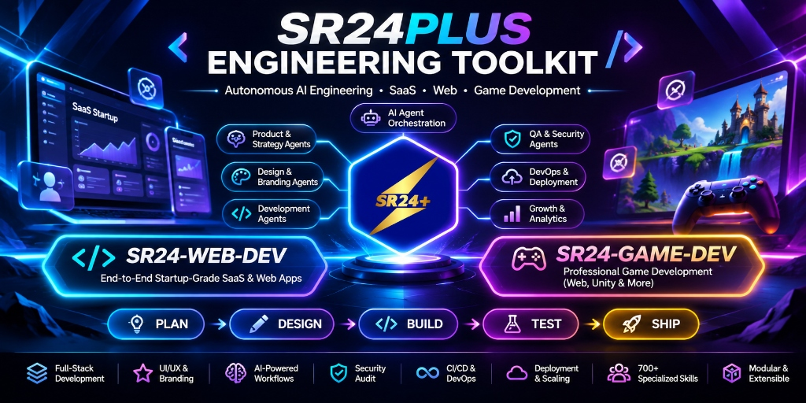
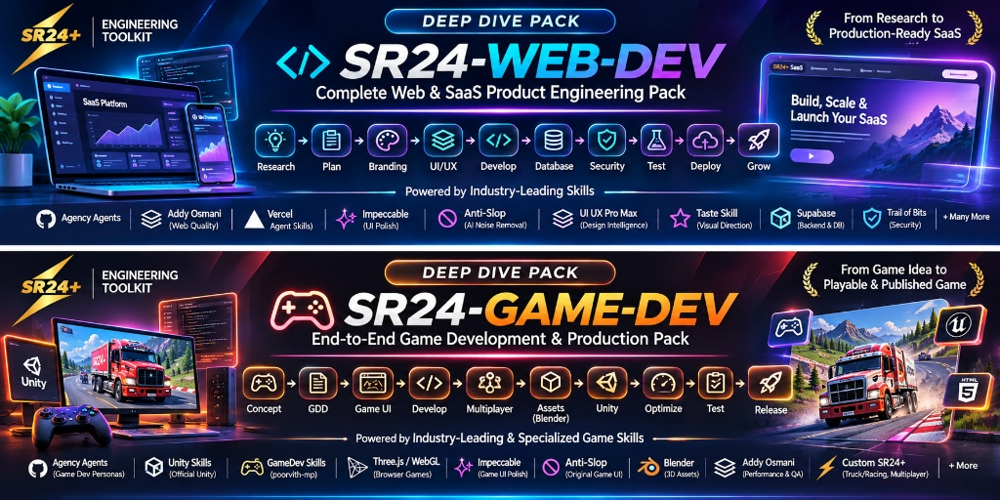

<p align="center">
  
</p>

# SR24Plus Engineering Toolkit
### Build Smarter. Engineer Better. Ship Production-Ready.

[](./SKILL-REGISTRY.md)
[](./docs/SR24PLUS-MASTER-COMMANDS.md)
[](./docs/SR24PLUS-CORE-INTELLIGENCE.md)
[](#4-flagship-engineering-packs)
[](#12-license--legal-attribution)

---

## Executive Overview

**SR24Plus Engineering Toolkit** is a modular, AI-assisted engineering ecosystem designed to streamline full-stack web development, game development, quality engineering, production auditing, and autonomous debugging through specialized skills and intelligent orchestration.

Traditional AI coding assistants often produce generic templates ("AI slop")—unmotivated purple gradients, brittle copy-pasted UI, missing database indexes, unhardened endpoints, and jittery browser game loops. SR24Plus eliminates these defects by deploying **479 canonical production skills** across a disciplined multi-agent squad structure governed by strict engineering contracts and automated quality gates.

```
                                 USER TASK OR GOAL
                                         │
                                         ▼
                            SR24 INTELLIGENCE ENGINE
               (Static Codebase Scan • Stack Detection • 12 Archetypes)
                                         │
                                         ▼
                            MULTI-AGENT ORCHESTRATION
                         ┌───────────────┴───────────────┐
                         ▼                               ▼
                 SR24-WEB-DEV                     SR24-GAME-DEV
              (12-Phase SaaS Squad)            (12-Phase Game Squad)
                         │                               │
                         └───────────────┬───────────────┘
                                         │
                                         ▼
                             SR24 PRODUCTION AUDITOR
                   (8-Dimension Forensic Readiness Inspection)
                                         │
                                         ▼
                           SR24 SELF-HEALING ENGINEER
                 (Detect ➔ Diagnose ➔ Plan ➔ Repair ➔ Test ➔ Verify)
                                         │
                                         ▼
                                PRODUCTION RELEASE
                 (Multi-Stage Docker • CI/CD • Verified Delivery)
```

---

## Master Documentation Portal

| Manual / Specification | Operational Focus & Highlights |
|---|---|
| [**`docs/SR24PLUS-MASTER-COMMANDS.md`**](./docs/SR24PLUS-MASTER-COMMANDS.md) | **14 Master Workflow Commands** — Comprehensive CLI syntax, options, mobilized skills, and runbooks. |
| [**`docs/SR24PLUS-CORE-INTELLIGENCE.md`**](./docs/SR24PLUS-CORE-INTELLIGENCE.md) | **Core Intelligence Layer Manual** — Intelligence Engine, 8-dimension Auditor, and 6-step Self-Healing loop. |
| [**`docs/README-SR24-WEB-DEV.md`**](./docs/README-SR24-WEB-DEV.md) | **Web & SaaS Pack (58 Skills)** — 12-phase lifecycle, PRD specs, Anti-Slop UI, React 18/Next.js, Drizzle, Lago. |
| [**`docs/README-SR24-GAME-DEV.md`**](./docs/README-SR24-GAME-DEV.md) | **Game Dev Pack (52 Skills)** — 12-phase lifecycle, Rapier physics, Three.js/R3F, Colyseus 60Hz, truck physics. |
| [**`docs/SR24PLUS-SOURCE-ATTRIBUTION.md`**](./docs/SR24PLUS-SOURCE-ATTRIBUTION.md) | **Upstream Attribution Directory** — Authentic source repositories, original authors, licenses across Categories A–J. |
| [**`docs/SR24PLUS-SKILL-PROVENANCE.md`**](./docs/SR24PLUS-SKILL-PROVENANCE.md) | **Unified Skill Provenance Matrix** — Complete lineage and integration status for all 479 canonical skills. |
| [**`docs/SR24PLUS-TECH-STACK.md`**](./docs/SR24PLUS-TECH-STACK.md) | **Technology Ecosystem** — Detailed tiers of supported web, game, AI, database, and DevOps technologies. |
| [**`docs/SR24PLUS-README-AUDIT.md`**](./docs/SR24PLUS-README-AUDIT.md) | **Forensic Repository Audit** — Complete audit of existing commands, packs, phases, and baseline architecture. |
| [**`docs/SR24PLUS-DOCUMENTATION-VALIDATION.md`**](./docs/SR24PLUS-DOCUMENTATION-VALIDATION.md) | **Documentation Validation Report** — Automated link integrity, table rendering, and compliance verification. |
| [**`SKILL-REGISTRY.md`**](./SKILL-REGISTRY.md) | **Master Skill Registry** — Exhaustive manifest of 479 production skills with directory paths and licenses. |
| [**`SKILL-INDEX.md`**](./SKILL-INDEX.md) | **Alphabetical Jump Index** — Fast alphabetical index of all 479 skills. |

---

## 1. Master Command Center

The toolkit provides **14 Primary Workflow Commands**, each backed by an executable runbook in `00-MASTER-CONTROLLER/workflows/`:

| No. | Master Command | Category | What It Does | Skills / Upstream Repositories | Target Runbook |
|:---:|---|---|---|---|:---:|
| **01** | `/sr24-auto [task]` | Orchestration | Automatically scans workspace, detects tech stack, and selects the matching squad. | `sr24-intelligence-engine`, `sr24-production-auditor` ([SR24Plus](https://github.com/sahil24raj/SR24plus-engineering-toolkit)) | [`SR24-AUTO.md`](./00-MASTER-CONTROLLER/workflows/SR24-AUTO.md) |
| **02** | `/sr24-web-dev [task]` | Web Development | Executes the complete 12-phase web application lifecycle from PRD to production deploy. | `bulletproof-react`, `supabase-engineering`, `drizzle-orm` ([Vercel](https://github.com/vercel-labs/agent-skills), [Addy Osmani](https://github.com/addyosmani/agent-skills)) | [`README-SR24-WEB-DEV.md`](./docs/README-SR24-WEB-DEV.md) |
| **03** | `/sr24-game-dev [task]` | Game Development | End-to-end 12-phase game development across WebGL 2D/3D, Rapier physics, and Unity 3D. | `rapier-physics`, `colyseus-multiplayer`, `threejs-game-engine` ([Unity](https://unity.com), [Agency](https://github.com/msitarzewski/agency-agents)) | [`README-SR24-GAME-DEV.md`](./docs/README-SR24-GAME-DEV.md) |
| **04** | `/sr24-saas [task]` | SaaS Engineering | Multi-tenant SaaS platform, subscription billing, multi-tier auth, dashboard HUD, SRE. | `razorpay-upi-specialist`, `indian-gst-billing-engineer`, `lago-billing` ([SR24Plus](https://github.com/sahil24raj/SR24plus-engineering-toolkit), [Lago](https://github.com/getlago/lago)) | [`SR24-SAAS.md`](./00-MASTER-CONTROLLER/workflows/SR24-SAAS.md) |
| **05** | `/sr24-fullstack [task]` | Fullstack Engineering | TypeScript contracts, database migrations, REST/tRPC API endpoints, responsive UI. | `zod-schema-validation`, `drizzle-orm`, `node-best-practices` ([Zod](https://github.com/colinhacks/zod), [Drizzle](https://github.com/drizzle-team/drizzle-orm)) | [`SR24-FULLSTACK.md`](./00-MASTER-CONTROLLER/workflows/SR24-FULLSTACK.md) |
| **06** | `/sr24-browser-game [task]` | Browser Gaming | 60 FPS HTML5/WebGL browser games, fixed-timestep loop, mobile virtual joypads, game feel. | `browser-game-architect`, `threejs-game-engine`, `matter-js-physics` ([SR24Plus](https://github.com/sahil24raj/SR24plus-engineering-toolkit), [Mr.doob](https://github.com/mrdoob/three.js)) | [`SR24-BROWSER-GAME.md`](./00-MASTER-CONTROLLER/workflows/SR24-BROWSER-GAME.md) |
| **07** | `/sr24-multiplayer [task]` | Multiplayer Systems | Low-latency authoritative game servers, client prediction, reconciliation, room codes. | `colyseus-multiplayer`, `socketio-realtime`, `redis-in-memory-datastore` ([Colyseus](https://github.com/colyseus/colyseus), [Redis](https://github.com/redis/redis)) | [`SR24-MULTIPLAYER.md`](./00-MASTER-CONTROLLER/workflows/SR24-MULTIPLAYER.md) |
| **08** | `/sr24-unity [task]` | Native 3D Engine | Unity 2D/3D development, ScriptableObjects, URP shaders, audio mixers, headless builds. | `unity-cli`, `urp-postprocessing`, `initialize-ai-navigation` ([Unity Technologies Official](https://unity.com)) | [`SR24-UNITY.md`](./00-MASTER-CONTROLLER/workflows/SR24-UNITY.md) |
| **09** | `/sr24-racing-game [task]` | Vehicle Simulation | Heavy truck & vehicle physics, WheelColliders, Ackermann steering, banked hairpin circuits. | `truck-physics-engineer`, `realistic-car-controller-engineer` ([SR24Plus](https://github.com/sahil24raj/SR24plus-engineering-toolkit), [Unity](https://unity.com)) | [`SR24-RACING-GAME.md`](./00-MASTER-CONTROLLER/workflows/SR24-RACING-GAME.md) |
| **10** | `/sr24-ai [task]` | AI & Agent Systems | Production AI systems, MCP servers, prompt injection defense, hybrid RAG vector indexes. | `prompt-injection-security-engineer`, `agency-specialized-mcp-builder` ([Agency Agents](https://github.com/msitarzewski/agency-agents)) | [`SR24-AI.md`](./00-MASTER-CONTROLLER/workflows/SR24-AI.md) |
| **11** | `/sr24-design [task]` | UI/UX & Design Systems | Bespoke design system, 4px/8px tokens, anti-AI-slop audit, finish-gate critique. | `impeccable`, `antislop-ui`, `taste-skill`, `ui-ux-pro-max` ([Paul Bakaus](https://github.com/pbakaus/impeccable), [Miqdad Badjuber](https://github.com/miqdadbadjuber/anti-slop)) | [`SR24-DESIGN.md`](./00-MASTER-CONTROLLER/workflows/SR24-DESIGN.md) |
| **12** | `/sr24-security [task]` | Security & Hardening | AppSec, OWASP Top 10 hardening, secret scanning, dependency CVE audits, CSP/CORS. | `owasp-zap-scanner`, `gitleaks-secret-detection`, `trivy-security-scanner` ([OWASP](https://github.com/zaproxy/zaproxy), [Gitleaks](https://github.com/gitleaks/gitleaks)) | [`SR24-SECURITY.md`](./00-MASTER-CONTROLLER/workflows/SR24-SECURITY.md) |
| **13** | `/sr24-research [task]` | Evidence & Research | Literature search, market sizing, competitive crawl, empirical synthesis, telemetry. | `firecrawl-scraper`, `tavily-search-intelligence`, `agency-research-synthesist` ([Firecrawl](https://github.com/firecrawl/firecrawl), [Tavily](https://github.com/tavily-ai/tavily-python)) | [`SR24-RESEARCH.md`](./00-MASTER-CONTROLLER/workflows/SR24-RESEARCH.md) |
| **14** | `/sr24-ship [task]` | DevOps & Release | Production Dockerization, GitHub Actions CI/CD, health check endpoints, zero downtime. | `docker-containerization`, `github-actions-ci`, `sentry-monitoring` ([Docker](https://github.com/docker/docs), [Sentry](https://github.com/getsentry/sentry)) | [`SR24-SHIP.md`](./00-MASTER-CONTROLLER/workflows/SR24-SHIP.md) |

### Core Intelligence Operations:
- **`/sr24-orchestrate [dir]`** — Inspects directory, detects tech stack, classifies into 12 archetypes, and outputs an activation matrix.
- **`/sr24-audit-prod [dir]`** — Conducts an 8-dimension forensic audit producing `reports/SR24-PRODUCTION-AUDIT.md`.
- **`/sr24-heal [test_cmd]`** — Executes a controlled 6-step closed-loop repair cycle (max 3 retries) with strict safety boundaries.
- **`/sr24-full-check`** — Autonomous end-to-end certification pipeline: Orchestration ➔ Audit ➔ Self-Healing ➔ Regression ➔ Release.

---

## 2. How Master Commands Work

When you trigger any master command or natural-language request, the toolkit executes a deterministic engineering pipeline:

```
[User Task]
    │
    ▼
[Workspace Analysis] ──────── Static scan of packages, configs, lockfiles, and folder structure
    │
    ▼
[Technology Detection] ────── Inference of framework, language, styling, ORM, and physics engine
    │
    ▼
[Skill Selection] ─────────── Mobilization of specific canonical skills with confidence rankings
    │
    ▼
[Engineering Execution] ───── Execution of phase-by-phase deliverables with strict typing & contracts
    │
    ▼
[Production Audit] ────────── Forensic inspection across 8 quality dimensions with zero synthetic scoring
    │
    ▼
[Self-Healing Loop] ───────── Controlled 6-step repair cycle if test failures or defects are discovered
    │
    ▼
[Release Certification] ───── Docker container verification, CI/CD pipeline, and green test proof
```

---

## 3. Core Intelligence Layer

The Core Intelligence Layer acts as the operational brain of SR24Plus, uniting all 479 skills into an autonomous quality loop:

```
┌────────────────────────────────────────────────────────────────────────┐
│                        SR24 INTELLIGENCE ENGINE                        │
│   • Traverses filesystem & reads package manifests                     │
│   • Detects languages (TS/JS/Py/Rust/Go/C#) and frameworks             │
│   • Classifies project into 12 archetypes (SaaS, 3D Game, AI, etc.)    │
│   • Generates priority-scored skill activation plans                   │
└───────────────────────────────────┬────────────────────────────────────┘
                                    │
                                    ▼
┌────────────────────────────────────────────────────────────────────────┐
│                       SR24 PRODUCTION AUDITOR                          │
│   • Audits 8 verified production dimensions with non-synthetic scoring │
│   • Checks Architecture, UI/UX Anti-Slop, Frontend, Backend, DB,       │
│     Security, Game Loop/Physics, and Deployment                        │
│   • Generates forensic defect register: reports/SR24-PRODUCTION-AUDIT  │
└───────────────────────────────────┬────────────────────────────────────┘
                                    │
                                    ▼
┌────────────────────────────────────────────────────────────────────────┐
│                      SR24 SELF-HEALING ENGINEER                        │
│   • Closed-Loop Repair: Detect ➔ Diagnose ➔ Plan ➔ Repair ➔ Test       │
│   • Strict Safety Guardrails: Blocks rm -rf, DROP TABLE, force push    │
│   • Capped at maximum 3 attempts with automatic rollback on failure    │
└────────────────────────────────────────────────────────────────────────┘
```

Detailed documentation and test results: [`docs/SR24PLUS-CORE-INTELLIGENCE.md`](./docs/SR24PLUS-CORE-INTELLIGENCE.md).

---

## 4. Flagship Engineering Packs

<p align="center">
  
</p>

### Pack A: `SR24-WEB-DEV` (58 Verified Skills • Rating: 10.0 / 10)
Enforces a comprehensive **12-Phase Web Application & SaaS Lifecycle** to eliminate generic templates and deliver hardened, production-grade web systems.

| Phase | Phase Name | Focus & Scope | Core Skills Mobilized |
|:---:|---|---|---|
| **01** | Research & Discovery | Market sizing, competitor crawl, pricing extraction | `firecrawl-scraper`, `tavily-search-intelligence`, `posthog-analytics` |
| **02** | Planning & Specifications | PRD authoring, user stories, C4 visual architecture | `c4-architecture-model`, `mermaid-diagrams`, `spec-driven-development` |
| **03** | Branding & Identity | Self-hosted typography, color scales, 24px icons | `taste-skill`, `lucide-icons`, `fontsource-typography` |
| **04** | UI/UX & Anti-Slop Gate | Hard gate banning purple gradients, WCAG AA contrast | `impeccable`, `ui-ux-pro-max`, `antislop-ui`, `component-intelligence` |
| **05** | Frontend Development | Modular React/Next.js features, strict typing, motion | `bulletproof-react`, `typescript-eslint`, `react-testing-library`, `gsap-animations` |
| **06** | Backend & Realtime | Distributed APIs, WebSockets, background job queues | `supabase-engineering`, `node-best-practices`, `socketio-realtime`, `bullmq-job-queues` |
| **07** | Database & Storage | Normalized schemas (3NF), zero-downtime migrations | `prisma-orm`, `drizzle-orm`, `dbml-schema-design`, `redis-in-memory-datastore` |
| **08** | SaaS & Fintech | Razorpay Orders, UPI QR, Indian GST math, Lago | `razorpay-upi-specialist`, `indian-gst-billing-engineer`, `lago-billing` |
| **09** | Security & Hardening | OWASP Top 10 defenses, secret scanning, CVE audits | `owasp-zap-scanner`, `gitleaks-secret-detection`, `trivy-security-scanner` |
| **10** | Testing & QA | Flake-free E2E browser tests, visual pixel diffing | `playwright-testing`, `lost-pixel-visual-regression`, `k6-load-testing` |
| **11** | DevOps & CI/CD | Multi-stage Docker, OpenTofu cloud IaC, Sentry APM | `docker-containerization`, `opentofu-iac`, `github-actions-ci`, `sentry-monitoring` |
| **12** | Analytics & Launch | Telemetry funnels, session heatmaps, programmatic SEO | `posthog-analytics`, `microsoft-clarity`, `programmatic-seo-engineer` |

*Deep-Dive Manual*: [`docs/README-SR24-WEB-DEV.md`](./docs/README-SR24-WEB-DEV.md)

---

### Pack B: `SR24-GAME-DEV` (52 Verified Skills • Rating: 10.0 / 10)
Powers high-performance, deterministic game engineering across **Browser 2D/3D Canvas/WebGL**, **Rapier/Jolt Physics**, **Authoritative Multiplayer**, and **Native Unity 3D**.

| Phase | Phase Name | Focus & Scope | Core Skills Mobilized |
|:---:|---|---|---|
| **01** | Concept & GDD | 2-minute core loops, GDD specs, economy sinks/sources | `game-programming-patterns`, `awesome-gamedev-skills`, `agency-game-development-game-designer` |
| **02** | Architecture & ECS | Zero-GC TypedArray ECS, state machines, ScriptableObjects | `bitecs-architecture`, `game-programming-patterns`, `new-unity-project` |
| **03** | In-Game HUD & Audio | Dual-camera HUD, minimap, combo counters, 3D audio | `threejs-ui-hud`, `gsap-animations`, `howler-js-audio`, `ui-uitk` |
| **04** | Web Game Engines | Three.js PBR, R3F declarative scenes, Phaser 3 arcade | `threejs-game-engine`, `react-three-fiber`, `pixijs-engine`, `phaser-game-engine` |
| **05** | Gameplay & Physics | Rapier 3D/2D, Jolt vehicles, 80ms hitstop, frame data | `rapier-physics`, `react-three-rapier`, `jolt-physics`, `combat-mechanics-engineer` |
| **06** | Authoritative Multiplayer | 60Hz server tick, prediction, reconciliation, anti-cheat | `colyseus-multiplayer`, `nakama-backend`, `browser-game-anti-cheat-engineer` |
| **07** | Unity 3D & URP | DOTS/ECS Burst jobs, custom HLSL Shader Graph nodes | `unity-entities-ecs`, `agency-game-development-unity-unity-architect`, `urp-postprocessing` |
| **08** | Vehicle Physics | 16-wheeler heavy trucks (12,000kg), Pacejka slip, ghats | `truck-physics-engineer`, `realistic-car-controller-engineer`, `racing-track-design-engineer` |
| **09** | 3D Asset & glTF Pipeline | glTF DRACO compression, KTX2 transcoding, Blender CLI | `gltf-transform-pipeline`, `blender-pipeline`, `agency-game-development-blender-blender-addon-engineer` |
| **10** | Testing & Profiling | InstancedMesh, draw call batching, canvas E2E testing | `threejs-optimization-profiling`, `gameplay-regression-testing`, `unity-performance-testing` |
| **11** | Build & Release | Headless Unity CLI builds, WebGL Brotli packaging | `game-build-and-release`, `unity-cli`, `optimize-web` |
| **12** | Analytics & Retention | Telemetry events, economy balancing, churn reduction | `game-analytics-sdk`, `umami-game-analytics`, `agency-game-development-economy-designer` |

*Deep-Dive Manual*: [`docs/README-SR24-GAME-DEV.md`](./docs/README-SR24-GAME-DEV.md)

---

## 5. Master Production Profiles

For enterprise implementations, the toolkit includes pre-configured production blueprints combining multi-phase squads:

### Profile 1: Full-Stack SaaS Platforms (`FULLSTACK-SAAS-PROFILE.md`)
- **Target Applications**: E-Commerce, B2B SaaS, Offline POS (e.g., *Dukan Sathi*, *ExamLoop*).
- **Core Architecture**: Next.js App Router, PostgreSQL (Supabase/Neon), Drizzle ORM, Zod runtime parsing, Razorpay dynamic UPI QR, Indian GST tax calculations, and Lago metered billing.
- **Blueprint Location**: [`00-MASTER-CONTROLLER/projects/FULLSTACK-SAAS-PROFILE.md`](./00-MASTER-CONTROLLER/projects/FULLSTACK-SAAS-PROFILE.md)

### Profile 2: High-Performance Browser Gaming (`BROWSER-GAMING-PROFILE.md`)
- **Target Applications**: Real-Time Multiplayer, 3D Highway Runners, Esports (e.g., *Vibe Arena*, *GullyVerse*).
- **Core Architecture**: Deterministic 60 FPS accumulator loop (`dt = 1/60s`), Three.js/R3F WebGL, Rapier 3D physics, Colyseus authoritative 60Hz server tick with client prediction, memory XOR anti-cheat, and Howler.js spatial audio.
- **Blueprint Location**: [`00-MASTER-CONTROLLER/projects/BROWSER-GAMING-PROFILE.md`](./00-MASTER-CONTROLLER/projects/BROWSER-GAMING-PROFILE.md)

---

## 6. Quick Start Guide

You do not need to manually configure or install individual skills. All 479 skills are pre-indexed and ready for autonomous dispatch:

### Step 1: Clone Repository
```bash
git clone https://github.com/sahil24raj/SR24plus-engineering-toolkit.git
cd SR24plus-engineering-toolkit
```

### Step 2: Invoke via CLI or AI Agent Prompt
Inside Google Antigravity, Cursor, Claude, or any modern agent environment, issue your command:

```text
/sr24-auto
```
*Or execute a specialized workflow:*
```text
/sr24-web-dev Build an offline-first inventory SaaS with GST invoices and UPI QR payments
```
```text
/sr24-game-dev Create a 3D highway runner with obstacle lanes, dynamic speed curves, and boss fights
```

---

## 7. Supported Technology Ecosystem

```
Web Development      Game Development      AI & Agents           DevOps & SRE
────────────────     ────────────────      ───────────           ────────────
Next.js 14/15        Three.js & R3F        SR24 Intelligence     Docker Multi-Stage
React 18/19          Rapier 2D/3D (WASM)   SR24 Production Audit GitHub Actions CI
TypeScript (Strict)  Jolt Physics          SR24 Self-Healing     OpenTofu Cloud IaC
Tailwind CSS & Tokens Matter.js             Model Context Protocol Sentry Crash APM
Supabase PostgreSQL  Phaser 3 & PixiJS     Prompt Defense        PostHog Telemetry
Drizzle & Prisma     Unity Engine (URP)    301 Agency Personas   Microsoft Clarity
BullMQ & Redis       Colyseus 60Hz Tick    Google Antigravity    Grafana k6 Load Test
Razorpay & Indian GST Howler.js 3D Audio   Zod Runtime Parsing   Playwright E2E
```

Detailed ecosystem manual: [`docs/SR24PLUS-TECH-STACK.md`](./docs/SR24PLUS-TECH-STACK.md).

---

## 8. Source Attribution & Provenance

The toolkit strictly adheres to open-source licensing and authentic author attribution:
- **`msitarzewski/agency-agents`** (301 skills • MIT License): Autonomous agent personas.
- **`addyosmani/agent-skills`** (25 skills • MIT License): Engineering craft and architecture standards.
- **`Unity Technologies`** (32 skills • Unity Companion / Apache-2.0): Official Unity engine skills.
- **`vercel-labs/agent-skills`** (9 skills • MIT License): Modern React and Next.js performance patterns.
- **`ui-design-suite`** (5 skills • Apache-2.0 / MIT): `impeccable`, `antislop`, `taste-skill`, `ui-ux-pro-max`.
- **`google-deepmind`** (13 skills • Apache-2.0): Antigravity swarms and generative UI.
- **`SR24Plus Custom Engineering`** (82 skills • MIT License): Core Intelligence layer, Indian fintech, heavy vehicle physics, 60Hz anti-cheat.

Full provenance catalog: [`docs/SR24PLUS-SOURCE-ATTRIBUTION.md`](./docs/SR24PLUS-SOURCE-ATTRIBUTION.md) and [`docs/SR24PLUS-SKILL-PROVENANCE.md`](./docs/SR24PLUS-SKILL-PROVENANCE.md).

---

## 9. Quality Verification & Test Suite

The Core Intelligence Layer is validated by an automated test suite ([`tests/test_core_intelligence.py`](./tests/test_core_intelligence.py)):

```bash
python tests/test_core_intelligence.py
```

### Verification Results:
```
Ran 6 tests in 1.295s
OK
✓ TEST 1 PASSED: Browser game platform correctly classified with 3D & multiplayer skills.
✓ TEST 2 PASSED: SaaS application correctly routed to database, auth & architecture skills.
✓ TEST 3 PASSED: Production auditor captured security token & XSS with evidence.
✓ TEST 4 PASSED: Self-healing closed loop successfully diagnosed and repaired defect.
✓ TEST 5 PASSED: Defect repaired with zero regression to existing functionality.
✓ TEST 6 PASSED: Strict production safety guardrails actively enforced.
```

---

## 10. Inviolable Quality Gates & Execution Rules

1. **Zero Hallucinations**: Never generate non-existent package dependencies, fabricated API methods, or phantom file paths.
2. **Anti-AI-Slop Hard Gate**: Prohibits unmotivated purple-to-cyan gradient landing pages, illegible floating glass cards, and fake static charts.
3. **Deterministic Physics**: All game update loops must decouple physics simulation (`dt = 1/60s`) from variable rendering framerates using an accumulator.
4. **Safety Boundaries**: Destructive commands (`rm -rf /`, `DROP TABLE`, `git push --force`) are intercepted and blocked automatically.
5. **Verified Builds**: Every phase deliverable must pass static compilation (`npm run build`, `tsc --noEmit`, or `python -m py_compile`) and test verification.

---

## 11. Contributing & Community Guidelines

Contributions of high-taste design patterns, game physics models, and engineering skills are welcome:
1. Fork the repository.
2. Create a feature branch (`git checkout -b feature/new-skill`).
3. Ensure every new skill follows the canonical 12-section `SKILL.md` structure with explicit dependencies, operational boundaries, and upstream attribution.
4. Verify tests pass cleanly (`python tests/test_core_intelligence.py`).
5. Submit a descriptive Pull Request.

---

## 12. License & Legal Attribution

- The SR24Plus toolkit architecture, custom skills, and Core Intelligence engines are licensed under the **[MIT License](#12-license--legal-attribution)**.
- Upstream imported skills retain their original open-source licenses (MIT, Apache-2.0, Unity Companion License, BSD-2-Clause, MPL-2.0).
- All trademarks, logos, and brand names are the property of their respective owners.
