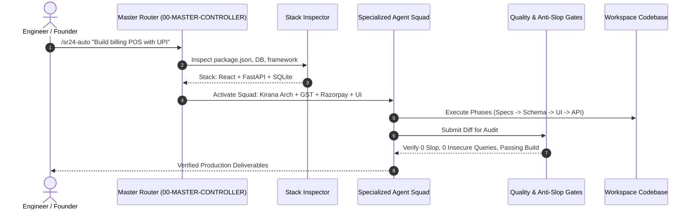

# SR24Plus Master Multi-Agent Orchestration Workflow
### Autonomous Coordination, Specialist Selection, Anti-Slop Gates, and Execution Lifecycle

[](./MASTER-WORKFLOW.md)
[](#3-the-four-inviolable-quality-gates)
[](#1-orchestration-architecture)

---

## 1. Orchestration Architecture

The **SR24Plus Engineering Toolkit** implements a hierarchical multi-agent orchestration architecture. Instead of relying on a single generalist AI model to perform all engineering tasks, the system coordinates specialized AI personas across a strict dependency graph.



---

## 2. The 15-Stage Master Engineering Lifecycle

Every production task executed through the toolkit follows this 15-stage pipeline:

```
[1. Research] ➔ [2. Planning] ➔ [3. Requirements] ➔ [4. Architecture] ➔ [5. Branding]
      │
      ▼
[6. UI/UX Anti-Slop] ➔ [7. Implementation] ➔ [8. Database] ➔ [9. Integrations] ➔ [10. Security]
      │
      ▼
[11. Testing & QA] ➔ [12. Performance] ➔ [13. Deployment] ➔ [14. Monitoring] ➔ [15. Release]
```

### Stage Details & Specialist Allocations

1. **Research**: Evaluates market landscape, competitor feature sets, and feasibility (`agency-product-trend-researcher`, `reverse-engineer-anything`).
2. **Planning**: Identifies dependencies, breaks tasks into atomic milestones, and sets time boundaries (`planning-and-task-breakdown`).
3. **Requirements**: Authors the formal `PRD.md` with explicit non-goals to prevent feature creep (`agency-product-manager`, `spec-driven-development`).
4. **Architecture**: Establishes modular monolith, microservice, or ScriptableObject patterns (`agency-engineering-software-architect`).
5. **Branding**: Cures color tokens, typographic scales, and brand tone (`agency-design-brand-guardian`, `taste-skill`).
6. **UI/UX Design**: Formulates 4px/8px mathematical layouts and enforces the Anti-AI-Slop gate (`impeccable`, `ui-ux-pro-max`, `antislop-ui`).
7. **Implementation**: Writes clean, single-responsibility frontend and client code (`agency-engineering-frontend-developer`, `composition-patterns`).
8. **Database**: Models normalized schemas, foreign keys, and composite indices (`agency-engineering-database-optimizer`, `offline-first-kirana-architect`).
9. **Integrations**: Connects payment gateways, dynamic UPI QR codes, and external APIs (`razorpay-upi-specialist`, `indian-gst-billing-engineer`).
10. **Security**: Audits OWASP Top 10, sanitizes SQL queries, and secures AI prompts (`agency-security-appsec-engineer`, `prompt-injection-security-engineer`).
11. **Testing & QA**: Executes unit tests, zero-flake Playwright E2E suites, and reality-check certifications (`playwright-automation-engineer`, `agency-testing-reality-checker`).
12. **Performance**: Profiles hot loops, eliminates memory leaks, and verifies Core Web Vitals (`performance-optimization`).
13. **Deployment**: Scaffolds Dockerfiles, GitHub Actions workflows, and Vercel/Cloudflare configs (`agency-engineering-devops-automator`, `deploy-to-vercel`).
14. **Monitoring**: Sets up healthchecks, structured logging, and error tracking (`agency-engineering-sre`).
15. **Release**: Generates release notes, dynamic sitemaps, and Product Hunt assets (`shipping-and-launch`, `product-hunt-launch-specialist`).

---

## 3. The Four Inviolable Quality Gates

No task or phase is marked complete unless it passes these four automated gates:

### Gate 1: The Anti-AI-Slop Gate
- **Enforcers**: `impeccable`, `antislop`, `antislop-ui`, `agency-design-ui-finish-gate-reviewer`.
- **Violations that Trigger Immediate Rejection**:
  - Unmotivated purple/cyan gradients.
  - Low-contrast text failing WCAG AA (minimum 4.5:1 ratio).
  - Cartoon emoji icons used in place of functional SVG icons.
  - Gratuitous glassmorphism that obscures content.
  - Repetitive 3-column feature card templates without distinct product identity.

### Gate 2: The Zero-Hallucination Evidence Gate
- **Enforcers**: `agency-testing-reality-checker`, `agency-testing-evidence-collector`.
- **Rule**: Claims of task completion are rejected without objective command verification:
  - Frontend: `npm run build` with zero compiler/bundler errors.
  - Backend: `pytest` or server startup verification with status 200 healthcheck.
  - Tests: Zero failing assertions.

### Gate 3: Security & Cryptographic Gate
- **Enforcers**: `agency-security-appsec-engineer`, `prompt-injection-security-engineer`.
- **Rule**: 100% parameterized database queries (zero raw SQL string concatenation). Zero API credentials hardcoded in Git. Cryptographic HMAC verification on all incoming payment webhooks.

### Gate 4: Deterministic Fallback Gate
- **Rule**: Every AI, voice, or cloud service must have a local, rule-based offline fallback (e.g., deterministic regex parser if LLM API is unavailable; local audio playback if cloud TTS fails).

---

## 4. Master Command Directory & Natural Language Prompts

| Command | Scope | Target Output | Example Prompt to AI |
|---|---|---|---|
| **`/sr24-auto [task]`** | Universal autonomous project detection | Automatically activates matching squad based on codebase | *"Analyze this repo and build a complete user onboarding flow."* |
| **`/sr24-web-dev [task]`** | Full-stack web application engineering | Complete web app across all 10 phases | *"Build a responsive B2B supplier portal with Next.js and PostgreSQL."* |
| **`/sr24-saas [task]`** | Multi-tenant SaaS platform | Tenancy isolation, subscription billing, RBAC | *"Build a multi-tenant team retrospective tool with Stripe subscriptions."* |
| **`/sr24-browser-game [task]`**| 60 FPS HTML5/WebGL browser game | Fixed loop, virtual touch joysticks, game feel | *"Build a 60 FPS browser platformer with hitstop impacts and mobile touch controls."* |
| **`/sr24-multiplayer [task]`** | Authoritative realtime multiplayer | 60Hz tick, client prediction, room codes | *"Build an authoritative 8-player arena server with 4-digit room codes."* |
| **`/sr24-unity [task]`** | Commercial Unity 2D/3D development | ScriptableObjects, URP shaders, audio mixers | *"Build an inventory and quest system using ScriptableObjects in Unity."* |
| **`/sr24-racing-game [task]`** | Heavy truck & vehicle simulation | WheelColliders, air brakes, spline circuits | *"Simulate a 16-wheeler commercial truck with dual drive axles on a mountain circuit."* |
| **`/sr24-ai [task]`** | Production AI systems & MCP servers | Prompt defense, RAG pipelines, MCP tools | *"Build an MCP server in TypeScript with Zod validation for searching order databases."* |
| **`/sr24-design [task]`** | Bespoke design system & anti-slop | 8px tokens, WCAG AA, typography hierarchy | *"Design a dark frosted glass design system with emerald accents for retail POS."* |
| **`/sr24-security [task]`** | AppSec & vulnerability hardening | OWASP Top 10 audit, secret leak scanning | *"Audit this FastAPI backend against SQL injection and insecure CORS policies."* |
| **`/sr24-qa [task]`** | Automated testing & RCA debugging | Playwright E2E suites, visual regression | *"Write Playwright tests for user signup, cart checkout, and payment confirmation."* |
| **`/sr24-ship [task]`** | Production DevOps & launch | Dockerfile, CI/CD pipeline, healthchecks | *"Generate a multi-stage Dockerfile and GitHub Actions workflow for automated deployments."* |
| **`/sr24-research [task]`** | Quantitative evidence synthesis | TAM/SAM, competitive matrix, reverse eng | *"Synthesize technical architecture papers for offline-first synchronization."* |

