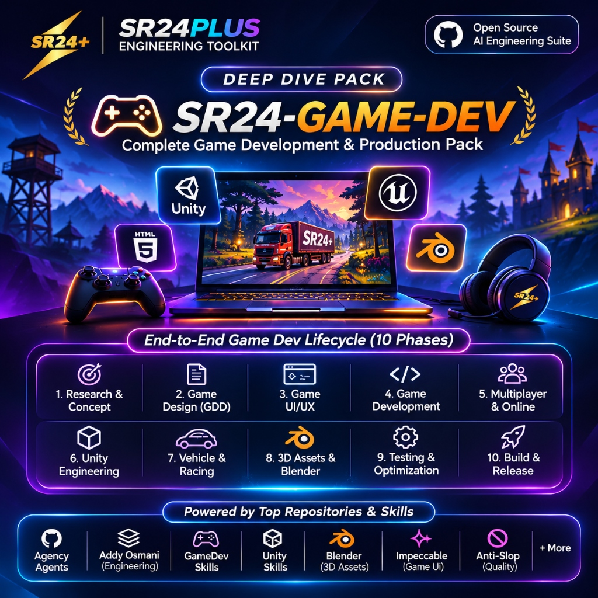
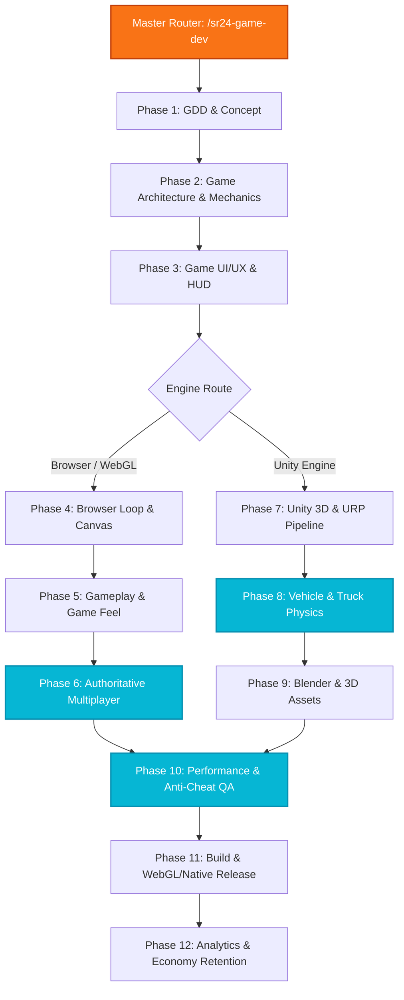

  

# SR24-GAME-DEV: Complete Game Production & Multiplayer Engineering Pack
### Autonomous Multi-Agent Engineering Architecture for Browser Games, WebSockets & Unity 3D

---

## 1. Executive Overview & Mission

**`SR24-GAME-DEV`** is the master game engineering pack in the **SR24Plus Engineering Toolkit**. It is built to engineer high-performance, polished, bug-free, and engaging games across two primary gaming domains:
1. **Real-Time Browser Games & Esports Platforms** (e.g., *Vibe Arena*, *Indian Politics Arena*): 60 FPS Canvas/WebGL, deterministic fixed-timestep accumulator loops, authoritative WebSockets, client-side prediction, and memory XOR anti-cheat.
2. **Commercial Unity 3D Simulators & Action Titles** (e.g., *Indian Truck Racing*): 16-wheeler heavy truck physics, Ackermann steering, Pacejka tire friction, spline mountain circuits with hairpin banking, URP shaders, and audio mixing buses.

Invoked via `/sr24-game-dev [task]`, `/sr24-browser-game [task]`, `/sr24-racing-game [task]`, or `/sr24-unity [task]`.

---

## 2. Squad Coordination Architecture

---

## 3. 12-Phase Game Production Lifecycle

### Phase 1 — Game Research and Concept
- **Objective**: Formulate the core gameplay hook, core loop (Action ➔ Reward ➔ Progression), session length, demographic positioning, and economic sources/sinks.
- **Key Verified Skills**:
  - `agency-game-development-game-designer` (`skills/agency-agents/agency-game-development-game-designer/SKILL.md`)
  - `agency-game-development-economy-designer` (`skills/agency-agents/agency-game-development-economy-designer/SKILL.md`)
  - `agency-product-trend-researcher` (`skills/agency-agents/agency-product-trend-researcher/SKILL.md`)
- **How to Prompt AI**:
  > *"Analyze competitive battle royale and browser party games. Formulate a Game Design Document (GDD) with a 3-minute core loop, soft currency economy, and monetization loop."*

### Phase 2 — Game Design and Planning
- **Objective**: Author the formal Game Design Document (GDD), level encounter flow, difficulty curves, reward progression trees, and decoupled system architecture.
- **Key Verified Skills**:
  - `agency-game-development-game-designer` (`skills/agency-agents/agency-game-development-game-designer/SKILL.md`)
  - `agency-game-development-level-designer` (`skills/agency-agents/agency-game-development-level-designer/SKILL.md`)
  - `new-unity-project` (`skills/unity-skills/new-unity-project/SKILL.md`): Scaffolds clean, decoupled Unity projects with ScriptableObject architectures.
- **How to Prompt AI**:
  > *"Create a level pacing curve and modular ScriptableObject architecture for weapon and upgrade data."*

### Phase 3 — Game UI/UX and Visual Design
- **Objective**: Design responsive, high-FPS in-game HUDs, matchmaking lobbies, pause menus, and victory screens with zero input latency.
- **Key Verified Skills**:
  - `agency-design-ui-designer` (`skills/agency-agents/agency-design-ui-designer/SKILL.md`)
  - `ui-ux-pro-max` (`skills/ui-design-suite/ui-ux-pro-max/SKILL.md`)
  - `ui` (`skills/unity-skills/ui/SKILL.md`): Routes to UI Toolkit, uGUI, or IMGUI based on performance requirements.
  - `ui-uitk` (`skills/unity-skills/ui-uitk/SKILL.md`): Modern flex-based UI Toolkit UXML/USS layouts.
  - `ui-ugui` (`skills/unity-skills/ui-ugui/SKILL.md`): Canvas hierarchies and RectTransform anchors.
  - `agency-design-whimsy-injector` (`skills/agency-agents/agency-design-whimsy-injector/SKILL.md`)
- **How to Prompt AI**:
  > *"Build a responsive in-game HUD with mini-map, health meter, and floating damage numbers using UI Toolkit that scales across 16:9 and 21:9 displays."*

### Phase 4 — Browser Game Development
- **Objective**: Engineer 60 FPS HTML5 Canvas, Pixi.js, or Three.js browser games with fixed-timestep accumulator loops and virtual touch joysticks.
- **Key Verified Skills**:
  - `browser-game-architect` (`skills/sr24-custom-engineering/browser-game-architect/SKILL.md`): Deterministic 60Hz loop, canvas auto-scaling, state machine, zero memory allocations in render loop.
  - `agency-engineering-frontend-developer` (`skills/agency-agents/agency-engineering-frontend-developer/SKILL.md`)
  - `agency-engineering-senior-developer` (`skills/agency-agents/agency-engineering-senior-developer/SKILL.md`): Three.js WebGL scenes, lighting, and camera controllers.
  - `optimize-web` (`skills/unity-skills/optimize-web/SKILL.md`): Shrinks WebGL builds, WebGPU optimization, and browser asset compression.
- **How to Prompt AI**:
  > *"Implement a deterministic fixed-timestep game loop in TypeScript with sub-frame interpolation and on-screen dual touch joysticks for mobile browsers."*

### Phase 5 — Gameplay Engineering & Game Feel
- **Objective**: Implement character controllers, collision detection, enemy AI, combat hitboxes/hurtboxes, hitstop impacts, and camera screen shakes.
- **Key Verified Skills**:
  - `combat-mechanics-engineer` (`skills/sr24-custom-engineering/combat-mechanics-engineer/SKILL.md`): 60Hz frame data (startup/active/recovery), 80ms hitstop freezes, combo input buffers.
  - `physics-3d-collision` (`skills/unity-skills/physics-3d-collision/SKILL.md`): Rigidbody 3D physics, collision matrix layers, and raycast optimization.
  - `create-2d-physics` (`skills/unity-skills/create-2d-physics/SKILL.md`): Rigidbody2D, composite colliders, and physics materials.
  - `initialize-ai-navigation` (`skills/unity-skills/initialize-ai-navigation/SKILL.md`): NavMesh surfaces, agent avoidance, and patrol links.
- **How to Prompt AI**:
  > *"Code a 2D combat character controller with a 3-hit combo buffer, 80ms hitstop impact on strike, and dynamic camera shake."*

### Phase 6 — Multiplayer Engineering & Anti-Cheat (The Vibe Arena Backbone)
- **Objective**: Engineer low-latency authoritative WebSocket game servers, client-side prediction, server reconciliation, dynamic 4-character room codes, and memory obfuscation.
- **Key Verified Skills**:
  - `websocket-multiplayer-engineer` (`skills/sr24-custom-engineering/websocket-multiplayer-engineer/SKILL.md`): 60Hz server tick, 20Hz snapshot broadcast, client prediction sequence IDs, entity interpolation buffer (100ms) for 4G networks.
  - `browser-game-anti-cheat-engineer` (`skills/sr24-custom-engineering/browser-game-anti-cheat-engineer/SKILL.md`): Speedhack distance delta checks, XOR memory obfuscation for score variables, input entropy bot detection.
  - `setup-multiplayer-services` (`skills/unity-skills/setup-multiplayer-services/SKILL.md`): Unity Relay, Lobby, and Netcode for GameObjects.
  - `setup-vivox-voice-chat` (`skills/unity-skills/setup-vivox-voice-chat/SKILL.md`): 3D spatial positional voice chat and team channels.
  - `agency-game-development-unity-unity-multiplayer-engineer` (`skills/agency-agents/agency-game-development-unity-unity-multiplayer-engineer/SKILL.md`)
  - `agency-game-development-godot-godot-multiplayer-engineer` (`skills/agency-agents/agency-game-development-godot-godot-multiplayer-engineer/SKILL.md`)
- **How to Prompt AI**:
  > *"Build an authoritative Node.js WebSocket server for 8-player arena matches with 4-digit room codes, client-side prediction, and delta distance speedhack validation."*

### Phase 7 — Unity Game Development & URP
- **Objective**: Build scalable Unity C# architectures using ScriptableObjects, custom Shader Graph materials, Volume post-processing, and URP render graph passes.
- **Key Verified Skills**:
  - `agency-game-development-unity-unity-architect` (`skills/agency-agents/agency-game-development-unity-unity-architect/SKILL.md`)
  - `agency-game-development-unity-unity-shader-graph-artist` (`skills/agency-agents/agency-game-development-unity-unity-shader-graph-artist/SKILL.md`)
  - `shader-graph-create-custom-node` (`skills/unity-skills/shader-graph-create-custom-node/SKILL.md`): Custom HLSL nodes for Shader Graph.
  - `urp-postprocessing` (`skills/unity-skills/urp-postprocessing/SKILL.md`): Bloom, tonemapping, vignette, and depth of field.
  - `validate-urp-render-graph-renderer-feature` (`skills/unity-skills/validate-urp-render-graph-renderer-feature/SKILL.md`): Unity 6 Render Graph validation.
  - `migrate-birp-to-urp` (`skills/unity-skills/migrate-birp-to-urp/SKILL.md`)
  - `build-live-game` (`skills/unity-skills/build-live-game/SKILL.md`): Unity Gaming Services (UGS) remote config and player auth.
- **How to Prompt AI**:
  > *"Create a URP custom render pass for night-vision thermal scope and set up a post-processing volume for cinematic atmospheric fog."*

### Phase 8 — Vehicle & Racing Game Development (Indian Truck Racing)
- **Objective**: Simulate realistic commercial heavy vehicle physics, multi-axle WheelColliders, Ackermann steering, torque curves, air brakes, and ghat hairpin banking.
- **Key Verified Skills**:
  - `truck-physics-engineer` (`skills/sr24-custom-engineering/truck-physics-engineer/SKILL.md`): 16-wheeler physics (12,000kg), dual rear axles, anti-roll bars, diesel torque curves, air brake pressure models.
  - `realistic-car-controller-engineer` (`skills/sr24-custom-engineering/realistic-car-controller-engineer/SKILL.md`): Pacejka slip curves, aerodynamic downforce ($C_L$), slipstream drafting.
  - `racing-track-design-engineer` (`skills/sr24-custom-engineering/racing-track-design-engineer/SKILL.md`): Spline road generation, $5^\circ-12^\circ$ banking on ghat hairpins, friction zones, lap checkpoints.
- **How to Prompt AI**:
  > *"Set up a 16-wheeler heavy truck prefab in Unity with dual drive rear axles, anti-roll suspension, and a spline circuit featuring banked ghat hairpins."*

### Phase 9 — Blender & 3D Asset Pipeline
- **Objective**: Automate Blender 3D modeling, UV unwrapping, material assignment, LOD generation, and asset bundle pipeline exports.
- **Key Verified Skills**:
  - `agency-game-development-blender-blender-addon-engineer` (`skills/agency-agents/agency-game-development-blender-blender-addon-engineer/SKILL.md`)
  - `agency-game-development-technical-artist` (`skills/agency-agents/agency-game-development-technical-artist/SKILL.md`)
  - `asset-transformer-toolkit` (`skills/unity-skills/asset-transformer-toolkit/SKILL.md`)
  - `manage-sprite-atlas` (`skills/unity-skills/manage-sprite-atlas/SKILL.md`)
- **How to Prompt AI**:
  > *"Write a Blender Python script to batch export 3D vehicle models into Unity-ready FBXs with automated LOD0, LOD1, and LOD2 reductions."*

### Phase 10 — Game Testing & Optimization
- **Objective**: Profile CPU/GPU bottlenecks, eliminate memory allocations in update loops, reduce draw calls via texture atlases, and audit multiplayer stress limits.
- **Key Verified Skills**:
  - `performance-optimization` (`skills/addyosmani-agent-skills/performance-optimization/SKILL.md`)
  - `optimize-audio` (`skills/unity-skills/optimize-audio/SKILL.md`): Vorbis/ADPCM codecs, memory load types.
  - `optimize-text-mesh-pro` (`skills/unity-skills/optimize-text-mesh-pro/SKILL.md`)
  - `agency-testing-reality-checker` (`skills/agency-agents/agency-testing-reality-checker/SKILL.md`)
- **How to Prompt AI**:
  > *"Profile this Unity scene to bring draw calls under 80 and eliminate GC allocations in the hot gameplay loop."*

### Phase 11 — Game Build & Release
- **Objective**: Automate multi-platform builds (Windows, macOS, WebGL, Android, iOS), asset bundle packaging, and store asset preparation.
- **Key Verified Skills**:
  - `unity-cli` (`skills/unity-skills/unity-cli/SKILL.md`): Headless command-line build automation.
  - `unity-package-management` (`skills/unity-skills/unity-package-management/SKILL.md`)
  - `shipping-and-launch` (`skills/addyosmani-agent-skills/shipping-and-launch/SKILL.md`)
- **How to Prompt AI**:
  > *"Configure a headless Unity CLI build script targeting WebGL with Brotli compression and release build optimizations."*

### Phase 12 — Game Analytics & Retention
- **Objective**: Track player session length, progression drop-off, churn funnels, and balance in-game economies.
- **Key Verified Skills**:
  - `agency-support-analytics-reporter` (`skills/agency-agents/agency-support-analytics-reporter/SKILL.md`)
  - `agency-marketing-growth-hacker` (`skills/agency-agents/agency-marketing-growth-hacker/SKILL.md`)
  - `agency-marketing-app-store-optimizer` (`skills/agency-agents/agency-marketing-app-store-optimizer/SKILL.md`)
- **How to Prompt AI**:
  > *"Design an event telemetry schema to track tutorial completion drop-offs and level 5 progression churn."*

---

## 4. Complete SR24-GAME-DEV Skill Matrix

| Phase | Skill Name | Source Repository | Original Skill Path | Local Skill Path | Main Responsibility | Verification Status |
|---|---|---|---|---|---|:---:|
| 01 | `agency-game-development-game-designer` | `msitarzewski/agency-agents` | `skills/agency-game-development-game-designer` | `skills/agency-agents/agency-game-development-game-designer/SKILL.md` | Core loop, player psychology, GDD | Verified In-Repo |
| 01 | `agency-game-development-economy-designer` | `msitarzewski/agency-agents` | `skills/agency-game-development-economy-designer` | `skills/agency-agents/agency-game-development-economy-designer/SKILL.md` | In-game currency sinks, sources, monetization | Verified In-Repo |
| 02 | `agency-game-development-level-designer` | `msitarzewski/agency-agents` | `skills/agency-game-development-level-designer` | `skills/agency-agents/agency-game-development-level-designer/SKILL.md` | Level pacing, encounters, spatial storytelling | Verified In-Repo |
| 02 | `new-unity-project` | `Unity Technologies` | `skills/new-unity-project` | `skills/unity-skills/new-unity-project/SKILL.md` | ScriptableObject decoupled architecture | Verified In-Repo |
| 03 | `agency-design-ui-designer` | `msitarzewski/agency-agents` | `skills/agency-design-ui-designer` | `skills/agency-agents/agency-design-ui-designer/SKILL.md` | HUD design & game UI systems | Verified In-Repo |
| 03 | `ui-uitk` | `Unity Technologies` | `skills/ui-uitk` | `skills/unity-skills/ui-uitk/SKILL.md` | Flex-based UI Toolkit UXML/USS layouts | Verified In-Repo |
| 03 | `ui-ugui` | `Unity Technologies` | `skills/ui-ugui` | `skills/unity-skills/ui-ugui/SKILL.md` | Unity Canvas & RectTransform anchors | Verified In-Repo |
| 04 | `browser-game-architect` | `SR24Plus Custom` | Original Architecture | `skills/sr24-custom-engineering/browser-game-architect/SKILL.md` | 60Hz loop, canvas scaling, mobile controls | Verified In-Repo |
| 04 | `optimize-web` | `Unity Technologies` | `skills/optimize-web` | `skills/unity-skills/optimize-web/SKILL.md` | WebGL build shrinking & WebGPU tuning | Verified In-Repo |
| 05 | `combat-mechanics-engineer` | `SR24Plus Custom` | Original Architecture | `skills/sr24-custom-engineering/combat-mechanics-engineer/SKILL.md` | 60Hz frame data, 80ms hitstop, combo buffers | Verified In-Repo |
| 05 | `physics-3d-collision` | `Unity Technologies` | `skills/physics-3d-collision` | `skills/unity-skills/physics-3d-collision/SKILL.md` | 3D Rigidbodies & collision matrix tuning | Verified In-Repo |
| 05 | `create-2d-physics` | `Unity Technologies` | `skills/create-2d-physics` | `skills/unity-skills/create-2d-physics/SKILL.md` | Rigidbody2D & 2D physics materials | Verified In-Repo |
| 05 | `initialize-ai-navigation` | `Unity Technologies` | `skills/initialize-ai-navigation` | `skills/unity-skills/initialize-ai-navigation/SKILL.md` | NavMesh surface baking & AI patrol routes | Verified In-Repo |
| 06 | `websocket-multiplayer-engineer` | `SR24Plus Custom` | Original Architecture | `skills/sr24-custom-engineering/websocket-multiplayer-engineer/SKILL.md` | Authoritative 60Hz server, prediction, reconciliation | Verified In-Repo |
| 06 | `browser-game-anti-cheat-engineer` | `SR24Plus Custom` | Original Architecture | `skills/sr24-custom-engineering/browser-game-anti-cheat-engineer/SKILL.md` | Delta speedhacks, memory XOR, bot detection | Verified In-Repo |
| 06 | `setup-multiplayer-services` | `Unity Technologies` | `skills/setup-multiplayer-services` | `skills/unity-skills/setup-multiplayer-services/SKILL.md` | Unity Netcode, Relay & Lobby setup | Verified In-Repo |
| 06 | `setup-vivox-voice-chat` | `Unity Technologies` | `skills/setup-vivox-voice-chat` | `skills/unity-skills/setup-vivox-voice-chat/SKILL.md` | 3D positional proximity voice chat | Verified In-Repo |
| 07 | `agency-game-development-unity-unity-architect` | `msitarzewski/agency-agents` | `skills/agency-game-development-unity-unity-architect` | `skills/agency-agents/agency-game-development-unity-unity-architect/SKILL.md` | ScriptableObject event architectures | Verified In-Repo |
| 07 | `agency-game-development-unity-unity-shader-graph-artist` | `msitarzewski/agency-agents` | `skills/agency-game-development-unity-unity-shader-graph-artist` | `skills/agency-agents/agency-game-development-unity-unity-shader-graph-artist/SKILL.md` | Unity Shader Graph & HLSL passes | Verified In-Repo |
| 07 | `shader-graph-create-custom-node` | `Unity Technologies` | `skills/shader-graph-create-custom-node` | `skills/unity-skills/shader-graph-create-custom-node/SKILL.md` | Custom HLSL nodes for Shader Graph | Verified In-Repo |
| 07 | `urp-postprocessing` | `Unity Technologies` | `skills/urp-postprocessing` | `skills/unity-skills/urp-postprocessing/SKILL.md` | URP Volume framework (bloom, tonemapping) | Verified In-Repo |
| 08 | `truck-physics-engineer` | `SR24Plus Custom` | Original Architecture | `skills/sr24-custom-engineering/truck-physics-engineer/SKILL.md` | 16-wheeler WheelColliders & air brakes | Verified In-Repo |
| 08 | `realistic-car-controller-engineer` | `SR24Plus Custom` | Original Architecture | `skills/sr24-custom-engineering/realistic-car-controller-engineer/SKILL.md` | Pacejka slip curves & Ackermann geometry | Verified In-Repo |
| 08 | `racing-track-design-engineer` | `SR24Plus Custom` | Original Architecture | `skills/sr24-custom-engineering/racing-track-design-engineer/SKILL.md` | Banked ghat roads & surface grip zones | Verified In-Repo |
| 09 | `agency-game-development-blender-blender-addon-engineer` | `msitarzewski/agency-agents` | `skills/agency-game-development-blender-blender-addon-engineer` | `skills/agency-agents/agency-game-development-blender-blender-addon-engineer/SKILL.md` | Blender Python tooling & pipeline export | Verified In-Repo |
| 09 | `manage-sprite-atlas` | `Unity Technologies` | `skills/manage-sprite-atlas` | `skills/unity-skills/manage-sprite-atlas/SKILL.md` | Prebuild sprite packing pipeline | Verified In-Repo |
| 10 | `performance-optimization` | `addyosmani/agent-skills` | `skills/performance-optimization` | `skills/addyosmani-agent-skills/performance-optimization/SKILL.md` | Hot-loop profiling & memory leak checks | Verified In-Repo |
| 10 | `optimize-audio` | `Unity Technologies` | `skills/optimize-audio` | `skills/unity-skills/optimize-audio/SKILL.md` | Codec selection & mixer group CPU costs | Verified In-Repo |
| 11 | `unity-cli` | `Unity Technologies` | `skills/unity-cli` | `skills/unity-skills/unity-cli/SKILL.md` | Headless command line build scripts | Verified In-Repo |
| 12 | `agency-support-analytics-reporter` | `msitarzewski/agency-agents` | `skills/agency-support-analytics-reporter` | `skills/agency-agents/agency-support-analytics-reporter/SKILL.md` | Session retention & progression analytics | Verified In-Repo |

