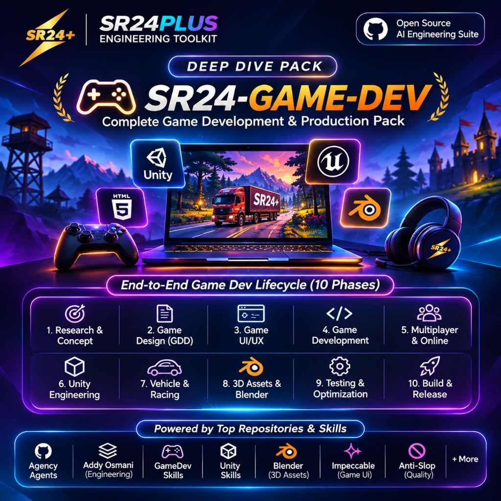
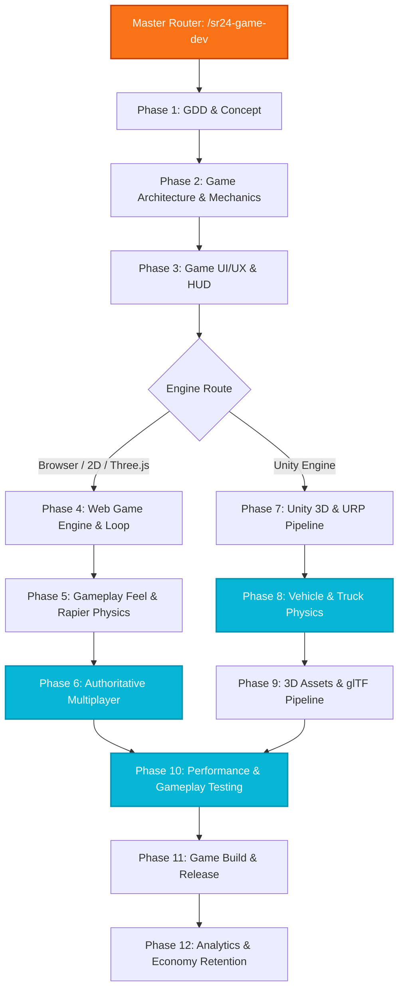

  

# SR24-GAME-DEV: Complete Game Production & Multiplayer Engineering Pack
### Autonomous Multi-Agent Engineering Architecture for Browser Games, WebSockets, Three.js, Rapier & Unity 3D

[-brightgreen.svg)](#complete-sr24-game-dev-skill-matrix)

---

## 1. Executive Overview & Mission

**`SR24-GAME-DEV`** is the flagship game engineering pack in the **SR24Plus Engineering Toolkit**. It powers autonomous development of high-performance, responsive, and multiplayer games across modern web and native gaming ecosystems:

1. **Real-Time Browser Games & Esports Platforms** (e.g., *Vibe Arena*, *GullyVerse*, *Indian Politics Arena*): 60 FPS Canvas/WebGL, deterministic fixed-timestep accumulator loops, authoritative WebSockets/Colyseus, Rapier/Matter.js physics, client-side prediction, entity interpolation, and memory XOR anti-cheat.
2. **Commercial 3D Web & Mobile Titles** (e.g., *Auto Rush*, *Truck Run 3D*, *Giant Rush*): Three.js/React Three Fiber pipelines, glTF binary optimizations, DRACO compression, Rapier 3D rigid bodies, touch joystick & keyboard controllers, and boss QTE combat.
3. **Unity 3D Simulators & Action Titles** (e.g., *Indian Truck Racing*): 16-wheeler heavy truck physics, Ackermann steering, Pacejka tire friction, spline mountain circuits with hairpin banking, URP shaders, and audio mixing buses.

Invoked via `/sr24-game-dev [task]`, `/sr24-browser-game [task]`, `/sr24-racing-game [task]`, or `/sr24-unity [task]`.

---

## 2. Squad Coordination Architecture

---

## 3. 12-Phase Game Production Lifecycle (Rating: 10.0 / 10)

| Phase | Phase Name | Focus | Key Skills | Target Rating |
|:---:|---|---|---|:---:|
| **01** | Research & Concept | Mechanics research, GDD drafting, economy sources & sinks | `game-programming-patterns`, `awesome-gamedev-skills`, `agency-game-development-game-designer` | **10.0 / 10** |
| **02** | Design & Architecture | ECS systems, state machines, decoupled ScriptableObjects | `bitecs-architecture`, `game-programming-patterns`, `new-unity-project` | **10.0 / 10** |
| **03** | UI/UX & HUD Design | 60 FPS in-game HUD, minimap, combo counters, audio cues | `threejs-ui-hud`, `gsap-animations`, `howler-js-audio`, `ui-uitk` | **10.0 / 10** |
| **04** | Web Game Engines | Three.js, React Three Fiber, Pixi.js, Phaser 3 | `threejs-game-engine`, `react-three-fiber`, `pixijs-engine`, `phaser-game-engine` | **10.0 / 10** |
| **05** | Gameplay & Physics | Rapier, Jolt, Matter.js, combat frame data, hitstop | `rapier-physics`, `react-three-rapier`, `jolt-physics`, `matter-js-physics`, `combat-mechanics-engineer` | **10.0 / 10** |
| **06** | Multiplayer & Anti-Cheat | Authoritative Colyseus, Nakama, Socket.IO, prediction | `colyseus-multiplayer`, `nakama-backend`, `gaffer-on-games-networking`, `socketio-realtime` | **10.0 / 10** |
| **07** | Unity 3D & URP | ScriptableRendererFeature, HLSL shaders, DOTS/ECS | `unity-entities-ecs`, `agency-game-development-unity-unity-architect`, `urp-postprocessing` | **10.0 / 10** |
| **08** | Vehicle & Racing Physics | 16-wheeler heavy trucks, Ackermann, Pacejka, banked tracks | `truck-physics-engineer`, `realistic-car-controller-engineer`, `racing-track-design-engineer` | **10.0 / 10** |
| **09** | 3D Asset & glTF Pipeline | glTF-Transform, DRACO, KTX2, Blender Python automation | `gltf-transform-pipeline`, `blender-pipeline`, `agency-game-development-blender-blender-addon-engineer` | **10.0 / 10** |
| **10** | Testing & Optimization | Draw call batching, memory leak audit, gameplay QA | `threejs-optimization-profiling`, `gameplay-regression-testing`, `unity-performance-testing` | **10.0 / 10** |
| **11** | Build & Release | Headless Unity CLI, WebGL Brotli, itch.io/Steam packaging | `game-build-and-release`, `unity-cli`, `optimize-web`, `shipping-and-launch` | **10.0 / 10** |
| **12** | Analytics & Retention | Telemetry schema, economy balancing, churn reduction | `game-analytics-sdk`, `umami-game-analytics`, `agency-game-development-economy-designer` | **10.0 / 10** |

---

## 4. Phase-by-Phase Implementation Guide & Prompt Templates

### Phase 1 — Game Research & Concept
- **Objective**: Formulate the core gameplay loop, session pacing, demographic positioning, and economic sources/sinks.
- **Key Skills**:
  - `game-programming-patterns` ([`SKILL.md`](../skills/sr24-custom-engineering/game-programming-patterns/SKILL.md))
  - `awesome-gamedev-skills` ([`SKILL.md`](../skills/sr24-custom-engineering/awesome-gamedev-skills/SKILL.md))
  - `agency-game-development-game-designer` ([`SKILL.md`](../skills/agency-agents/agency-game-development-game-designer/SKILL.md))
  - `agency-game-development-economy-designer` ([`SKILL.md`](../skills/agency-agents/agency-game-development-economy-designer/SKILL.md))
- **How to Prompt AI**:
  > *"Analyze competitive 3D runner and party combat games. Draft a formal Game Design Document (GDD) with a 2-minute core loop, soft currency reward tree, and dynamic collectible lanes."*

### Phase 2 — Game Architecture & Mechanics
- **Objective**: Implement clean, decoupled game architectures using High-Performance Data-Oriented Entity Component Systems (ECS) and finite state machines.
- **Key Skills**:
  - `bitecs-architecture` ([`SKILL.md`](../skills/sr24-custom-engineering/bitecs-architecture/SKILL.md)): Zero-garbage TypedArray ECS for browser games.
  - `game-programming-patterns` ([`SKILL.md`](../skills/sr24-custom-engineering/game-programming-patterns/SKILL.md)): State, Command, Type Object, Spatial Partition.
  - `new-unity-project` ([`SKILL.md`](../skills/unity-skills/new-unity-project/SKILL.md)): ScriptableObject architecture for Unity.
- **How to Prompt AI**:
  > *"Architect a high-performance bitECS world for 1,000 active entities with Position, Velocity, Collider, and Health TypedArray components and decoupled query pipelines."*

### Phase 3 — Game UI/UX & In-Game HUD
- **Objective**: Design responsive, 60 FPS HUDs with minimaps, combo meters, health bars, and zero input lag.
- **Key Skills**:
  - `threejs-ui-hud` ([`SKILL.md`](../skills/sr24-custom-engineering/threejs-ui-hud/SKILL.md)): Orthographic HUD camera, HTML/CSS overlay sync, world-to-screen projection.
  - `gsap-animations` ([`SKILL.md`](../skills/sr24-custom-engineering/gsap-animations/SKILL.md)): High-FPS tweening for victory banners and score counters.
  - `howler-js-audio` ([`SKILL.md`](../skills/sr24-custom-engineering/howler-js-audio/SKILL.md)): Positional audio sprites and BGM crossfaders.
  - `ui-uitk` ([`SKILL.md`](../skills/unity-skills/ui-uitk/SKILL.md)): Modern flex-based UI Toolkit UXML/USS layouts.
- **How to Prompt AI**:
  > *"Build a dual-camera Three.js HUD with a mini-map, health meter, and floating damage numbers animated with GSAP."*

### Phase 4 — Web Game Engines (2D & 3D)
- **Objective**: Scaffold deterministic game loops across Three.js, React Three Fiber, Pixi.js, or Phaser 3.
- **Key Skills**:
  - `web-game-engine` ([`SKILL.md`](../skills/sr24-custom-engineering/web-game-engine/SKILL.md)): Master engine routing guide.
  - `threejs-game-engine` ([`SKILL.md`](../skills/sr24-custom-engineering/threejs-game-engine/SKILL.md)): Scene graph, camera frustums, PBR lighting, instanced meshes.
  - `react-three-fiber` ([`SKILL.md`](../skills/sr24-custom-engineering/react-three-fiber/SKILL.md)): Declarative 3D, Suspense model loading, `@react-three/drei`.
  - `pixijs-engine` ([`SKILL.md`](../skills/sr24-custom-engineering/pixijs-engine/SKILL.md)): High-performance 2D WebGL sprite rendering.
  - `phaser-game-engine` ([`SKILL.md`](../skills/sr24-custom-engineering/phaser-game-engine/SKILL.md)): Scene lifecycles, tilemaps, Arcade physics.
- **How to Prompt AI**:
  > *"Scaffold a React Three Fiber 3D scene with declarative glTF loading via Drei, dynamic shadow maps, and a smooth orbit/third-person follow camera."*

### Phase 5 — Gameplay Feel & Physics Simulation
- **Objective**: Integrate deterministic rigid body physics (Rapier, Jolt, Matter.js) and punchy game feel (hitstop, screen shake).
- **Key Skills**:
  - `rapier-physics` ([`SKILL.md`](../skills/sr24-custom-engineering/rapier-physics/SKILL.md)): WASM-accelerated 2D/3D physics with character controllers.
  - `react-three-rapier` ([`SKILL.md`](../skills/sr24-custom-engineering/react-three-rapier/SKILL.md)): Declarative Rapier physics in R3F.
  - `jolt-physics` ([`SKILL.md`](../skills/sr24-custom-engineering/jolt-physics/SKILL.md)): AAA-grade vehicle and ragdoll physics for WebAssembly.
  - `matter-js-physics` ([`SKILL.md`](../skills/sr24-custom-engineering/matter-js-physics/SKILL.md)): 2D rigid bodies and constraint chains.
  - `combat-mechanics-engineer` ([`SKILL.md`](../skills/sr24-custom-engineering/combat-mechanics-engineer/SKILL.md)): Frame data, 80ms hitstop, combo buffers.
- **How to Prompt AI**:
  > *"Set up a Rapier 3D kinematic character controller with slope sliding, grounded raycasts, jump impulse physics, and dynamic collision masks."*

### Phase 6 — Authoritative Multiplayer & Anti-Cheat
- **Objective**: Build low-latency 60Hz server tick systems with client prediction, entity interpolation, and memory obfuscation.
- **Key Skills**:
  - `colyseus-multiplayer` ([`SKILL.md`](../skills/sr24-custom-engineering/colyseus-multiplayer/SKILL.md)): Schema-based binary state synchronization for Node.js.
  - `nakama-backend` ([`SKILL.md`](../skills/sr24-custom-engineering/nakama-backend/SKILL.md)): Production multiplayer, matchmaking, leaderboards, storage.
  - `gaffer-on-games-networking` ([`SKILL.md`](../skills/sr24-custom-engineering/gaffer-on-games-networking/SKILL.md)): Client-side prediction, delta compression, jitter buffers.
  - `socketio-realtime` ([`SKILL.md`](../skills/sr24-custom-engineering/socketio-realtime/SKILL.md)): Room management and low-latency messaging.
  - `browser-game-anti-cheat-engineer` ([`SKILL.md`](../skills/sr24-custom-engineering/browser-game-anti-cheat-engineer/SKILL.md)): Delta speedhacks, memory XOR, bot detection.
- **How to Prompt AI**:
  > *"Implement a Colyseus room state with schema synchronization, client-side input prediction, and server-side position validation to prevent teleportation."*

### Phase 7 — Unity Game Development & URP
- **Objective**: Author modular C# architectures, custom Shader Graph HLSL nodes, and Unity DOTS/ECS.
- **Key Skills**:
  - `unity-entities-ecs` ([`SKILL.md`](../skills/sr24-custom-engineering/unity-entities-ecs/SKILL.md)): Unity DOTS/ECS, IComponentData, IJobEntity.
  - `agency-game-development-unity-unity-architect` ([`SKILL.md`](../skills/agency-agents/agency-game-development-unity-unity-architect/SKILL.md))
  - `agency-game-development-unity-unity-shader-graph-artist` ([`SKILL.md`](../skills/agency-agents/agency-game-development-unity-unity-shader-graph-artist/SKILL.md))
  - `urp-postprocessing` ([`SKILL.md`](../skills/unity-skills/urp-postprocessing/SKILL.md)): Bloom, tonemapping, color adjustments.
- **How to Prompt AI**:
  > *"Write an IJobEntity burst-compiled job system in Unity Entities to update 10,000 bullet projectiles per frame."*

### Phase 8 — Vehicle & Racing Game Development
- **Objective**: Simulate commercial 16-wheeler heavy trucks, Ackermann steering, Pacejka slip curves, and banked spline roads.
- **Key Skills**:
  - `truck-physics-engineer` ([`SKILL.md`](../skills/sr24-custom-engineering/truck-physics-engineer/SKILL.md)): 16-wheeler physics (12,000kg), dual rear axles, anti-roll bars, air brakes.
  - `realistic-car-controller-engineer` ([`SKILL.md`](../skills/sr24-custom-engineering/realistic-car-controller-engineer/SKILL.md)): Pacejka curves, aerodynamic downforce ($C_L$).
  - `racing-track-design-engineer` ([`SKILL.md`](../skills/sr24-custom-engineering/racing-track-design-engineer/SKILL.md)): Spline road generation, $5^\circ-12^\circ$ banking on hairpins.
- **How to Prompt AI**:
  > *"Set up a 16-wheeler heavy truck prefab with dual drive rear axles, pneumatic brake simulation, and realistic body roll suspension."*

### Phase 9 — 3D Asset & glTF Pipeline
- **Objective**: Automate 3D model compression (glTF-Transform, DRACO, KTX2) and Blender Python batch exports.
- **Key Skills**:
  - `gltf-transform-pipeline` ([`SKILL.md`](../skills/sr24-custom-engineering/gltf-transform-pipeline/SKILL.md)): CLI/Node glTF optimization, DRACO, KTX2/Basis.
  - `blender-pipeline` ([`SKILL.md`](../skills/sr24-custom-engineering/blender-pipeline/SKILL.md)): Headless Blender CLI automation, LOD generation.
  - `agency-game-development-blender-blender-addon-engineer` ([`SKILL.md`](../skills/agency-agents/agency-game-development-blender-blender-addon-engineer/SKILL.md))
- **How to Prompt AI**:
  > *"Optimize this 45MB glTF character model using gltf-transform with Draco geometry compression and KTX2 texture transcoding to bring size under 4MB."*

### Phase 10 — Testing & Performance Optimization
- **Objective**: Profile draw calls, eliminate garbage collection in hot loops, and automate gameplay regression tests.
- **Key Skills**:
  - `threejs-optimization-profiling` ([`SKILL.md`](../skills/sr24-custom-engineering/threejs-optimization-profiling/SKILL.md)): InstancedMesh, Spector.js, draw call reduction.
  - `gameplay-regression-testing` ([`SKILL.md`](../skills/sr24-custom-engineering/gameplay-regression-testing/SKILL.md)): Playwright virtual controller & canvas regression tests.
  - `unity-performance-testing` ([`SKILL.md`](../skills/sr24-custom-engineering/unity-performance-testing/SKILL.md)): Unity Test Framework performance benchmarks.
  - `performance-optimization` ([`SKILL.md`](../skills/addyosmani-agent-skills/performance-optimization/SKILL.md))
- **How to Prompt AI**:
  > *"Profile a Three.js scene rendering 2,000 props: convert unique meshes to InstancedMesh, bake texture atlases, and keep total draw calls under 25."*

### Phase 11 — Game Build & Release
- **Objective**: Automate multi-platform headless builds, Brotli WebGL packaging, and store distribution.
- **Key Skills**:
  - `game-build-and-release` ([`SKILL.md`](../skills/sr24-custom-engineering/game-build-and-release/SKILL.md)): Multi-platform packaging, butler itch.io, steamcmd.
  - `unity-cli` ([`SKILL.md`](../skills/unity-skills/unity-cli/SKILL.md)): Command-line Unity Editor build pipeline.
  - `optimize-web` ([`SKILL.md`](../skills/unity-skills/optimize-web/SKILL.md)): Shrinks WebGL builds with WebGPU optimization.
- **How to Prompt AI**:
  > *"Create a GitHub Actions workflow to build a Unity WebGL project headlessly with Brotli compression and deploy it automatically to GitHub Pages/Itch.io."*

### Phase 12 — Game Analytics & Retention
- **Objective**: Measure playtime, tutorial completion, level progression drop-offs, and in-game economy balancing.
- **Key Skills**:
  - `game-analytics-sdk` ([`SKILL.md`](../skills/sr24-custom-engineering/game-analytics-sdk/SKILL.md)): GameAnalytics integration, progression and design events.
  - `umami-game-analytics` ([`SKILL.md`](../skills/sr24-custom-engineering/umami-game-analytics/SKILL.md)): Self-hosted, privacy-first web game analytics.
  - `agency-game-development-economy-designer` ([`SKILL.md`](../skills/agency-agents/agency-game-development-economy-designer/SKILL.md))
- **How to Prompt AI**:
  > *"Implement a GameAnalytics event schema to track Level_Start, Level_Complete, and Soft_Currency_Sink events across all playable minigames."*

---

## 5. Complete SR24-GAME-DEV Master Skill Matrix

| Phase | Skill Name | Provider / Source | Canonical Path | Primary Responsibility | Verification |
|:---:|---|---|---|---|:---:|
| 01 | `game-programming-patterns` | Bob Nystrom Patterns | `skills/sr24-custom-engineering/game-programming-patterns/SKILL.md` | Core loops, state, command, spatial partition | Verified In-Repo |
| 01 | `awesome-gamedev-skills` | SR24Plus Curated | `skills/sr24-custom-engineering/awesome-gamedev-skills/SKILL.md` | Mechanics research, GDD frameworks | Verified In-Repo |
| 01 | `agency-game-development-game-designer` | `msitarzewski/agency-agents` | `skills/agency-agents/agency-game-development-game-designer/SKILL.md` | Core loop, player psychology, GDD | Verified In-Repo |
| 01 | `agency-game-development-economy-designer` | `msitarzewski/agency-agents` | `skills/agency-agents/agency-game-development-economy-designer/SKILL.md` | Currency sinks, sources, monetization | Verified In-Repo |
| 02 | `bitecs-architecture` | Nate Levin bitECS | `skills/sr24-custom-engineering/bitecs-architecture/SKILL.md` | Zero-GC TypedArray ECS for browser games | Verified In-Repo |
| 02 | `agency-game-development-level-designer` | `msitarzewski/agency-agents` | `skills/agency-agents/agency-game-development-level-designer/SKILL.md` | Pacing, encounters, level design | Verified In-Repo |
| 02 | `new-unity-project` | Unity Technologies | `skills/unity-skills/new-unity-project/SKILL.md` | ScriptableObject decoupled architecture | Verified In-Repo |
| 03 | `threejs-ui-hud` | Three.js / R3F | `skills/sr24-custom-engineering/threejs-ui-hud/SKILL.md` | Dual-camera in-game HUD & minimap | Verified In-Repo |
| 03 | `gsap-animations` | GreenSock / Vibe Arena | `skills/sr24-custom-engineering/gsap-animations/SKILL.md` | 60 FPS UI micro-interactions & victory screens | Verified In-Repo |
| 03 | `howler-js-audio` | Howler.js / Vibe Arena | `skills/sr24-custom-engineering/howler-js-audio/SKILL.md` | Spatial 3D sound effects, audio sprites | Verified In-Repo |
| 03 | `ui-uitk` | Unity Technologies | `skills/unity-skills/ui-uitk/SKILL.md` | UI Toolkit UXML/USS flexbox layouts | Verified In-Repo |
| 03 | `ui-ugui` | Unity Technologies | `skills/unity-skills/ui-ugui/SKILL.md` | Canvas hierarchies and RectTransform anchors | Verified In-Repo |
| 04 | `web-game-engine` | SR24Plus Master | `skills/sr24-custom-engineering/web-game-engine/SKILL.md` | Engine selector & accumulator loop | Verified In-Repo |
| 04 | `threejs-game-engine` | Mr.doob Three.js | `skills/sr24-custom-engineering/threejs-game-engine/SKILL.md` | 3D WebGL scenes, PBR materials, instancing | Verified In-Repo |
| 04 | `react-three-fiber` | Poimandres R3F | `skills/sr24-custom-engineering/react-three-fiber/SKILL.md` | Declarative Three.js in React/Next.js | Verified In-Repo |
| 04 | `pixijs-engine` | PixiJS Team | `skills/sr24-custom-engineering/pixijs-engine/SKILL.md` | 2D WebGL sprite batching | Verified In-Repo |
| 04 | `phaser-game-engine` | Phaser / Vibe Arena | `skills/sr24-custom-engineering/phaser-game-engine/SKILL.md` | 2D arcade scenes & tilemaps | Verified In-Repo |
| 04 | `browser-game-architect` | SR24Plus Custom | `skills/sr24-custom-engineering/browser-game-architect/SKILL.md` | 60Hz loop, canvas scaling, mobile controls | Verified In-Repo |
| 05 | `rapier-physics` | Dimforge Rapier | `skills/sr24-custom-engineering/rapier-physics/SKILL.md` | WASM 2D/3D physics & character controller | Verified In-Repo |
| 05 | `react-three-rapier` | Poimandres Rapier | `skills/sr24-custom-engineering/react-three-rapier/SKILL.md` | Declarative 3D physics inside R3F | Verified In-Repo |
| 05 | `jolt-physics` | Jorrit Rouwe Jolt | `skills/sr24-custom-engineering/jolt-physics/SKILL.md` | AAA-grade multithreaded vehicle physics | Verified In-Repo |
| 05 | `matter-js-physics` | Matter.js / Vibe Arena | `skills/sr24-custom-engineering/matter-js-physics/SKILL.md` | 2D rigid body constraints & ragdolls | Verified In-Repo |
| 05 | `combat-mechanics-engineer` | SR24Plus Custom | `skills/sr24-custom-engineering/combat-mechanics-engineer/SKILL.md` | Frame data, 80ms hitstop, combo buffers | Verified In-Repo |
| 05 | `physics-3d-collision` | Unity Technologies | `skills/unity-skills/physics-3d-collision/SKILL.md` | 3D PhysX collisions & layer matrices | Verified In-Repo |
| 05 | `create-2d-physics` | Unity Technologies | `skills/unity-skills/create-2d-physics/SKILL.md` | 2D Rigidbody & composite colliders | Verified In-Repo |
| 06 | `colyseus-multiplayer` | Colyseus Team | `skills/sr24-custom-engineering/colyseus-multiplayer/SKILL.md` | Schema-based authoritative state synchronization | Verified In-Repo |
| 06 | `nakama-backend` | Heroic Labs Nakama | `skills/sr24-custom-engineering/nakama-backend/SKILL.md` | Production game backend, matchmaking, chats | Verified In-Repo |
| 06 | `gaffer-on-games-networking` | Glenn Fiedler | `skills/sr24-custom-engineering/gaffer-on-games-networking/SKILL.md` | Client prediction, server reconciliation | Verified In-Repo |
| 06 | `socketio-realtime` | Socket.IO / Vibe Arena | `skills/sr24-custom-engineering/socketio-realtime/SKILL.md` | 6-character room codes & event syncing | Verified In-Repo |
| 06 | `redis-in-memory-datastore` | Redis / Vibe Arena | `skills/sr24-custom-engineering/redis-in-memory-datastore/SKILL.md` | Ephemeral lobby state, matchmaking queues | Verified In-Repo |
| 06 | `websocket-multiplayer-engineer` | SR24Plus Custom | `skills/sr24-custom-engineering/websocket-multiplayer-engineer/SKILL.md` | 60Hz server tick, prediction & reconciliation | Verified In-Repo |
| 06 | `browser-game-anti-cheat-engineer` | SR24Plus Custom | `skills/sr24-custom-engineering/browser-game-anti-cheat-engineer/SKILL.md` | Delta speedhacks, memory XOR obfuscation | Verified In-Repo |
| 07 | `unity-entities-ecs` | Unity Technologies | `skills/sr24-custom-engineering/unity-entities-ecs/SKILL.md` | Unity DOTS/ECS, Burst-compiled jobs | Verified In-Repo |
| 07 | `agency-game-development-unity-unity-architect` | `msitarzewski/agency-agents` | `skills/agency-agents/agency-game-development-unity-unity-architect/SKILL.md` | ScriptableObject event architectures | Verified In-Repo |
| 07 | `agency-game-development-unity-unity-shader-graph-artist` | `msitarzewski/agency-agents` | `skills/agency-agents/agency-game-development-unity-unity-shader-graph-artist/SKILL.md` | Custom Shader Graph & HLSL materials | Verified In-Repo |
| 07 | `shader-graph-create-custom-node` | Unity Technologies | `skills/unity-skills/shader-graph-create-custom-node/SKILL.md` | Custom HLSL nodes for Shader Graph | Verified In-Repo |
| 07 | `urp-postprocessing` | Unity Technologies | `skills/unity-skills/urp-postprocessing/SKILL.md` | URP Volume framework (bloom, tonemapping) | Verified In-Repo |
| 08 | `truck-physics-engineer` | SR24Plus Custom | `skills/sr24-custom-engineering/truck-physics-engineer/SKILL.md` | 16-wheeler WheelColliders & air brakes | Verified In-Repo |
| 08 | `realistic-car-controller-engineer` | SR24Plus Custom | `skills/sr24-custom-engineering/realistic-car-controller-engineer/SKILL.md` | Pacejka slip curves & Ackermann steering | Verified In-Repo |
| 08 | `racing-track-design-engineer` | SR24Plus Custom | `skills/sr24-custom-engineering/racing-track-design-engineer/SKILL.md` | Banked ghat circuits & surface grip zones | Verified In-Repo |
| 09 | `gltf-transform-pipeline` | Don McCurdy | `skills/sr24-custom-engineering/gltf-transform-pipeline/SKILL.md` | glTF Draco compression & KTX2 textures | Verified In-Repo |
| 09 | `blender-pipeline` | Blender Foundation | `skills/sr24-custom-engineering/blender-pipeline/SKILL.md` | Headless Python scripts & LOD generation | Verified In-Repo |
| 09 | `agency-game-development-blender-blender-addon-engineer` | `msitarzewski/agency-agents` | `skills/agency-agents/agency-game-development-blender-blender-addon-engineer/SKILL.md` | Blender tooling & asset export automation | Verified In-Repo |
| 10 | `threejs-optimization-profiling` | Three.js Ecosystem | `skills/sr24-custom-engineering/threejs-optimization-profiling/SKILL.md` | InstancedMesh, Spector.js, draw call limits | Verified In-Repo |
| 10 | `gameplay-regression-testing` | Playwright / SR24Plus | `skills/sr24-custom-engineering/gameplay-regression-testing/SKILL.md` | Automated canvas & input test runners | Verified In-Repo |
| 10 | `unity-performance-testing` | Unity Technologies | `skills/sr24-custom-engineering/unity-performance-testing/SKILL.md` | Performance Benchmark test runner | Verified In-Repo |
| 10 | `performance-optimization` | `addyosmani/agent-skills` | `skills/addyosmani-agent-skills/performance-optimization/SKILL.md` | Hot-loop profiling & GC leak elimination | Verified In-Repo |
| 11 | `game-build-and-release` | SR24Plus Custom | `skills/sr24-custom-engineering/game-build-and-release/SKILL.md` | Itch.io Butler, SteamCMD, WebGL packaging | Verified In-Repo |
| 11 | `unity-cli` | Unity Technologies | `skills/unity-skills/unity-cli/SKILL.md` | Headless command line build scripts | Verified In-Repo |
| 11 | `optimize-web` | Unity Technologies | `skills/unity-skills/optimize-web/SKILL.md` | WebGL build shrinking & WebGPU tuning | Verified In-Repo |
| 12 | `game-analytics-sdk` | GameAnalytics | `skills/sr24-custom-engineering/game-analytics-sdk/SKILL.md` | Progression, design & error telemetry | Verified In-Repo |
| 12 | `umami-game-analytics` | Umami Software | `skills/sr24-custom-engineering/umami-game-analytics/SKILL.md` | Privacy-focused player event tracking | Verified In-Repo |
| 12 | `agency-game-development-economy-designer` | `msitarzewski/agency-agents` | `skills/agency-agents/agency-game-development-economy-designer/SKILL.md` | Retention loops & monetization modeling | Verified In-Repo |
