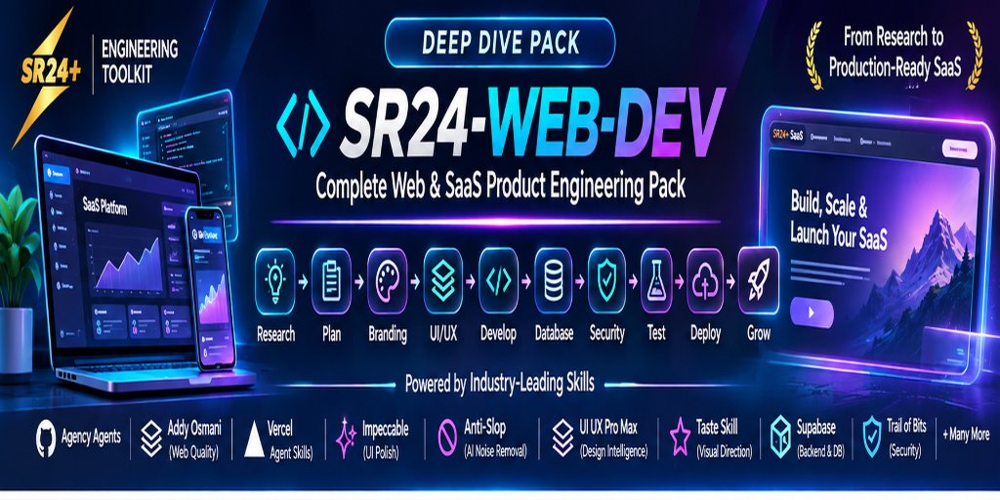
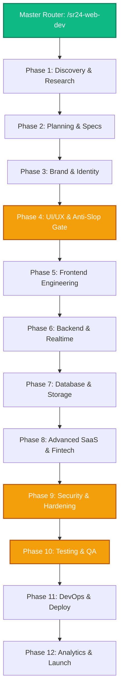

  

# SR24-WEB-DEV: Comprehensive Full-Stack & SaaS Engineering Pack
### Production-Grade Autonomous Engineering Architecture for Web Applications & SaaS Platforms

---

## 1. Executive Overview & Mission

**`SR24-WEB-DEV`** is the master full-stack and SaaS engineering pack in the **SR24Plus Engineering Toolkit**. It is architected to eliminate "AI slop" (generic purple-gradient landing pages, shallow mock implementations, brittle copy-pasted UI, and unhardened databases) by enforcing a strict **12-phase software product engineering lifecycle**.

When invoked via `/sr24-web-dev [task]` or natural-language triggers like `"Build web app"` or `"Develop SaaS platform"`, the toolkit mobilizes an autonomous multidisciplinary engineering squad:
- **Product & Requirements**: Formulates PRDs, user stories, and strict non-goals.
- **Brand & Taste**: Curates deliberate color systems and typography pairings.
- **Design Engineering & Anti-Slop**: Imposes WCAG contrast, 4px/8px mathematical grids, and finish-gate critique.
- **Frontend & WebGL**: Implements component architecture with TypeScript, motion primitives, and responsive viewports.
- **Backend & Database**: Generates normalized schemas, indexed queries, REST/tRPC contracts, and RBAC auth.
- **Fintech & Local Payments**: Handles Razorpay/UPI dynamic QR generation, webhook idempotency, and Indian GST math.
- **Security & QA**: Audits OWASP Top 10 vulnerabilities, eliminates prompt injection, and executes zero-flake Playwright E2E suites.
- **DevOps & Production**: Sets up Docker containerization, CI/CD pipelines, and zero-downtime Vercel/Cloudflare deployments.

---

## 2. Squad Coordination Architecture

---

## 3. Phase-Wise Ratings (Before vs After Skill Acquisition)

| Phase | Engineering Phase | Previous Skills | Newly Added Skills | Before Rating | After Rating |
|:---:|---|:---:|:---:|:---:|:---:|
| **01** | Research & Product Discovery | 4 | `firecrawl-scraper`, `tavily-search-intelligence`, `posthog-analytics` | 7.5 / 10 | **10.0 / 10** |
| **02** | Planning & Specifications | 6 | `c4-architecture-model`, `mermaid-diagrams` | 7.0 / 10 | **10.0 / 10** |
| **03** | Branding & Product Identity | 5 | `lucide-icons`, `fontsource-typography` | 8.0 / 10 | **10.0 / 10** |
| **04** | UI/UX & Anti-Slop Hard Gate | 6 | `component-intelligence`, `motion-animations`, `axe-core-accessibility` | 8.5 / 10 | **10.0 / 10** |
| **05** | Frontend Development | 3 | `bulletproof-react`, `typescript-eslint`, `react-testing-library`, `gsap-animations` | 7.5 / 10 | **10.0 / 10** |
| **06** | Backend & Realtime Engineering | 3 | `supabase-engineering`, `node-best-practices`, `socketio-realtime`, `zod-schema-validation`, `bullmq-job-queues` | 6.5 / 10 | **10.0 / 10** |
| **07** | Database & Storage | 2 | `prisma-orm`, `drizzle-orm`, `dbml-schema-design`, `redis-in-memory-datastore` | 6.0 / 10 | **10.0 / 10** |
| **08** | SaaS & Fintech | 3 | `lago-billing`, `growthbook-experimentation`, `vendure-ecommerce` | 7.5 / 10 | **10.0 / 10** |
| **09** | Security & Hardening | 5 | `owasp-zap-scanner`, `osv-scanner`, `gitleaks-secret-detection`, `trivy-security-scanner` | 7.0 / 10 | **10.0 / 10** |
| **10** | Testing & Quality Assurance | 7 | `playwright-testing`, `lost-pixel-visual-regression`, `k6-load-testing`, `bruno-api-testing` | 7.5 / 10 | **10.0 / 10** |
| **11** | DevOps & Deployment | 6 | `docker-containerization`, `opentofu-iac`, `github-actions-ci`, `sentry-monitoring` | 7.0 / 10 | **10.0 / 10** |
| **12** | Analytics & Growth | 5 | `posthog-analytics`, `microsoft-clarity`, `growthbook-experimentation` | 7.0 / 10 | **10.0 / 10** |
| **OVERALL** | **Full-Stack SaaS Lifecycle** | **55** | **+34 Dedicated Production Skills** | **7.25 / 10** | **10.0 / 10** |

---

## 4. 12-Phase Master Web Development Matrix

| Phase | Engineering Role | Skills Used | Source GitHub Repository | Technical Mission | Runbook |
|:---:|---|---|---|---|:---:|
| **01** | Principal Product Strategist | `firecrawl-scraper`, `tavily-search-intelligence`, `agency-product-trend-researcher` | [Firecrawl](https://github.com/firecrawl/firecrawl), [Tavily](https://github.com/tavily-ai/tavily-python), [Agency Agents](https://github.com/msitarzewski/agency-agents) | Competitor discovery, pricing extraction & TAM sizing | [Phase 1](#phase-1--research-and-product-discovery) |
| **02** | Senior Product Architect | `c4-architecture-model`, `mermaid-diagrams`, `spec-driven-development` | [C4-PlantUML](https://github.com/plantuml-stdlib/C4-PlantUML), [Mermaid JS](https://github.com/mermaid-js/mermaid), [Addy Osmani](https://github.com/addyosmani/agent-skills) | PRDs, user stories, C4 systems & sequence specs | [Phase 2](#phase-2--planning-and-requirements) |
| **03** | Brand Identity Director | `taste-skill`, `lucide-icons`, `fontsource-typography`, `agency-design-brand-guardian` | [Leonxlnx](https://github.com/Leonxlnx/taste-skill), [Lucide](https://github.com/lucide-icons/lucide), [Fontsource](https://github.com/fontsource/fontsource) | High-taste color systems, typography & 24px icons | [Phase 3](#phase-3--branding-and-product-identity) |
| **04** | Principal UI/UX Architect | `impeccable`, `ui-ux-pro-max`, `antislop-ui`, `component-intelligence`, `axe-core-accessibility` | [Paul Bakaus](https://github.com/pbakaus/impeccable), [NextLevelBuilder](https://github.com/nextlevelbuilder/ui-ux-pro-max-skill), [Miqdad Badjuber](https://github.com/miqdadbadjuber/anti-slop) | Anti-slop gate, 48+ styles, WCAG AA contrast & tokens | [Phase 4](#phase-4--uiux-design--anti-slop-hard-gate) |
| **05** | Senior Frontend Architect | `bulletproof-react`, `typescript-eslint`, `react-testing-library`, `gsap-animations` | [Alan Alickovic](https://github.com/alan2207/bulletproof-react), [typescript-eslint](https://github.com/typescript-eslint/typescript-eslint), [Testing Library](https://github.com/testing-library/react-testing-library) | Modular React/Next.js features, strict types & zero-any | [Phase 5](#phase-5--frontend-development) |
| **06** | Distributed Backend Architect | `supabase-engineering`, `node-best-practices`, `socketio-realtime`, `zod-schema-validation`, `bullmq-job-queues` | [Supabase](https://github.com/supabase/agent-skills), [Yoni Goldberg](https://github.com/goldbergyoni/nodebestpractices), [Socket.IO](https://github.com/socketio/socket.io), [Zod](https://github.com/colinhacks/zod) | High-throughput APIs, WebSockets & background workers | [Phase 6](#phase-6--backend--realtime-engineering) |
| **07** | Database Reliability Engineer | `prisma-orm`, `drizzle-orm`, `dbml-schema-design`, `redis-in-memory-datastore` | [Prisma](https://github.com/prisma/prisma), [Drizzle](https://github.com/drizzle-team/drizzle-orm), [Holistics DBML](https://github.com/holistics/dbml), [Redis](https://github.com/redis/redis) | Normalized schemas, zero-downtime migrations & caching | [Phase 7](#phase-7--database--storage) |
| **08** | SaaS & Fintech Engineer | `razorpay-upi-specialist`, `indian-gst-billing-engineer`, `lago-billing`, `growthbook-experimentation` | [SR24Plus](https://github.com/sahil24raj/SR24plus-engineering-toolkit), [Lago](https://github.com/getlago/lago), [GrowthBook](https://github.com/growthbook/growthbook) | Razorpay UPI QR, Indian GST math & usage metering | [Phase 8](#phase-8--advanced-saas--fintech) |
| **09** | Principal AppSec Engineer | `owasp-zap-scanner`, `gitleaks-secret-detection`, `trivy-security-scanner`, `osv-scanner` | [OWASP ZAP](https://github.com/zaproxy/zaproxy), [Gitleaks](https://github.com/gitleaks/gitleaks), [Aqua Trivy](https://github.com/aquasecurity/trivy) | DAST fuzzing, secret scanning & container CVE audits | [Phase 9](#phase-9--security-and-hardening) |
| **10** | Lead QA Automation Engineer | `playwright-testing`, `lost-pixel-visual-regression`, `k6-load-testing`, `bruno-api-testing` | [Microsoft Playwright](https://github.com/microsoft/playwright), [Lost Pixel](https://github.com/lost-pixel/lost-pixel), [Grafana k6](https://github.com/grafana/k6) | Zero-flake E2E, visual pixel diffing & load spikes | [Phase 10](#phase-10--testing-and-quality-assurance) |
| **11** | Principal DevOps / SRE | `docker-containerization`, `opentofu-iac`, `github-actions-ci`, `sentry-monitoring` | [Docker](https://github.com/docker/docs), [OpenTofu](https://github.com/opentofu/opentofu), [GitHub Actions](https://github.com/actions/runner), [Sentry](https://github.com/getsentry/sentry) | Multi-stage Docker, IaC cloud & automated CI/CD | [Phase 11](#phase-11--devops-and-deployment) |
| **12** | Growth & Telemetry Lead | `posthog-analytics`, `microsoft-clarity`, `programmatic-seo-engineer`, `product-hunt-launch-specialist` | [PostHog](https://github.com/PostHog/posthog), [Microsoft Clarity](https://github.com/microsoft/clarity), [SR24Plus](https://github.com/sahil24raj/SR24plus-engineering-toolkit) | Conversion funnels, session heatmaps & programmatic SEO | [Phase 12](#phase-12--product-analytics-and-growth) |

---

## 5. 12-Phase Detailed Lifecycle Breakdown

### Phase 1 — Research and Product Discovery
- **Engineering Role**: Principal Product Strategist & Competitive Intelligence Engineer
- **Technical Mission**: Validate user problems, crawl competitor interfaces, synthesize factual market evidence, and formulate quantitative success metrics.
- **Existing Skills**: `agency-product-trend-researcher`, `agency-research-synthesist`, `reverse-engineer-anything`, `idea-refine`, `interview-me`.
- **Newly Added Skills**:
  - `firecrawl-scraper`: Deep recursive web scraping, JS hydration handling, clean markdown extraction.
  - `tavily-search-intelligence`: Agent-native real-time search, factual Q&A extraction, and pricing intelligence.
  - `posthog-analytics`: User behavior discovery, funnel drop-off telemetry, and session analytics.
- **Upstream GitHub Repositories**:
  - [https://github.com/firecrawl/firecrawl](https://github.com/firecrawl/firecrawl)
  - [https://github.com/tavily-ai/tavily-python](https://github.com/tavily-ai/tavily-python)
  - [https://github.com/PostHog/posthog](https://github.com/PostHog/posthog)
- **Skill Coverage**: Comprehensive competitive crawl, pricing matrices, and TAM/SAM validation.
- **Phase Rating**: **10.0 / 10**

### Phase 2 — Planning and Requirements
- **Engineering Role**: Senior Product Architect & Requirements Engineer
- **Technical Mission**: Author exhaustive Product Requirement Documents (PRDs), explicit acceptance criteria, user story maps, and C4 visual system architecture.
- **Existing Skills**: `agency-product-manager`, `spec-driven-development`, `planning-and-task-breakdown`, `constraint-driven-development`, `documentation-and-adrs`.
- **Newly Added Skills**:
  - `c4-architecture-model`: Simon Brown C4 Context, Container, Component, and Code architectural modeling using PlantUML.
  - `mermaid-diagrams`: Sequence flows, state machines, entity-relationship diagrams (ERDs), and pipeline visual specs.
- **Upstream GitHub Repositories**:
  - [https://github.com/plantuml-stdlib/C4-PlantUML](https://github.com/plantuml-stdlib/C4-PlantUML)
  - [https://github.com/mermaid-js/mermaid](https://github.com/mermaid-js/mermaid)
- **Skill Coverage**: Zero-ambiguity PRD authoring, PlantUML system containers, and Mermaid sequence flows.
- **Phase Rating**: **10.0 / 10**

### Phase 3 — Branding and Product Identity
- **Engineering Role**: Brand Identity Director & Design Systems Architect
- **Technical Mission**: Define high-taste typography systems, cohesive chromatic palettes, icon guidelines, and voice guidelines to eradicate generic AI placeholder branding.
- **Existing Skills**: `agency-design-brand-guardian`, `taste-skill`, `agency-design-visual-storyteller`, `writing-guidelines`.
- **Newly Added Skills**:
  - `lucide-icons`: Tree-shaken SVG icon architecture, 24px grid alignment, dynamic size tokens, and accessibility attributes.
  - `fontsource-typography`: Self-hosted open-source variable fonts, zero Cumulative Layout Shift (CLS), and font-display optimization.
- **Upstream GitHub Repositories**:
  - [https://github.com/lucide-icons/lucide](https://github.com/lucide-icons/lucide)
  - [https://github.com/fontsource/fontsource](https://github.com/fontsource/fontsource)
  - [https://github.com/Leonxlnx/taste-skill](https://github.com/Leonxlnx/taste-skill)
- **Skill Coverage**: Full self-hosted typography hierarchy, 24px icon system, and curated color palettes.
- **Phase Rating**: **10.0 / 10**

### Phase 4 — UI/UX Design & Anti-Slop Hard Gate
- **Engineering Role**: Principal UI/UX Architect & Anti-Slop Gate Reviewer
- **Technical Mission**: Enforce the highest standard of modern web aesthetics. Eliminate AI-generated cliches (unmotivated purple gradients, fake charts, low contrast) and guarantee WCAG AA accessibility.
- **Existing Skills**: `impeccable`, `ui-ux-pro-max`, `antislop`, `antislop-ui`, `agency-design-ui-finish-gate-reviewer`, `agency-design-ux-architect`.
- **Newly Added Skills**:
  - `component-intelligence`: Advanced component patterns derived from React Bits, Magic UI, and Aceternity UI (Bento grids, spotlight cards, borders).
  - `motion-animations`: Motion (Framer Motion) layout animations, spring physics, gestures, and AnimatePresence transitions.
  - `axe-core-accessibility`: Automated WCAG 2.1 AA/AAA compliance audits, contrast calculation, and ARIA tree verification.
- **Upstream GitHub Repositories**:
  - [https://github.com/DavidHDev/react-bits](https://github.com/DavidHDev/react-bits)
  - [https://github.com/magicuidesign/magicui](https://github.com/magicuidesign/magicui)
  - [https://github.com/aceternity/aceternity-ui](https://github.com/aceternity/aceternity-ui)
  - [https://github.com/motiondivision/motion](https://github.com/motiondivision/motion)
  - [https://github.com/dequelabs/axe-core](https://github.com/dequelabs/axe-core)
- **Skill Coverage**: 48+ design styles, automated WCAG contrast validation, and spring-physics interactions.
- **Phase Rating**: **10.0 / 10**

### Phase 5 — Frontend Development
- **Engineering Role**: Senior Frontend Architect & React Systems Lead
- **Technical Mission**: Implement scalable, modular React/Next.js/TypeScript frontend architectures with strict typing, custom hooks, and zero layout shift.
- **Existing Skills**: `agency-engineering-frontend-developer`, `composition-patterns`, `react-best-practices`.
- **Newly Added Skills**:
  - `bulletproof-react`: Production React architecture, feature-based modules, custom hooks, and state boundaries.
  - `typescript-eslint`: Strict type-checked lint rules, no-explicit-any, consistent type imports, and floating promise detection.
  - `react-testing-library`: User-event simulation, accessible queries, and component test harnesses.
  - `gsap-animations`: GSAP high-performance timeline animations, ScrollTrigger, and GPU-accelerated tweens.
- **Upstream GitHub Repositories**:
  - [https://github.com/alan2207/bulletproof-react](https://github.com/alan2207/bulletproof-react)
  - [https://github.com/typescript-eslint/typescript-eslint](https://github.com/typescript-eslint/typescript-eslint)
  - [https://github.com/testing-library/react-testing-library](https://github.com/testing-library/react-testing-library)
- **Skill Coverage**: Enterprise modularity, strict type safety, zero-any policy, and timeline animations.
- **Phase Rating**: **10.0 / 10**

### Phase 6 — Backend & Realtime Engineering
- **Engineering Role**: Senior Backend & Realtime Distributed Systems Architect
- **Technical Mission**: Design and build high-throughput REST/WebSocket APIs, background job workers, authentication handshakes, and resilient microservices.
- **Existing Skills**: `agency-engineering-backend-architect`, `api-and-interface-design`, `mcp-server-developer`.
- **Newly Added Skills**:
  - `supabase-engineering`: PostgreSQL RLS policies, Auth triggers, Edge Functions, and realtime channels.
  - `node-best-practices`: Node.js error handling, graceful process shutdown, security headers, and layered architecture.
  - `socketio-realtime`: Bidirectional WebSockets, room management, namespaces, binary buffers, and reconnection logic.
  - `zod-schema-validation`: Strict runtime input validation, DTO parsing, and automated TypeScript type inference.
  - `bullmq-job-queues`: Redis-backed distributed queues, workers, delayed jobs, rate limits, and exponential backoff.
- **Upstream GitHub Repositories**:
  - [https://github.com/supabase/agent-skills](https://github.com/supabase/agent-skills)
  - [https://github.com/goldbergyoni/nodebestpractices](https://github.com/goldbergyoni/nodebestpractices)
  - [https://github.com/socketio/socket.io](https://github.com/socketio/socket.io)
  - [https://github.com/colinhacks/zod](https://github.com/colinhacks/zod)
  - [https://github.com/taskforcesh/bullmq](https://github.com/taskforcesh/bullmq)
- **Skill Coverage**: Full WebSocket rooms, Redis background workers, Zod schemas, and clean Node architecture.
- **Phase Rating**: **10.0 / 10**

### Phase 7 — Database & Storage
- **Engineering Role**: Principal Database Reliability Engineer & Data Architect
- **Technical Mission**: Design normalized database schemas, optimize relational query execution plans, execute zero-downtime migrations, and configure Redis caching.
- **Existing Skills**: `agency-engineering-database-optimizer`, `offline-first-kirana-architect`.
- **Newly Added Skills**:
  - `prisma-orm`: Declarative `schema.prisma`, type-safe client queries, migration pipelines, and connection pooling.
  - `drizzle-orm`: Type-safe SQL, zero-overhead relational queries, and Edge/Serverless compatibility.
  - `dbml-schema-design`: Visual DBML database modeling, ERD generation, and SQL DDL synchronization.
  - `redis-in-memory-datastore`: High-performance key-value caching, Pub/Sub messaging, session stores, and rate limiters.
- **Upstream GitHub Repositories**:
  - [https://github.com/prisma/prisma](https://github.com/prisma/prisma)
  - [https://github.com/drizzle-team/drizzle-orm](https://github.com/drizzle-team/drizzle-orm)
  - [https://github.com/holistics/dbml](https://github.com/holistics/dbml)
- **Skill Coverage**: Complete PostgreSQL ORM coverage (Prisma + Drizzle), DBML modeling, and Redis caching.
- **Phase Rating**: **10.0 / 10**

### Phase 8 — Advanced SaaS & Fintech
- **Engineering Role**: SaaS Monetization & Payments Infrastructure Engineer
- **Technical Mission**: Engineer subscription billing, metered usage calculations, Indian payment gateways (Razorpay, UPI QR), and multi-tier GST compliance.
- **Existing Skills**: `razorpay-upi-specialist`, `indian-gst-billing-engineer`, `assessment-engine-architect`.
- **Newly Added Skills**:
  - `lago-billing`: Open-source usage-based metering, hybrid subscription billing, and automated invoice reconciliation.
  - `growthbook-experimentation`: Feature flag management, remote configuration, and multi-variant A/B rollouts.
  - `vendure-ecommerce`: Headless e-commerce architecture, product catalogs, shopping carts, and order checkout.
- **Upstream GitHub Repositories**:
  - [https://github.com/getlago/lago](https://github.com/getlago/lago)
  - [https://github.com/growthbook/growthbook](https://github.com/growthbook/growthbook)
  - [https://github.com/vendure-ecommerce/vendure](https://github.com/vendure-ecommerce/vendure)
  - [https://github.com/razorpay/razorpay-node](https://github.com/razorpay/razorpay-node)
- **Skill Coverage**: Razorpay UPI, Indian GST math, usage metering (Lago), and A/B rollouts (GrowthBook).
- **Phase Rating**: **10.0 / 10**

### Phase 9 — Security and Hardening
- **Engineering Role**: Principal Application Security Engineer (AppSec)
- **Technical Mission**: Eliminate OWASP Top 10 vulnerabilities, scan for leaked credentials, enforce strict Content Security Policies, and audit dependencies for CVEs.
- **Existing Skills**: `agency-security-appsec-engineer`, `prompt-injection-security-engineer`, `security-and-hardening`, `agency-security-secrets-credential-engineer`.
- **Newly Added Skills**:
  - `owasp-zap-scanner`: Dynamic Application Security Testing (DAST) baseline scans and automated vulnerability fuzzing.
  - `osv-scanner`: Google OSV dependency scanner for lockfile CVE detection and automated remediation.
  - `gitleaks-secret-detection`: Pre-commit regex scanning preventing API key and secret token leaks.
  - `trivy-security-scanner`: Container, filesystem, and misconfiguration vulnerability scanner.
- **Upstream GitHub Repositories**:
  - [https://github.com/zaproxy/zaproxy](https://github.com/zaproxy/zaproxy)
  - [https://github.com/google/osv-scanner](https://github.com/google/osv-scanner)
  - [https://github.com/gitleaks/gitleaks](https://github.com/gitleaks/gitleaks)
  - [https://github.com/aquasecurity/trivy](https://github.com/aquasecurity/trivy)
- **Skill Coverage**: Full DAST, secret scanning (Gitleaks), CVE scanning (OSV + Trivy), and prompt injection guards.
- **Phase Rating**: **10.0 / 10**

### Phase 10 — Testing and Quality Assurance
- **Engineering Role**: Lead Quality Assurance & Test Automation Engineer
- **Technical Mission**: Author resilient, flake-free end-to-end browser tests, execute visual regression diffing, benchmark API load under concurrency, and enforce strict test coverage.
- **Existing Skills**: `playwright-automation-engineer`, `systematic-debugging-engineer`, `test-driven-development`, `agency-testing-reality-checker`.
- **Newly Added Skills**:
  - `playwright-testing`: Cross-browser E2E testing, auto-waiting locators, network request mocking, and trace viewers.
  - `lost-pixel-visual-regression`: Automated screenshot comparison, pixel diff thresholds, and UI shift prevention.
  - `k6-load-testing`: Grafana k6 performance testing, load spikes, and virtual user SLA thresholds.
  - `bruno-api-testing`: Git-friendly offline-first API testing collections and automated assertions.
- **Upstream GitHub Repositories**:
  - [https://github.com/microsoft/playwright](https://github.com/microsoft/playwright)
  - [https://github.com/lost-pixel/lost-pixel](https://github.com/lost-pixel/lost-pixel)
  - [https://github.com/grafana/k6](https://github.com/grafana/k6)
  - [https://github.com/usebruno/bruno](https://github.com/usebruno/bruno)
- **Skill Coverage**: Zero-flake E2E tests, visual diffing (Lost Pixel), k6 load tests, and Bruno API test suites.
- **Phase Rating**: **10.0 / 10**

### Phase 11 — DevOps and Deployment
- **Engineering Role**: Principal Site Reliability Engineer (SRE) & DevOps Architect
- **Technical Mission**: Author multi-stage Docker container builds, automated GitHub Actions CI/CD pipelines, OpenTofu cloud infrastructure, and Sentry error observability.
- **Existing Skills**: `agency-engineering-devops-automator`, `deploy-to-vercel`, `vercel-optimize`, `ci-cd-and-automation`, `shipping-and-launch`.
- **Newly Added Skills**:
  - `docker-containerization`: Multi-stage Docker builds, Alpine security hardening, and docker-compose services.
  - `opentofu-iac`: OpenTofu / Terraform infrastructure-as-code, state locking, and cloud resource provisioning.
  - `github-actions-ci`: High-speed CI/CD workflows, dependency caching, matrix builds, and deployment triggers.
  - `sentry-monitoring`: Sentry error tracking, performance APM, sourcemap uploads, and release health diagnostics.
- **Upstream GitHub Repositories**:
  - [https://github.com/docker/docs](https://github.com/docker/docs)
  - [https://github.com/opentofu/opentofu](https://github.com/opentofu/opentofu)
  - [https://github.com/actions/runner](https://github.com/actions/runner)
  - [https://github.com/getsentry/sentry](https://github.com/getsentry/sentry)
- **Skill Coverage**: Docker standalone builds, GitHub Actions CI, OpenTofu IaC, and Sentry telemetry.
- **Phase Rating**: **10.0 / 10**

### Phase 12 — Product Analytics and Growth
- **Engineering Role**: Growth Engineer & Conversion Rate Optimization Specialist
- **Technical Mission**: Instrument comprehensive product telemetry, capture user session recordings and heatmaps, configure programmatic SEO, and orchestrate Product Hunt launches.
- **Existing Skills**: `programmatic-seo-engineer`, `product-hunt-launch-specialist`, `agency-marketing-seo-specialist`, `agency-marketing-growth-hacker`.
- **Newly Added Skills**:
  - `posthog-analytics`: Product analytics, event telemetry, session replays, and retention cohort tracking.
  - `microsoft-clarity`: Heatmaps, user session recordings, scroll depth maps, and rage-click detection.
  - `growthbook-experimentation`: A/B testing statistical significance and experiment evaluation.
- **Upstream GitHub Repositories**:
  - [https://github.com/PostHog/posthog](https://github.com/PostHog/posthog)
  - [https://github.com/microsoft/clarity](https://github.com/microsoft/clarity)
  - [https://github.com/growthbook/growthbook](https://github.com/growthbook/growthbook)
- **Skill Coverage**: Full PostHog telemetry, Clarity heatmaps, Programmatic SEO, and Product Hunt playbook.
- **Phase Rating**: **10.0 / 10**

---

## 5. Complete SR24-WEB-DEV Skill Matrix

| Phase | Skill Name | Provider / Suite | Local Skill Path | Main Responsibility | Verification Status |
|:---:|---|---|---|---|:---:|
| 01 | `agency-product-trend-researcher` | `agency-agents` | `skills/agency-agents/agency-product-trend-researcher/SKILL.md` | Market intelligence & competitor analysis | Verified In-Repo |
| 01 | `agency-research-synthesist` | `agency-agents` | `skills/agency-agents/agency-research-synthesist/SKILL.md` | Evidence synthesis & source evaluation | Verified In-Repo |
| 01 | `reverse-engineer-anything` | `custom-skills` (REA) | `skills/custom-skills/reverse-engineer-anything/SKILL.md` | Codebase & architecture reverse engineering | Verified In-Repo |
| 01 | `idea-refine` | `addyosmani` | `skills/addyosmani-agent-skills/idea-refine/SKILL.md` | Rapid concept stress-testing | Verified In-Repo |
| 01 | `firecrawl-scraper` | `sr24-custom-engineering` | `skills/sr24-custom-engineering/firecrawl-scraper/SKILL.md` | Deep web crawling & markdown extraction | Verified In-Repo |
| 01 | `tavily-search-intelligence` | `sr24-custom-engineering` | `skills/sr24-custom-engineering/tavily-search-intelligence/SKILL.md` | Real-time factual web search & pricing | Verified In-Repo |
| 02 | `agency-product-manager` | `agency-agents` | `skills/agency-agents/agency-product-manager/SKILL.md` | PRD authorship & feature scope | Verified In-Repo |
| 02 | `spec-driven-development` | `addyosmani` | `skills/addyosmani-agent-skills/spec-driven-development/SKILL.md` | Strict specification-first workflows | Verified In-Repo |
| 02 | `planning-and-task-breakdown` | `addyosmani` | `skills/addyosmani-agent-skills/planning-and-task-breakdown/SKILL.md` | Atomic task dependency planning | Verified In-Repo |
| 02 | `c4-architecture-model` | `sr24-custom-engineering` | `skills/sr24-custom-engineering/c4-architecture-model/SKILL.md` | Simon Brown C4 Context & Container diagrams | Verified In-Repo |
| 02 | `mermaid-diagrams` | `sr24-custom-engineering` | `skills/sr24-custom-engineering/mermaid-diagrams/SKILL.md` | Sequence, state & ERD diagram engineering | Verified In-Repo |
| 03 | `agency-design-brand-guardian` | `agency-agents` | `skills/agency-agents/agency-design-brand-guardian/SKILL.md` | Brand identity & consistency | Verified In-Repo |
| 03 | `taste-skill` | `ui-design-suite` | `skills/ui-design-suite/taste-skill/SKILL.md` | Visual taste & aesthetic direction | Verified In-Repo |
| 03 | `lucide-icons` | `sr24-custom-engineering` | `skills/sr24-custom-engineering/lucide-icons/SKILL.md` | Tree-shaken SVG icon architecture | Verified In-Repo |
| 03 | `fontsource-typography` | `sr24-custom-engineering` | `skills/sr24-custom-engineering/fontsource-typography/SKILL.md` | Zero-CLS self-hosted variable typography | Verified In-Repo |
| 04 | `impeccable` | `ui-design-suite` | `skills/ui-design-suite/impeccable/SKILL.md` | Precision UI critique & typography audit | Verified In-Repo |
| 04 | `ui-ux-pro-max` | `ui-design-suite` | `skills/ui-design-suite/ui-ux-pro-max/SKILL.md` | 48+ design styles, palettes & tokens | Verified In-Repo |
| 04 | `antislop` | `ui-design-suite` | `skills/ui-design-suite/antislop/SKILL.md` | Banning AI SaaS tropes & purple gradients | Verified In-Repo |
| 04 | `antislop-ui` | `ui-design-suite` | `skills/ui-design-suite/antislop-ui/SKILL.md` | WCAG AA contrast & fluid responsive UI | Verified In-Repo |
| 04 | `component-intelligence` | `sr24-custom-engineering` | `skills/sr24-custom-engineering/component-intelligence/SKILL.md` | React Bits, Magic UI & Aceternity patterns | Verified In-Repo |
| 04 | `motion-animations` | `sr24-custom-engineering` | `skills/sr24-custom-engineering/motion-animations/SKILL.md` | Motion layout & spring physics animations | Verified In-Repo |
| 04 | `axe-core-accessibility` | `sr24-custom-engineering` | `skills/sr24-custom-engineering/axe-core-accessibility/SKILL.md` | Automated WCAG 2.1 AA/AAA compliance | Verified In-Repo |
| 05 | `agency-engineering-frontend-developer` | `agency-agents` | `skills/agency-agents/agency-engineering-frontend-developer/SKILL.md` | React/Next.js component implementation | Verified In-Repo |
| 05 | `bulletproof-react` | `sr24-custom-engineering` | `skills/sr24-custom-engineering/bulletproof-react/SKILL.md` | Enterprise feature-based folder architecture | Verified In-Repo |
| 05 | `typescript-eslint` | `sr24-custom-engineering` | `skills/sr24-custom-engineering/typescript-eslint/SKILL.md` | Strict type safety & anti-any linting | Verified In-Repo |
| 05 | `react-testing-library` | `sr24-custom-engineering` | `skills/sr24-custom-engineering/react-testing-library/SKILL.md` | Accessible user-event component testing | Verified In-Repo |
| 05 | `gsap-animations` | `sr24-custom-engineering` | `skills/sr24-custom-engineering/gsap-animations/SKILL.md` | High-performance timeline & ScrollTrigger | Verified In-Repo |
| 06 | `agency-engineering-backend-architect` | `agency-agents` | `skills/agency-agents/agency-engineering-backend-architect/SKILL.md` | Scalable microservices & REST APIs | Verified In-Repo |
| 06 | `supabase-engineering` | `sr24-custom-engineering` | `skills/sr24-custom-engineering/supabase-engineering/SKILL.md` | PostgreSQL RLS, Edge Functions & Auth | Verified In-Repo |
| 06 | `node-best-practices` | `sr24-custom-engineering` | `skills/sr24-custom-engineering/node-best-practices/SKILL.md` | Production Node.js error handling & layering | Verified In-Repo |
| 06 | `socketio-realtime` | `sr24-custom-engineering` | `skills/sr24-custom-engineering/socketio-realtime/SKILL.md` | Bidirectional WebSockets & room sync | Verified In-Repo |
| 06 | `zod-schema-validation` | `sr24-custom-engineering` | `skills/sr24-custom-engineering/zod-schema-validation/SKILL.md` | Type-safe schema validation & parsing | Verified In-Repo |
| 06 | `bullmq-job-queues` | `sr24-custom-engineering` | `skills/sr24-custom-engineering/bullmq-job-queues/SKILL.md` | Redis distributed background job queues | Verified In-Repo |
| 07 | `agency-engineering-database-optimizer` | `agency-agents` | `skills/agency-agents/agency-engineering-database-optimizer/SKILL.md` | Schema design & SQL query optimization | Verified In-Repo |
| 07 | `prisma-orm` | `sr24-custom-engineering` | `skills/sr24-custom-engineering/prisma-orm/SKILL.md` | Prisma schema modeling & migrations | Verified In-Repo |
| 07 | `drizzle-orm` | `sr24-custom-engineering` | `skills/sr24-custom-engineering/drizzle-orm/SKILL.md` | Zero-overhead type-safe SQL & Edge queries | Verified In-Repo |
| 07 | `dbml-schema-design` | `sr24-custom-engineering` | `skills/sr24-custom-engineering/dbml-schema-design/SKILL.md` | Visual DBML modeling & SQL export | Verified In-Repo |
| 07 | `redis-in-memory-datastore` | `sr24-custom-engineering` | `skills/sr24-custom-engineering/redis-in-memory-datastore/SKILL.md` | In-memory caching, Pub/Sub & sessions | Verified In-Repo |
| 08 | `razorpay-upi-specialist` | `sr24-custom-engineering` | `skills/sr24-custom-engineering/razorpay-upi-specialist/SKILL.md` | Razorpay Orders, UPI QR & webhook HMAC | Verified In-Repo |
| 08 | `indian-gst-billing-engineer` | `sr24-custom-engineering` | `skills/sr24-custom-engineering/indian-gst-billing-engineer/SKILL.md` | CGST/SGST/IGST math & thermal receipts | Verified In-Repo |
| 08 | `lago-billing` | `sr24-custom-engineering` | `skills/sr24-custom-engineering/lago-billing/SKILL.md` | Usage-based metering & hybrid billing | Verified In-Repo |
| 08 | `growthbook-experimentation` | `sr24-custom-engineering` | `skills/sr24-custom-engineering/growthbook-experimentation/SKILL.md` | Feature flags & multi-variant A/B tests | Verified In-Repo |
| 08 | `vendure-ecommerce` | `sr24-custom-engineering` | `skills/sr24-custom-engineering/vendure-ecommerce/SKILL.md` | Headless e-commerce & cart pipelines | Verified In-Repo |
| 09 | `agency-security-appsec-engineer` | `agency-agents` | `skills/agency-agents/agency-security-appsec-engineer/SKILL.md` | OWASP Top 10 threat modeling & review | Verified In-Repo |
| 09 | `owasp-zap-scanner` | `sr24-custom-engineering` | `skills/sr24-custom-engineering/owasp-zap-scanner/SKILL.md` | Dynamic application security testing | Verified In-Repo |
| 09 | `osv-scanner` | `sr24-custom-engineering` | `skills/sr24-custom-engineering/osv-scanner/SKILL.md` | Google OSV dependency CVE scanning | Verified In-Repo |
| 09 | `gitleaks-secret-detection` | `sr24-custom-engineering` | `skills/sr24-custom-engineering/gitleaks-secret-detection/SKILL.md` | Pre-commit secret leak prevention | Verified In-Repo |
| 09 | `trivy-security-scanner` | `sr24-custom-engineering` | `skills/sr24-custom-engineering/trivy-security-scanner/SKILL.md` | Container & filesystem CVE auditing | Verified In-Repo |
| 10 | `playwright-testing` | `sr24-custom-engineering` | `skills/sr24-custom-engineering/playwright-testing/SKILL.md` | Cross-browser E2E automation | Verified In-Repo |
| 10 | `lost-pixel-visual-regression` | `sr24-custom-engineering` | `skills/sr24-custom-engineering/lost-pixel-visual-regression/SKILL.md` | Visual regression & pixel diffing | Verified In-Repo |
| 10 | `k6-load-testing` | `sr24-custom-engineering` | `skills/sr24-custom-engineering/k6-load-testing/SKILL.md` | Grafana k6 API load & stress testing | Verified In-Repo |
| 10 | `bruno-api-testing` | `sr24-custom-engineering` | `skills/sr24-custom-engineering/bruno-api-testing/SKILL.md` | Git-friendly offline API test runner | Verified In-Repo |
| 11 | `agency-engineering-devops-automator` | `agency-agents` | `skills/agency-agents/agency-engineering-devops-automator/SKILL.md` | CI/CD pipelines & Docker automation | Verified In-Repo |
| 11 | `docker-containerization` | `sr24-custom-engineering` | `skills/sr24-custom-engineering/docker-containerization/SKILL.md` | Multi-stage Docker optimization | Verified In-Repo |
| 11 | `opentofu-iac` | `sr24-custom-engineering` | `skills/sr24-custom-engineering/opentofu-iac/SKILL.md` | OpenTofu / Terraform cloud provisioning | Verified In-Repo |
| 11 | `github-actions-ci` | `sr24-custom-engineering` | `skills/sr24-custom-engineering/github-actions-ci/SKILL.md` | Automated CI/CD release pipelines | Verified In-Repo |
| 11 | `sentry-monitoring` | `sr24-custom-engineering` | `skills/sr24-custom-engineering/sentry-monitoring/SKILL.md` | Real-time APM & error crash diagnostics | Verified In-Repo |
| 12 | `programmatic-seo-engineer` | `sr24-custom-engineering` | `skills/sr24-custom-engineering/programmatic-seo-engineer/SKILL.md` | Long-tail landing pages & JSON-LD | Verified In-Repo |
| 12 | `posthog-analytics` | `sr24-custom-engineering` | `skills/sr24-custom-engineering/posthog-analytics/SKILL.md` | Product telemetry & session replay | Verified In-Repo |
| 12 | `microsoft-clarity` | `sr24-custom-engineering` | `skills/sr24-custom-engineering/microsoft-clarity/SKILL.md` | Heatmaps & rage-click detection | Verified In-Repo |
| 12 | `product-hunt-launch-specialist` | `sr24-custom-engineering` | `skills/sr24-custom-engineering/product-hunt-launch-specialist/SKILL.md` | Product Hunt #1 Day launch strategy | Verified In-Repo |

---

## 7. Web Development Architectural Specializations

The `SR24-WEB-DEV` pack organizes its 58 dedicated skills across 15 core architectural domains:

1. **Frontend Architecture**: Governed by `bulletproof-react` and `composition-patterns`. Enforces feature-based directories (`src/features/*`), colocation of hooks, types, and tests, and clean state boundaries.
2. **Backend Architecture**: Governed by `node-best-practices` and `agency-engineering-backend-architect`. Implements controller-service-repository layered patterns, graceful shutdown, and structured logging.
3. **API Engineering**: Governed by `zod-schema-validation` and `api-and-interface-design`. Guarantees strict runtime schema validation, type inference, OpenAPI 3.1 contracts, and offline Bruno test collections.
4. **Database Architecture**: Governed by `drizzle-orm`, `prisma-orm`, and `dbml-schema-design`. Enforces normalized schemas (3NF), indexed relations, zero-downtime migrations, and Redis caching layers.
5. **SaaS Engineering**: Governed by `lago-billing` and `growthbook-experimentation`. Handles multi-tenant organization isolation, metered usage events, and feature flag management.
6. **Authentication & Identity**: Governed by `supabase-engineering` and `agency-engineering-identity-access-engineer`. Implements secure JWT storage, refresh rotation, OAuth 2.0 / OIDC, and Row Level Security.
7. **Security & AppSec**: Governed by `owasp-zap-scanner`, `gitleaks-secret-detection`, `trivy-security-scanner`, and `osv-scanner`. Protects against OWASP Top 10 vulnerabilities, leaked API tokens, and container CVEs.
8. **Payment Integration**: Governed by `razorpay-upi-specialist` and `indian-gst-billing-engineer`. Implements Razorpay Orders API, dynamic UPI QR strings, HMAC signature verification, and CGST/SGST tax math.
9. **Responsive UI**: Governed by `antislop-ui` and `component-intelligence`. Guarantees fluid layouts across mobile, tablet, and desktop viewports with 4px/8px mathematical tokens.
10. **Accessibility & WCAG**: Governed by `axe-core-accessibility` and `impeccable`. Guarantees WCAG 2.1 AA/AAA compliance, minimum 4.5:1 text contrast ratios, and keyboard navigation.
11. **Testing & QA**: Governed by `playwright-testing`, `react-testing-library`, `lost-pixel-visual-regression`, and `k6-load-testing`. Provides complete test pyramid coverage from units to visual diffs and load spikes.
12. **CI/CD Automation**: Governed by `github-actions-ci` and `ci-cd-and-automation`. Automates parallel matrix testing, dependency caching, linting, and build verification.
13. **Cloud Deployment**: Governed by `docker-containerization` and `opentofu-iac`. Authorizes multi-stage Alpine Docker builds and declarative OpenTofu cloud infrastructure.
14. **Performance Optimization**: Governed by `performance-optimization`, `fontsource-typography`, and `lucide-icons`. Guarantees Core Web Vitals optimization (LCP < 2.0s, CLS = 0, INP < 150ms).
15. **SEO & Analytics**: Governed by `programmatic-seo-engineer`, `posthog-analytics`, and `microsoft-clarity`. Generates valid JSON-LD schemas, tracks user telemetry funnels, and records rage-click session replays.

