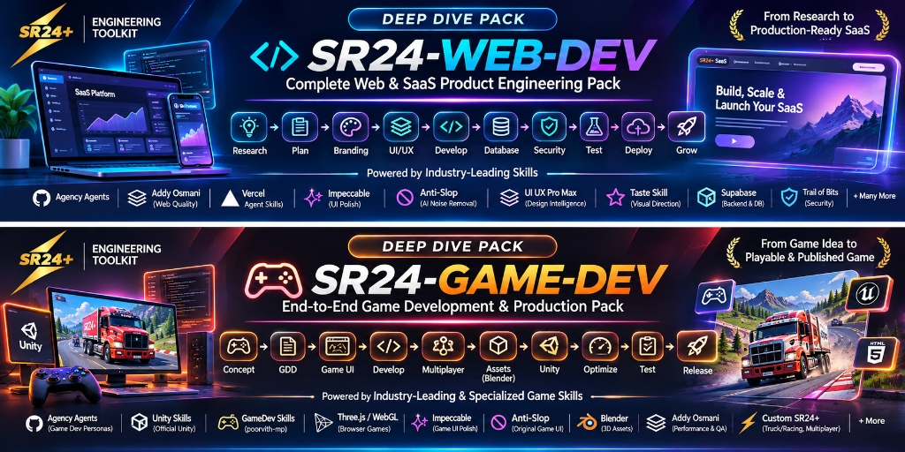
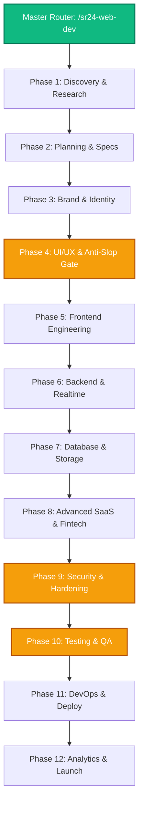

  

# SR24-WEB-DEV: Comprehensive Full-Stack & SaaS Engineering Pack
### Production-Grade Autonomous Engineering Architecture for Web Applications & SaaS Platforms

---

## 1. Executive Overview & Mission

**`SR24-WEB-DEV`** is the master full-stack and SaaS engineering pack in the **SR24Plus Engineering Toolkit**. It is architected to eliminate "AI slop" (generic purple-gradient landing pages, shallow mock implementations, brittle copy-pasted UI, and unhardened databases) by enforcing a strict **12-phase software product engineering lifecycle**.

When invoked via `/sr24-web-dev [task]` or natural-language triggers like `"Build web app"` or `"Develop SaaS platform"`, the toolkit mobilizes an autonomous multidisciplinary engineering squad:
- **Product & Requirements**: Formulates PRDs, user stories, and strict non-goals.
- **Brand & Taste**: Curates deliberate color systems and typography pairings.
- **Design Engineering & Anti-Slop**: Imposes WCAG contrast, 4px/8px mathematical grids, and finish-gate critique.
- **Frontend & WebGL**: Implements component architecture with TypeScript, motion primitives, and responsive viewports.
- **Backend & Database**: Generates normalized schemas, indexed queries, REST/tRPC contracts, and RBAC auth.
- **Fintech & Local Payments**: Handles Razorpay/UPI dynamic QR generation, webhook idempotency, and Indian GST math.
- **Security & QA**: Audits OWASP Top 10 vulnerabilities, eliminates prompt injection, and executes zero-flake Playwright E2E suites.
- **DevOps & Production**: Sets up Docker containerization, CI/CD pipelines, and zero-downtime Vercel/Cloudflare deployments.

---

## 2. Squad Coordination Architecture

---

## 3. 12-Phase Engineering Lifecycle

### Phase 1 — Research and Product Discovery
- **Objective**: Validate the user problem, study competitor offerings, conduct technical feasibility audits, and define quantitative success metrics before writing a single line of code.
- **Key Verified Skills**:
  - `agency-product-trend-researcher` (`skills/agency-agents/agency-product-trend-researcher/SKILL.md`)
  - `agency-research-synthesist` (`skills/agency-agents/agency-research-synthesist/SKILL.md`)
  - `reverse-engineer-anything` (`skills/custom-skills/reverse-engineer-anything/SKILL.md`)
  - `agency-design-ux-researcher` (`skills/agency-agents/agency-design-ux-researcher/SKILL.md`)
  - `idea-refine` (`skills/addyosmani-agent-skills/idea-refine/SKILL.md`)
  - `interview-me` (`skills/addyosmani-agent-skills/interview-me/SKILL.md`)
- **Inputs**: High-level user prompt, industry sector, target audience persona.
- **Outputs**: Market landscape analysis, TAM/SAM sizing, competitor feature matrix, user persona profiles.

### Phase 2 — Planning and Requirements
- **Objective**: Translate raw problem statements into structured, non-negotiable Product Requirement Documents (PRD), explicit acceptance criteria, user stories, and architecture decision records (ADRs).
- **Key Verified Skills**:
  - `agency-product-manager` (`skills/agency-agents/agency-product-manager/SKILL.md`)
  - `agency-product-sprint-prioritizer` (`skills/agency-agents/agency-product-sprint-prioritizer/SKILL.md`)
  - `spec-driven-development` (`skills/addyosmani-agent-skills/spec-driven-development/SKILL.md`)
  - `planning-and-task-breakdown` (`skills/addyosmani-agent-skills/planning-and-task-breakdown/SKILL.md`)
  - `constraint-driven-development` (`skills/addyosmani-agent-skills/constraint-driven-development/SKILL.md`)
  - `documentation-and-adrs` (`skills/addyosmani-agent-skills/documentation-and-adrs/SKILL.md`)
- **Inputs**: Discovery research, technical stack constraints, timeline limits.
- **Outputs**: `PRD.md`, `MVP_SCOPE.md` (with non-goals), technical roadmap, sprint breakdown.

### Phase 3 — Branding and Product Identity
- **Objective**: Establish distinctive product personality, design tokens, typography scales, and brand guidelines to prevent generic placeholder visuals.
- **Key Verified Skills**:
  - `agency-design-brand-guardian` (`skills/agency-agents/agency-design-brand-guardian/SKILL.md`)
  - `agency-design-visual-storyteller` (`skills/agency-agents/agency-design-visual-storyteller/SKILL.md`)
  - `taste-skill` (`skills/ui-design-suite/taste-skill/SKILL.md`)
  - `agency-marketing-content-creator` (`skills/agency-agents/agency-marketing-content-creator/SKILL.md`)
  - `writing-guidelines` (`skills/vercel-skills/writing-guidelines/SKILL.md`)
- **Inputs**: Target audience demographic, product vibe (e.g., Industrial, Luxury, Warm Retail, Minimalist Tech).
- **Outputs**: `BRAND_GUIDELINES.md`, font pairings (Display + UI body), primary/secondary/accent color hex palette.

### Phase 4 — UI/UX Design and Design System (Anti-Slop Hard Gate)
- **Objective**: Enforce the highest standard of modern web aesthetics. Eliminate AI-generated cliches (unmotivated purple gradients, low-contrast text, meaningless floating cards, emoji icons).
- **Key Verified Skills**:
  - `impeccable` (`skills/ui-design-suite/impeccable/SKILL.md`): Paul Bakaus' design critique and interface refinement tool. Audits spacing, hierarchy, layout density, and typographic rhythm.
  - `ui-ux-pro-max` (`skills/ui-design-suite/ui-ux-pro-max/SKILL.md`): NextLevelBuilder's comprehensive design intelligence system with 48+ curated design styles, typography scales, and responsive layout algorithms.
  - `antislop` (`skills/ui-design-suite/antislop/SKILL.md`): Strict filter banning AI slop tropes (cyan/magenta gradients, fake dashboard charts, rounded-3xl cards with 2px borders).
  - `antislop-ui` (`skills/ui-design-suite/antislop-ui/SKILL.md`): Frontend-specific design rules ensuring WCAG AA contrast ratios, fluid typography, and zero layout shift.
  - `agency-design-ui-designer` (`skills/agency-agents/agency-design-ui-designer/SKILL.md`): System-level component library architect.
  - `agency-design-ui-finish-gate-reviewer` (`skills/agency-agents/agency-design-ui-finish-gate-reviewer/SKILL.md`): Hard implementation finish gate. Rejects code that does not satisfy the written design contract.
  - `agency-design-ux-architect` (`skills/agency-agents/agency-design-ux-architect/SKILL.md`): Information architecture, user flows, and wireframe hierarchy.
  - `web-design-guidelines` (`skills/vercel-skills/web-design-guidelines/SKILL.md`): Vercel Labs' web design guidelines for crisp, modern interfaces.
- **Enforced Design Rules**:
  - Grid: Strict 4px/8px mathematical layout increments.
  - Contrast: 4.5:1 minimum contrast for normal text; 3:1 for large text.
  - Icons: SVGs only (Lucide/Phosphor); zero emoji-based iconography in place of actual buttons.
  - Motion: Sub-300ms cubic-bezier easing with `prefers-reduced-motion` compliance.

### Phase 5 — Frontend Engineering
- **Objective**: Translate design system tokens into production-grade React, Next.js, and TypeScript components with rock-solid state management and sub-100ms render speeds.
- **Key Verified Skills**:
  - `agency-engineering-frontend-developer` (`skills/agency-agents/agency-engineering-frontend-developer/SKILL.md`)
  - `agency-engineering-senior-developer` (`skills/agency-agents/agency-engineering-senior-developer/SKILL.md`)
  - `composition-patterns` (`skills/vercel-skills/composition-patterns/SKILL.md`)
  - `react-best-practices` (`skills/vercel-skills/react-best-practices/SKILL.md`)
  - `react-view-transitions` (`skills/vercel-skills/react-view-transitions/SKILL.md`)
  - `frontend-ui-engineering` (`skills/addyosmani-agent-skills/frontend-ui-engineering/SKILL.md`)
  - `agency-engineering-minimal-change-engineer` (`skills/agency-agents/agency-engineering-minimal-change-engineer/SKILL.md`)
  - `generative_ui` (`skills/antigravity-core/generative_ui/SKILL.md`)
- **Inputs**: Design specifications, component wireframes, data contracts.
- **Outputs**: Modular React/TypeScript components, responsive layouts (Mobile 375px, Tablet 768px, Desktop 1280px+), zero TypeScript errors.

### Phase 6 — Backend Engineering
- **Objective**: Engineer scalable RESTful and tRPC endpoints, secure session management, real-time WebSockets, background queue workers, and structured error responses.
- **Key Verified Skills**:
  - `agency-engineering-backend-architect` (`skills/agency-agents/agency-engineering-backend-architect/SKILL.md`)
  - `agency-engineering-api-platform-engineer` (`skills/agency-agents/agency-engineering-api-platform-engineer/SKILL.md`)
  - `api-and-interface-design` (`skills/addyosmani-agent-skills/api-and-interface-design/SKILL.md`)
  - `agency-engineering-identity-access-engineer` (`skills/agency-agents/agency-engineering-identity-access-engineer/SKILL.md`)
  - `agency-engineering-realtime-collaboration-engineer` (`skills/agency-agents/agency-engineering-realtime-collaboration-engineer/SKILL.md`)
  - `mcp-server-developer` (`skills/sr24-custom-engineering/mcp-server-developer/SKILL.md`)
- **Inputs**: Data requirements, authentication provider specs, API route definitions.
- **Outputs**: Express/FastAPI route handlers, JWT/session middleware, WebSocket hubs, JSON schema validation via Zod/Pydantic.

### Phase 7 — Database and Storage
- **Objective**: Design normalized relational or document database schemas, author migration scripts, optimize composite indices, and configure offline-first synchronization.
- **Key Verified Skills**:
  - `agency-engineering-database-optimizer` (`skills/agency-agents/agency-engineering-database-optimizer/SKILL.md`)
  - `agency-engineering-database-reliability-engineer` (`skills/agency-agents/agency-engineering-database-reliability-engineer/SKILL.md`)
  - `agency-engineering-data-engineer` (`skills/agency-agents/agency-engineering-data-engineer/SKILL.md`)
  - `offline-first-kirana-architect` (`skills/sr24-custom-engineering/offline-first-kirana-architect/SKILL.md`): Dual-layer storage (IndexedDB/SQLite WASM) with FIFO sync queues and append-only ledgers.
- **Inputs**: Entity relationship diagrams, expected read/write ratios, volume projections.
- **Outputs**: `SCHEMA.sql`, ORM models (Prisma/SQLAlchemy), migration files, composite B-tree indices.

### Phase 8 — Advanced SaaS Engineering & Fintech
- **Objective**: Build production SaaS infrastructure: multi-tenant tenancy isolation, subscription tier billing, usage metering, and Indian payment gateways (Razorpay, UPI, GST).
- **Key Verified Skills**:
  - `razorpay-upi-specialist` (`skills/sr24-custom-engineering/razorpay-upi-specialist/SKILL.md`): Orders API, dynamic UPI QR strings (`upi://pay`), HMAC-SHA256 signature verification, idempotent webhook processing.
  - `indian-gst-billing-engineer` (`skills/sr24-custom-engineering/indian-gst-billing-engineer/SKILL.md`): Intra-state (CGST+SGST) vs Inter-state (IGST) multi-tier calculations (0%, 5%, 12%, 18%, 28%), HSN code summary tables, 80mm/58mm thermal receipt layouts.
  - `agency-engineering-payments-billing-engineer` (`skills/agency-agents/agency-engineering-payments-billing-engineer/SKILL.md`)
  - `agency-engineering-software-architect` (`skills/agency-agents/agency-engineering-software-architect/SKILL.md`)
  - `assessment-engine-architect` (`skills/sr24-custom-engineering/assessment-engine-architect/SKILL.md`)
- **Inputs**: Pricing tiers, tax jurisdictions, payment provider credentials.
- **Outputs**: Subscription billing pipelines, verified payment webhooks, thermal bill generators.

### Phase 9 — Security and Hardening
- **Objective**: Defend against OWASP Top 10 vulnerabilities, verify parameterized SQL queries, scan for secret leaks, and isolate AI prompts against direct/indirect injection.
- **Key Verified Skills**:
  - `agency-security-appsec-engineer` (`skills/agency-agents/agency-security-appsec-engineer/SKILL.md`)
  - `agency-security-architect` (`skills/agency-agents/agency-security-architect/SKILL.md`)
  - `agency-security-secrets-credential-engineer` (`skills/agency-agents/agency-security-secrets-credential-engineer/SKILL.md`)
  - `security-and-hardening` (`skills/addyosmani-agent-skills/security-and-hardening/SKILL.md`)
  - `prompt-injection-security-engineer` (`skills/sr24-custom-engineering/prompt-injection-security-engineer/SKILL.md`): XML boundary tags, canary tokens, tool call authorization barriers.
- **Outputs**: Zero Critical/High vulnerability report, CORS/CSP policy headers, encrypted secret management.

### Phase 10 — Testing and Quality Assurance
- **Objective**: Validate the entire application through disciplined test-driven development, E2E browser automation, visual regression checks, and root-cause analysis.
- **Key Verified Skills**:
  - `playwright-automation-engineer` (`skills/sr24-custom-engineering/playwright-automation-engineer/SKILL.md`): Zero-flake Playwright E2E suites, accessible locators, visual snapshot comparison, storage state caching.
  - `agency-testing-test-automation-engineer` (`skills/agency-agents/agency-testing-test-automation-engineer/SKILL.md`)
  - `browser-testing-with-devtools` (`skills/addyosmani-agent-skills/browser-testing-with-devtools/SKILL.md`)
  - `test-driven-development` (`skills/addyosmani-agent-skills/test-driven-development/SKILL.md`)
  - `agency-testing-reality-checker` (`skills/agency-agents/agency-testing-reality-checker/SKILL.md`)
  - `systematic-debugging-engineer` (`skills/sr24-custom-engineering/systematic-debugging-engineer/SKILL.md`)
  - `performance-optimization` (`skills/addyosmani-agent-skills/performance-optimization/SKILL.md`)
- **Outputs**: 100% passing test logs, sub-2.5s LCP Core Web Vitals audit, E2E execution trace artifacts.

### Phase 11 — DevOps and Deployment
- **Objective**: Containerize services with Docker, author zero-downtime CI/CD workflows, configure edge CDN caches, and implement healthcheck monitoring.
- **Key Verified Skills**:
  - `agency-engineering-devops-automator` (`skills/agency-agents/agency-engineering-devops-automator/SKILL.md`)
  - `agency-engineering-sre` (`skills/agency-agents/agency-engineering-sre/SKILL.md`)
  - `ci-cd-and-automation` (`skills/addyosmani-agent-skills/ci-cd-and-automation/SKILL.md`)
  - `deploy-to-vercel` (`skills/vercel-skills/deploy-to-vercel/SKILL.md`)
  - `vercel-optimize` (`skills/vercel-skills/vercel-optimize/SKILL.md`)
  - `shipping-and-launch` (`skills/addyosmani-agent-skills/shipping-and-launch/SKILL.md`)
- **Outputs**: `Dockerfile`, `docker-compose.yml`, GitHub Actions CI pipeline, `.env.example`, verified production URL.

### Phase 12 — Product Analytics and Growth
- **Objective**: Instrument event tracking, configure programmatic SEO architecture, optimize organic conversion funnels, and prepare Product Hunt launch assets.
- **Key Verified Skills**:
  - `programmatic-seo-engineer` (`skills/sr24-custom-engineering/programmatic-seo-engineer/SKILL.md`): Long-tail landing page generation (ISR), JSON-LD schemas (`SoftwareApplication`, `LocalBusiness`), XML sitemaps.
  - `product-hunt-launch-specialist` (`skills/sr24-custom-engineering/product-hunt-launch-specialist/SKILL.md`): Product Hunt #1 playbook, Show HN copywriting, 5-slide visual teaser gallery.
  - `agency-marketing-seo-specialist` (`skills/agency-agents/agency-marketing-seo-specialist/SKILL.md`)
  - `agency-marketing-growth-hacker` (`skills/agency-agents/agency-marketing-growth-hacker/SKILL.md`)
  - `agency-support-analytics-reporter` (`skills/agency-agents/agency-support-analytics-reporter/SKILL.md`)
- **Outputs**: Event telemetry specs, dynamic sitemaps, structured schema markup, Product Hunt launch kit.

---

## 4. Complete SR24-WEB-DEV Skill Matrix

| Phase | Skill Name | Source Repository | Original Skill Path | Local Skill Path | Main Responsibility | Verification Status |
|---|---|---|---|---|---|:---:|
| 01 | `agency-product-trend-researcher` | `agency-agents` | `skills/agency-product-trend-researcher` | `skills/agency-agents/agency-product-trend-researcher/SKILL.md` | Market intelligence & competitor analysis | Verified In-Repo |
| 01 | `agency-research-synthesist` | `agency-agents` | `skills/agency-research-synthesist` | `skills/agency-agents/agency-research-synthesist/SKILL.md` | Evidence synthesis & source evaluation | Verified In-Repo |
| 01 | `reverse-engineer-anything` | `custom-skills` (REA) | `skills/reverse-engineer-anything` | `skills/custom-skills/reverse-engineer-anything/SKILL.md` | Codebase & architecture reverse engineering | Verified In-Repo |
| 01 | `idea-refine` | `addyosmani/web-quality-skills` | `skills/idea-refine` | `skills/addyosmani-agent-skills/idea-refine/SKILL.md` | Rapid concept stress-testing | Verified In-Repo |
| 02 | `agency-product-manager` | `agency-agents` | `skills/agency-product-manager` | `skills/agency-agents/agency-product-manager/SKILL.md` | PRD authorship & feature scope | Verified In-Repo |
| 02 | `spec-driven-development` | `addyosmani/web-quality-skills` | `skills/spec-driven-development` | `skills/addyosmani-agent-skills/spec-driven-development/SKILL.md` | Strict specification-first workflows | Verified In-Repo |
| 02 | `planning-and-task-breakdown` | `addyosmani/web-quality-skills` | `skills/planning-and-task-breakdown` | `skills/addyosmani-agent-skills/planning-and-task-breakdown/SKILL.md` | Atomic task dependency planning | Verified In-Repo |
| 03 | `agency-design-brand-guardian` | `agency-agents` | `skills/agency-design-brand-guardian` | `skills/agency-agents/agency-design-brand-guardian/SKILL.md` | Brand identity & consistency | Verified In-Repo |
| 03 | `taste-skill` | `Leonxlnx/taste-skill` | `skills/taste-skill` | `skills/ui-design-suite/taste-skill/SKILL.md` | Visual taste & aesthetic direction | Verified In-Repo |
| 04 | `impeccable` | `pbakaus/impeccable` | `skills/impeccable` | `skills/ui-design-suite/impeccable/SKILL.md` | Precision UI critique & typography audit | Verified In-Repo |
| 04 | `ui-ux-pro-max` | `nextlevelbuilder/ui-ux-pro-max-skill` | `skills/ui-ux-pro-max` | `skills/ui-design-suite/ui-ux-pro-max/SKILL.md` | 48+ design styles, palettes & tokens | Verified In-Repo |
| 04 | `antislop` | `miqdadbadjuber/anti-slop` | `skills/antislop` | `skills/ui-design-suite/antislop/SKILL.md` | Banning AI SaaS tropes & purple gradients | Verified In-Repo |
| 04 | `antislop-ui` | `miqdadbadjuber/anti-slop` | `skills/antislop-ui` | `skills/ui-design-suite/antislop-ui/SKILL.md` | WCAG AA contrast & fluid responsive UI | Verified In-Repo |
| 04 | `agency-design-ui-finish-gate-reviewer` | `agency-agents` | `skills/agency-design-ui-finish-gate-reviewer` | `skills/agency-agents/agency-design-ui-finish-gate-reviewer/SKILL.md` | Design contract finish-gate enforcement | Verified In-Repo |
| 05 | `agency-engineering-frontend-developer` | `agency-agents` | `skills/agency-engineering-frontend-developer` | `skills/agency-agents/agency-engineering-frontend-developer/SKILL.md` | React/Next.js/Vue component implementation | Verified In-Repo |
| 05 | `composition-patterns` | `vercel-labs/agent-skills` | `skills/composition-patterns` | `skills/vercel-skills/composition-patterns/SKILL.md` | React component composition architecture | Verified In-Repo |
| 05 | `react-best-practices` | `vercel-labs/agent-skills` | `skills/react-best-practices` | `skills/vercel-skills/react-best-practices/SKILL.md` | React Compiler & hydration optimization | Verified In-Repo |
| 06 | `agency-engineering-backend-architect` | `agency-agents` | `skills/agency-engineering-backend-architect` | `skills/agency-agents/agency-engineering-backend-architect/SKILL.md` | Scalable microservices & REST APIs | Verified In-Repo |
| 06 | `api-and-interface-design` | `addyosmani/web-quality-skills` | `skills/api-and-interface-design` | `skills/addyosmani-agent-skills/api-and-interface-design/SKILL.md` | Clean REST/GraphQL API contracts | Verified In-Repo |
| 06 | `mcp-server-developer` | `SR24Plus Custom` | Original Architecture | `skills/sr24-custom-engineering/mcp-server-developer/SKILL.md` | JSON-RPC Model Context Protocol servers | Verified In-Repo |
| 07 | `agency-engineering-database-optimizer` | `agency-agents` | `skills/agency-engineering-database-optimizer` | `skills/agency-agents/agency-engineering-database-optimizer/SKILL.md` | Schema design & SQL query optimization | Verified In-Repo |
| 07 | `offline-first-kirana-architect` | `SR24Plus Custom` | Original Architecture | `skills/sr24-custom-engineering/offline-first-kirana-architect/SKILL.md` | IndexedDB/SQLite offline sync engine | Verified In-Repo |
| 08 | `razorpay-upi-specialist` | `SR24Plus Custom` | Original Architecture | `skills/sr24-custom-engineering/razorpay-upi-specialist/SKILL.md` | Razorpay Orders, UPI QR & webhook HMAC | Verified In-Repo |
| 08 | `indian-gst-billing-engineer` | `SR24Plus Custom` | Original Architecture | `skills/sr24-custom-engineering/indian-gst-billing-engineer/SKILL.md` | CGST/SGST/IGST math & thermal receipts | Verified In-Repo |
| 09 | `agency-security-appsec-engineer` | `agency-agents` | `skills/agency-security-appsec-engineer` | `skills/agency-agents/agency-security-appsec-engineer/SKILL.md` | OWASP Top 10 threat modeling & review | Verified In-Repo |
| 09 | `prompt-injection-security-engineer` | `SR24Plus Custom` | Original Architecture | `skills/sr24-custom-engineering/prompt-injection-security-engineer/SKILL.md` | Direct/indirect prompt injection defense | Verified In-Repo |
| 10 | `playwright-automation-engineer` | `SR24Plus Custom` | Original Architecture | `skills/sr24-custom-engineering/playwright-automation-engineer/SKILL.md` | Zero-flake E2E & visual regression | Verified In-Repo |
| 10 | `systematic-debugging-engineer` | `SR24Plus Custom` | Original Architecture | `skills/sr24-custom-engineering/systematic-debugging-engineer/SKILL.md` | 4-step hypothesis-driven RCA | Verified In-Repo |
| 11 | `agency-engineering-devops-automator` | `agency-agents` | `skills/agency-engineering-devops-automator` | `skills/agency-agents/agency-engineering-devops-automator/SKILL.md` | CI/CD pipelines & Docker automation | Verified In-Repo |
| 11 | `deploy-to-vercel` | `vercel-labs/agent-skills` | `skills/deploy-to-vercel` | `skills/vercel-skills/deploy-to-vercel/SKILL.md` | Serverless deployment verification | Verified In-Repo |
| 12 | `programmatic-seo-engineer` | `SR24Plus Custom` | Original Architecture | `skills/sr24-custom-engineering/programmatic-seo-engineer/SKILL.md` | Long-tail landing pages & JSON-LD | Verified In-Repo |
| 12 | `product-hunt-launch-specialist` | `SR24Plus Custom` | Original Architecture | `skills/sr24-custom-engineering/product-hunt-launch-specialist/SKILL.md` | Product Hunt #1 Day launch strategy | Verified In-Repo |

