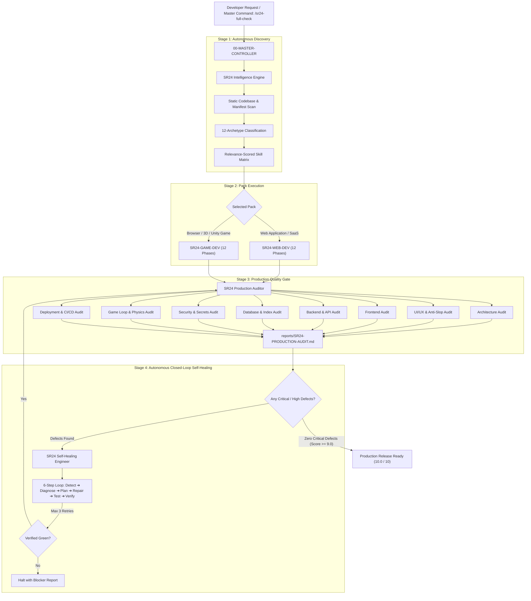

# SR24PLUS CORE INTELLIGENCE ARCHITECTURE
### Master Orchestration Blueprint Connecting Intelligence, Packs, Auditing, and Self-Healing

> **Architecture Version**: v3.0  
> **Master Router**: `/sr24-auto` • `/sr24-full-check`  
> **Total Canonical Skills**: 479 Verified In-Repo Skills

---

## 1. Unified End-to-End Execution Pipeline

---

## 2. Core Master Commands

| Master Command | Scope & Mission | Underlying Subsystems |
|---|---|---|
| **`/sr24-auto [task]`** | Fully autonomous project analysis and matching skill activation | Intelligence Engine ➔ Skill Selection |
| **`/sr24-intelligence [dir]`** | Run static codebase discovery, archetype classification, and skill plan | `sr24-intelligence-engine` |
| **`/sr24-audit [dir]`** | Run 8-module full-spectrum production audit and generate structured report | `sr24-production-auditor` |
| **`/sr24-heal [test_cmd]`** | Autonomous 6-step closed-loop debugging and minimal repair | `sr24-self-healing-engineer` |
| **`/sr24-full-check`** | End-to-end pipeline: Intelligence ➔ Audit ➔ Heal ➔ Verify ➔ Release | All Core Subsystems |
| **`/sr24-web-audit`** | Targeted audit for Web/SaaS stacks (Modules A-F, H) | Production Auditor (Web Profile) |
| **`/sr24-game-audit`** | Targeted audit for Browser/Unity game stacks (Modules A-C, G-H) | Production Auditor (Game Profile) |
| **`/sr24-production-ready`** | Evaluates whether all quality dimensions score $\ge 9.0/10$ | Quality Gate Validator |