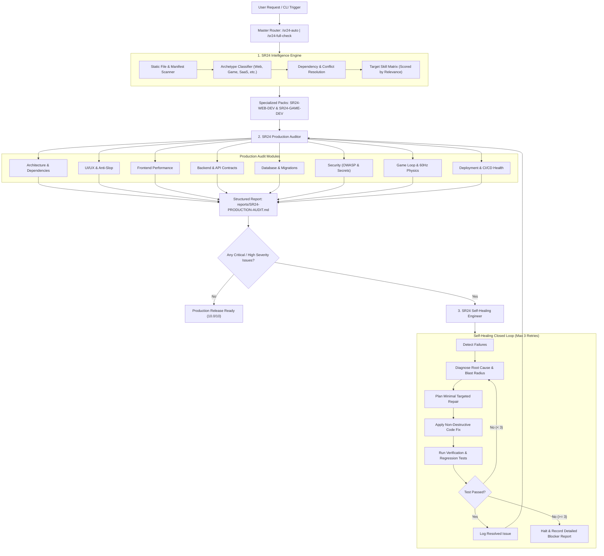

# SR24PLUS CORE INTELLIGENCE LAYER AUDIT

> **Repository**: `https://github.com/sahil24raj/SR24plus-engineering-toolkit.git`  
> **Audit Version**: v3.0-CORE-AUDIT  
> **Target Subsystems**: SR24 Intelligence Engine • SR24 Production Auditor • SR24 Self-Healing Engineer

---

## 1. Executive Summary

This audit assesses the integration of three foundational intelligence subsystems into the **SR24Plus Engineering Toolkit**:
1. **SR24 Intelligence Engine (`sr24-intelligence-engine`)**: Automated project understanding, tech stack inference, classification, and priority-scored skill activation planning.
2. **SR24 Production Auditor (`sr24-production-auditor`)**: Automated 8-module full-spectrum production audit (Architecture, UI/UX, Frontend, Backend, Database, Security, Game Systems, Deployment) with structured reports and non-fabricated scoring.
3. **SR24 Self-Healing Engineer (`sr24-self-healing-engineer`)**: Autonomous 6-step closed-loop error detection, diagnosis, targeted repair, and regression-tested verification with strict safety boundaries.

---

## 2. Existing Capabilities vs. Gaps Analysis

| Core Subsystem | Existing Capability in Repo | Observed Architectural Gap | Target Integrated Solution |
|---|---|---|---|
| **Project Understanding & Stack Detection** | Manual stack profile selection in `00-MASTER-CONTROLLER/workflows/SR24-AUTO.md` and `PROJECT-WORKFLOW-MATRIX.md`. | No automated AST/file scanner or manifest parser to dynamically infer complex hybrid stacks (e.g., React + Three.js + Colyseus vs. Next.js + Supabase + Drizzle). | Implement **`sr24-intelligence-engine`** with automated file tree heuristic analysis, manifest parsing, 12 project archetype classifications, and conflict-free skill routing. |
| **Production Auditing** | Discrete security/QA skills (`owasp-zap-scanner`, `trivy-security-scanner`, `lost-pixel-visual-regression`, `reality-checker`). | Lack of a single unified production auditor that executes across all 8 dimensions, produces uniform `reports/SR24-PRODUCTION-AUDIT.md`, and computes verified scores. | Implement **`sr24-production-auditor`** with unified CLI/API covering Architecture, UI/UX, Frontend, Backend, DB, Security, Game Dev, and CI/CD with evidence-grounded scoring. |
| **Autonomous Debugging & Self-Healing** | `debugging-and-error-recovery`, `doubt-driven-development`, `reality-checker`. | Debugging is purely advice/chat-driven; lacks a controlled, non-destructive 6-step loop (Detect ➔ Diagnose ➔ Plan ➔ Repair ➔ Test ➔ Verify) with max 3 retries and safety guardrails. | Implement **`sr24-self-healing-engineer`** with automated AST/diff validation, test feedback loops, maximum 3 retry bounds, and hard fail-safes against data loss. |

---

## 3. Integration Architecture

The three core intelligence subsystems connect directly to the existing **`00-MASTER-CONTROLLER`** and orchestrate both **`SR24-WEB-DEV`** and **`SR24-GAME-DEV`** packs:

---

## 4. Dependencies & Technical Prerequisites

1. **Python 3.10+**: Core engine scripts run cross-platform (Windows, Linux, macOS) without requiring heavy runtime frameworks.
2. **Node.js 18+ & npm/pnpm**: For JavaScript/TypeScript parsing, package manifest reading, and test runners (`vitest`, `playwright`, `jest`).
3. **Git 2.40+**: For change staging, diff generation, and clean working tree verification.
4. **Permissive Open-Source Libraries**: Zero proprietary dependencies; leverages standard JSON, YAML, regex AST heuristics, and existing verified toolkit skills.

---

## 5. Implementation Plan

- **Phase 1: Subsystem Authoring**:
  - Author `skills/sr24-custom-engineering/sr24-intelligence-engine/` (`SKILL.md` + `scripts/intelligence_engine.py`).
  - Author `skills/sr24-custom-engineering/sr24-production-auditor/` (`SKILL.md` + `scripts/production_auditor.py`).
  - Author `skills/sr24-custom-engineering/sr24-self-healing-engineer/` (`SKILL.md` + `scripts/self_healing_engineer.py`).
- **Phase 2: Master Workflows & Command Synchronization**:
  - Update `00-MASTER-CONTROLLER/COMMANDS.md`, `00-MASTER-CONTROLLER/workflows/SR24-AUTO.md`, and `00-MASTER-CONTROLLER/MASTER-ROUTER.md`.
  - Add commands: `/sr24-intelligence`, `/sr24-audit`, `/sr24-heal`, `/sr24-full-check`, `/sr24-web-audit`, `/sr24-game-audit`, `/sr24-production-ready`.
- **Phase 3: Automated Verification Test Suite**:
  - Build `tests/test_core_intelligence.py` covering all 6 test scenarios (Classification, Routing, Audit, Self-Healing, Regression, Safety).
  - Execute test runner and generate `docs/SR24PLUS-CORE-TEST-REPORT.md`.
- **Phase 4: Comprehensive Documentation Suite**:
  - Create dedicated architecture and guide documents in `docs/`.
  - Update root `README.md`, `SKILL-REGISTRY.md`, `SKILL-INDEX.md`, and pack documentation.
- **Phase 5: GitHub Synchronization**:
  - Verify git status, review diffs, commit, and push to GitHub `origin main`.

---

## 6. Compatibility & Safety Risks

| Risk | Impact | Mitigation Strategy |
|---|---|---|
| **Accidental Overwrite of Custom Project Logic** | High | Self-Healing engine strictly enforces minimal unified diffs, never rewrites files from scratch, and aborts if unrelated code is modified. |
| **Infinite Healing Loops** | Medium | Hard cap of **maximum 3 repair attempts** per failing issue. If unverified after 3 attempts, engine immediately logs a blocker report and returns control to the developer. |
| **Destructive Data or Credential Exposure** | Critical | Strict safety policies prevent automatic execution of `DROP TABLE`, destructive migrations, git force push, or commits of `.env` files. |
| **Skill Registry Disruption** | Medium | Non-destructive registration: all 476 existing skills are retained; the 3 core engines expand the canonical directory to 479 skills. |
