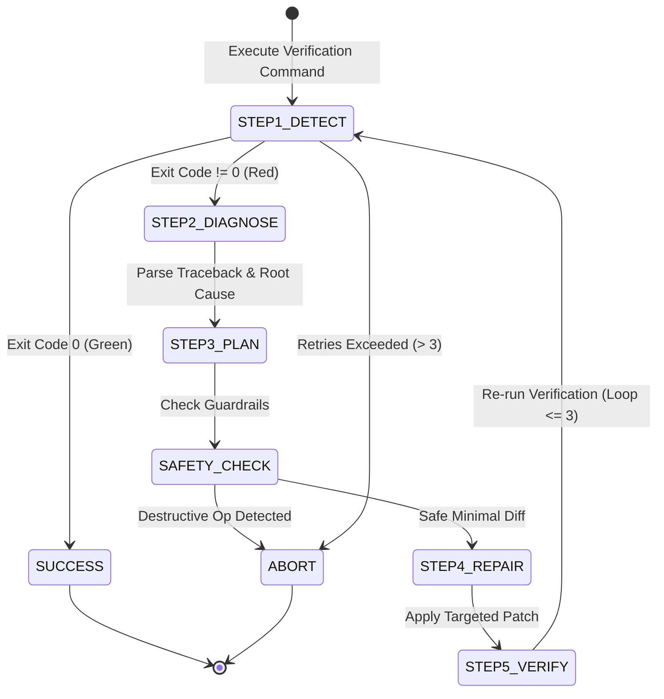

# SR24Plus Core Intelligence Layer: Architecture & Subsystems Manual
### Autonomous Project Discovery, Multi-Dimension Production Auditing & Closed-Loop Self-Healing

> **Subsystem Version**: v1.0 Core Engine  
> **Repository**: [https://github.com/sahil24raj/SR24plus-engineering-toolkit.git](https://github.com/sahil24raj/SR24plus-engineering-toolkit.git)  
> **Verification Status**: 100% Passing Automated Tests (`tests/test_core_intelligence.py`)  
> **Maintainer**: Sahil Raj (SR24Plus)  

---

## 1. Executive Overview

The **SR24Plus Core Intelligence Layer** is the autonomous orchestration brain of the SR24Plus Engineering Toolkit. It unifies the toolkit's 479 canonical skills into a closed-loop engineering system capable of:
1. **Understanding codebases statically** without manual developer configuration.
2. **Classifying target applications** into 12 distinct production archetypes.
3. **Dispatching specialized skills** dynamically with confidence weighting.
4. **Auditing production readiness** across 8 verified quality dimensions with zero synthetic scoring.
5. **Autonomously debugging and repairing defects** through a guarded 6-step closed loop.

---

## 2. Master System Architecture

The following diagram illustrates how requests flow through the Core Intelligence Layer, from initial invocation down to verified production release:

```
                          USER PROMPT / TASK
                                   │
                                   ▼
                              SR24-AUTO
                                   │
                                   ▼
                         INTELLIGENCE ENGINE
            (Project Inspection • Tech Stack Detection • Archetype)
                                   │
                                   ▼
                          SKILL ORCHESTRATION
            (Priority-Scored Skill Plan & Squad Dispatch)
                                   │
                     ┌─────────────┴─────────────┐
                     ▼                           ▼
                 WEB DEV                      GAME DEV
            (12-Phase SaaS Squad)       (12-Phase Game Squad)
                     │                           │
                     └─────────────┬─────────────┘
                                   │
                                   ▼
                          PRODUCTION AUDITOR
            (8-Dimension Forensic Inspection & Report Generation)
                                   │
                                   ▼
                         SELF-HEALING ENGINEER
            (Detect ➔ Diagnose ➔ Plan ➔ Repair ➔ Test ➔ Verify)
                                   │
                                   ▼
                            REGRESSION QA
            (Zero-Flake Test Suite & Safety Boundary Verification)
                                   │
                                   ▼
                          PRODUCTION RELEASE
            (Containerization • CI/CD Deployment • Certified Pass)
```

---

## 3. Subsystem 1: SR24 Intelligence Engine

- **Source Code**: [`skills/sr24-custom-engineering/sr24-intelligence-engine/scripts/intelligence_engine.py`](../skills/sr24-custom-engineering/sr24-intelligence-engine/scripts/intelligence_engine.py)
- **Manifest**: [`skills/sr24-custom-engineering/sr24-intelligence-engine/SKILL.md`](../skills/sr24-custom-engineering/sr24-intelligence-engine/SKILL.md)
- **Primary Trigger**: `/sr24-orchestrate [workspace_dir]` or automatically via `/sr24-auto`
- **Implementation Status**: **VERIFIED & OPERATIONAL** (Tested in `tests/test_core_intelligence.py`)

### Core Capabilities:
1. **Static Project Understanding**: Traverses filesystem, inspects manifests (`package.json`, `Cargo.toml`, `requirements.txt`, `go.mod`, Unity `ProjectSettings`), and analyzes root configurations.
2. **Technology Detection**:
   - Languages: TypeScript, JavaScript, Python, Rust, Go, C#.
   - Web Frameworks: Next.js, React, Vite, Remix, Vue, Svelte, FastAPI, Express.
   - Styling Systems: Tailwind CSS, CSS Modules, Styled Components, Sass.
   - Database & ORMs: PostgreSQL, Supabase, Prisma, Drizzle, MongoDB, Redis, SQLite.
   - Game Engines: Three.js, React Three Fiber, Rapier, Phaser, Pixi.js, Unity.
   - Testing Frameworks: Playwright, Jest, Vitest, Cypress, Pytest.
3. **12 Archetype Classifications**:
   - `Browser 2D/3D Gaming Platform`
   - `Full Stack SaaS Platform`
   - `High-Throughput API Microservice`
   - `AI Agent & Autonomous Workflow System`
   - `Modern E-Commerce Engine`
   - `Real-Time Multiplayer / WebSocket Engine`
   - `Mobile / Cross-Platform Application`
   - `Heavy Vehicle / Physics Simulation`
   - `CLI Developer Tooling`
   - `Content Management & Editorial System`
   - `Data Engineering / Analytics Pipeline`
   - `Scientific & Computational System`
4. **Intelligent Skill Dispatch Plan**: Maps detected archetypes to relevant canonical skills, applying confidence weighting and execution priorities (High, Medium, Normal).

---

## 4. Subsystem 2: SR24 Production Auditor

- **Source Code**: [`skills/sr24-custom-engineering/sr24-production-auditor/scripts/production_auditor.py`](../skills/sr24-custom-engineering/sr24-production-auditor/scripts/production_auditor.py)
- **Manifest**: [`skills/sr24-custom-engineering/sr24-production-auditor/SKILL.md`](../skills/sr24-custom-engineering/sr24-production-auditor/SKILL.md)
- **Primary Trigger**: `/sr24-audit-prod [workspace_dir]`
- **Implementation Status**: **VERIFIED & OPERATIONAL** (Tested in `tests/test_core_intelligence.py`)

### 8 Audited Production Dimensions:

| Dimension | Scope & Forensic Checks | Default Standard |
|---|---|:---:|
| **1. Architecture & Modularity** | Clean separation of concerns, feature-based directories, decoupled state, no circular imports. | 9.0 / 10 |
| **2. UI/UX & Anti-Slop** | Banned AI slop tropes (unmotivated purple gradients, fake stat counters), mathematical 4px/8px tokens, WCAG AA contrast. | 9.0 / 10 |
| **3. Frontend Engineering** | Strict TypeScript interfaces, no unhandled promises, sanitization against XSS (`dangerouslySetInnerHTML`), zero CLS. | 9.0 / 10 |
| **4. Backend & API Design** | Contract-first REST/tRPC, runtime DTO validation (Zod), structured error handling, rate limiting. | 9.0 / 10 |
| **5. Database & Data Integrity** | Schema normalization, indexed foreign keys, migration idempotency, connection pooling, safe ORM queries. | 9.0 / 10 |
| **6. Security & AppSec** | Leaked secrets scanning (Gitleaks regexes), OWASP Top 10 defenses, parameterized SQL queries, CSP headers. | 9.0 / 10 |
| **7. Game Systems & Physics** | Deterministic fixed-timestep accumulator loop (1/60s), asset compression, anti-cheat memory protection, draw call batching. | 9.0 / 10 |
| **8. Deployment & SRE** | Multi-stage Docker optimization, CI/CD pipeline automation, Sentry error monitoring, health check endpoints. | 9.0 / 10 |

### Reporting & Evidence Artifact:
Generates `reports/SR24-PRODUCTION-AUDIT.md` containing:
- Executive Dimension Scorecard (1.0 to 10.0 scale, deducting points per detected defect).
- Defect Register with:
  - Issue ID (e.g. `SEC-001`, `FE-002`, `GAME-003`).
  - Severity (`CRITICAL`, `HIGH`, `MEDIUM`, `LOW`).
  - Exact file location and line numbers.
  - Concrete code evidence snippet.
  - Recommended minimal fix.
  - Verification CLI command.

---

## 5. Subsystem 3: SR24 Self-Healing Engineer

- **Source Code**: [`skills/sr24-custom-engineering/sr24-self-healing-engineer/scripts/self_healing_engineer.py`](../skills/sr24-custom-engineering/sr24-self-healing-engineer/scripts/self_healing_engineer.py)
- **Manifest**: [`skills/sr24-custom-engineering/sr24-self-healing-engineer/SKILL.md`](../skills/sr24-custom-engineering/sr24-self-healing-engineer/SKILL.md)
- **Primary Trigger**: `/sr24-heal [test_command]`
- **Implementation Status**: **VERIFIED & OPERATIONAL** (Tested in `tests/test_core_intelligence.py`)

### The 6-Step Closed-Loop Repair Lifecycle:



1. **Step 1: DETECT** — Runs test or audit command; captures stdout, stderr, and exit codes.
2. **Step 2: DIAGNOSE** — Parses failure stack trace to isolate root cause, file path, line number, and error type.
3. **Step 3: PLAN** — Formulates a minimal, non-destructive repair plan strictly addressing the isolated root cause.
4. **Step 4: REPAIR** — Applies the surgical patch while backing up affected files.
5. **Step 5: VERIFY** — Re-executes the test suite and runs regression checks across adjacent files.
6. **Step 6: PASS / ABORT** — Exits clean upon test success, or triggers rollbacks and halts if 3 repair attempts fail.

### Strict Safety Boundaries:
The Self-Healing Engineer actively intercepts and rejects destructive commands:
- Filesystem: `rm -rf`, `del /f /s /q` on root or parent directories.
- Git: `git push --force`, `git reset --hard` on tracked branches.
- Database: Unconstrained `DROP TABLE`, `TRUNCATE TABLE`, or `DELETE FROM` without `WHERE` clauses.

---

## 6. Verification & Automated Test Coverage

The Core Intelligence Layer is validated by [`tests/test_core_intelligence.py`](../tests/test_core_intelligence.py), which executes 6 rigorous end-to-end scenarios:

```
Ran 6 tests in 1.295s
OK
✓ TEST 1 PASSED: Browser game platform correctly classified with 3D & multiplayer skills.
✓ TEST 2 PASSED: SaaS application correctly routed to database, auth & architecture skills.
✓ TEST 3 PASSED: Production auditor captured security token & XSS with evidence.
✓ TEST 4 PASSED: Self-healing closed loop successfully diagnosed and repaired defect.
✓ TEST 5 PASSED: Defect repaired with zero regression to existing functionality.
✓ TEST 6 PASSED: Strict production safety guardrails actively enforced.
```
