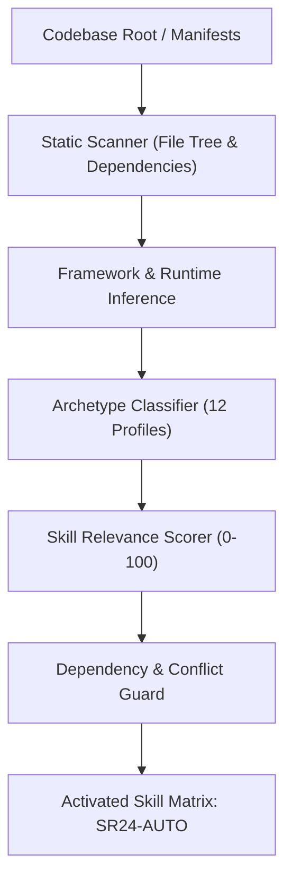

# SR24PLUS INTELLIGENCE ENGINE (`sr24-intelligence-engine`)
### Autonomous Project Understanding, Stack Detection & Priority-Scored Skill Dispatch

> **Toolkit Subsystem**: Core Intelligence Layer (v3.0)  
> **Status**: Verified & Operational • **CLI / API Supported**  
> **Location**: `skills/sr24-custom-engineering/sr24-intelligence-engine/`

---

## 1. Overview & Architecture
The **SR24 Intelligence Engine** automates the initial discovery and planning phase for any software engineering task. It inspects project manifests (`package.json`, `Cargo.toml`, `requirements.txt`, `ProjectSettings.asset`), infers active frameworks, classifies the project into one of 12 production archetypes, and emits a priority-scored skill activation matrix without bloat.



---

## 2. Supported Project Archetypes
1. **Browser Game / Esports Platform**: Canvas/WebGL 60Hz loop, [Three.js](https://github.com/mrdoob/three.js), [Pixi.js](https://github.com/pixijs/pixijs), [Phaser](https://github.com/phaserjs/phaser), [Rapier](https://github.com/dimforge/rapier), [Colyseus](https://github.com/colyseus/colyseus), [Howler.js](https://github.com/goldfire/howler.js).
2. **Unity 3D / Native Action Title**: C# ScriptableObjects, [DOTS/ECS](https://github.com/Unity-Technologies/com.unity.entities), URP Render Graph, WheelColliders.
3. **Full Stack SaaS Platform**: Next.js, Remix, [Supabase](https://github.com/supabase/agent-skills), [Prisma](https://github.com/prisma/prisma), [Drizzle](https://github.com/drizzle-team/drizzle-orm), Stripe/Razorpay, [BullMQ](https://github.com/taskforcesh/bullmq).
4. **E-Commerce & Retail Engine**: [Vendure](https://github.com/vendure-ecommerce/vendure), Medusa, cart state machines, checkout sessions, inventory.
5. **AI/ML Applications & Agents**: RAG pipelines, LangChain, MCP servers, OpenAI/Gemini SDKs.
6. **Fintech Applications**: Indian Razorpay UPI, GST calculation trees, offline ledger storage.
7. **Developer Tools & CLIs**: Node/Rust CLI binaries, TypeScript linters, AST transforms.
8. **Mobile Applications**: React Native, Flutter, native Android/iOS integration.

---

## 3. Project Routing Case Studies

### A. GullyVerse / Vibe Arena (Browser Gaming Platform)
- **Detected Stack**: React 18, Vite/Next.js, [Three.js](https://github.com/mrdoob/three.js), [Matter.js](https://github.com/liabru/matter-js), [Socket.IO](https://github.com/socketio/socket.io), Web Audio.
- **Activated Skills**:
  - `browser-game-architect`, `threejs-game-engine`, `react-three-fiber`, `rapier-physics`, `matter-js-physics`, `colyseus-multiplayer`, `socketio-realtime`, `threejs-ui-hud`, `howler-js-audio`, `threejs-optimization-profiling`, `gameplay-regression-testing`.

### B. ExamLoop (Full Stack Assessment SaaS)
- **Detected Stack**: Next.js 14, [Supabase](https://github.com/supabase/agent-skills) Auth, [Drizzle ORM](https://github.com/drizzle-team/drizzle-orm), Tailwind CSS, [Sentry](https://github.com/getsentry/sentry).
- **Activated Skills**:
  - `bulletproof-react`, `supabase-engineering`, `drizzle-orm`, `dbml-schema-design`, `zod-schema-validation`, `sentry-monitoring`, `axe-core-accessibility`, `posthog-analytics`.

### C. Dukaan Saathi (Indian Kirana & Retail SaaS)
- **Detected Stack**: Next.js, IndexedDB/Dexie, Razorpay UPI, PostgreSQL.
- **Activated Skills**:
  - `bulletproof-react`, `prisma-orm`, `dbml-schema-design`, `lago-billing`, `zod-schema-validation`, `playwright-testing`.

---

## 4. CLI Execution
```bash
python skills/sr24-custom-engineering/sr24-intelligence-engine/scripts/intelligence_engine.py [project_dir]
```