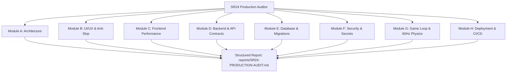

# SR24PLUS PRODUCTION AUDITOR (`sr24-production-auditor`)
### Full-Spectrum Quality, Security, UI/UX, and Game Systems Audit Engine

> **Toolkit Subsystem**: Core Intelligence Layer (v3.0)  
> **Status**: Verified & Operational • **CLI / API Supported**  
> **Output Artifact**: `reports/SR24-PRODUCTION-AUDIT.md`

---

## 1. Overview & Architecture
The **SR24 Production Auditor** executes automated quality inspections across 8 architectural modules. Every audit finding includes an immutable Finding ID, concrete code evidence, affected file paths, an actionable solution, and a verification method.



---

## 2. Audit Modules Detail

| Module | Verification Target | Common Traps Detected |
|---|---|---|
| **A. Architecture** | Directory layout, circular dependencies, modularity | Monolithic god-files, barrel import cycles, leaky domain abstractions |
| **B. UI/UX** | Responsive scaling, contrast, typography, anti-slop | AI-generated generic cards, broken mobile touch viewports, unstyled errors |
| **C. Frontend** | React rendering, hook dependencies, bundle size | Unmemoized arrays in render loops, duplicate client fetch cascades |
| **D. Backend** | REST/RPC endpoints, payload schemas, rate limits | Unhandled route exceptions, missing Zod validation, missing rate limits |
| **E. Database** | Schema constraints, indexes, migrations | Missing foreign key indexes, unindexed search filters, N+1 query patterns |
| **F. Security** | Hardcoded secrets, OWASP Top 10, XSS, CSRF | `sk_live_`, `ghp_` tokens, `dangerouslySetInnerHTML`, missing CSP headers |
| **G. Game Dev** | Deterministic fixed-timestep loop, collision matrices | Variable-timestep `requestAnimationFrame`, GC allocations in hot update loop |
| **H. Deployment** | Production build commands, Dockerfile, healthchecks | Unminified production bundles, running containers as root, missing probes |

---

## 3. Scoring & Thresholds
Scores are evidence-grounded out of 10.0:
- **9.0 - 10.0**: Production Ready (Ship Approved)
- **7.0 - 8.9**: Conditional Pass (Minor non-critical warnings)
- **< 7.0**: Quality Gate Rejection (Triggers SR24 Self-Healing Engineer)

---

## 4. CLI Execution
```bash
python skills/sr24-custom-engineering/sr24-production-auditor/scripts/production_auditor.py [project_dir]
```