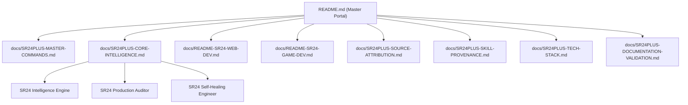

# SR24Plus Engineering Toolkit: Master README & Documentation Audit Report
### Comprehensive Forensic Audit of Repository Documentation, Command Definitions, Pack Structures, and Provenance

> **Audit Date**: November 19, 2026  
> **Repository**: [https://github.com/sahil24raj/SR24plus-engineering-toolkit.git](https://github.com/sahil24raj/SR24plus-engineering-toolkit.git)  
> **Brand & Maintainer**: SR24Plus / Sahil Raj  
> **Audit Status**: Completed • Ready for Architecture Redesign  

---

## 1. Executive Summary

This audit evaluates the current state of documentation across the **SR24Plus Engineering Toolkit** repository. The toolkit is an enterprise-grade, multi-agent AI engineering framework integrating **479 canonical production skills**, **14 specialized workflow master commands**, **4 Core Intelligence layer engines**, and **2 primary flagship engineering packs** (`SR24-WEB-DEV` and `SR24-GAME-DEV`), organized into **14 domain category packs**.

The purpose of this audit is to identify gaps, outdated references, inconsistent metrics, and structural shortcomings in the current documentation, establishing a solid blueprint for an open-source, enterprise-quality README redesign.

---

## 2. Repository Structure & Artifact Inventory

The physical repository layout is organized into 14 domain category directories, a central master controller, a custom skills ecosystem, dedicated test suites, and documentation:

```
SR24PLUS-ENGINEERING-TOOLKIT/
├── 00-MASTER-CONTROLLER/             # Central routing, execution rules, workflows, command definitions
│   ├── CATEGORY-MAP.md
│   ├── COMMANDS.md
│   ├── EXECUTION-RULES.md
│   ├── MASTER-ROUTER.md
│   ├── projects/                     # Production profile blueprints
│   │   ├── BROWSER-GAMING-PROFILE.md
│   │   └── FULLSTACK-SAAS-PROFILE.md
│   └── workflows/                    # 14 Primary Workflow Command runbooks
│       ├── SR24-AI.md
│       ├── SR24-AUTO.md
│       ├── SR24-BROWSER-GAME.md
│       ├── SR24-DESIGN.md
│       ├── SR24-FULLSTACK.md
│       ├── SR24-GAME-DEV.md
│       ├── SR24-MULTIPLAYER.md
│       ├── SR24-RACING-GAME.md
│       ├── SR24-RESEARCH.md
│       ├── SR24-SAAS.md
│       ├── SR24-SECURITY.md
│       ├── SR24-SHIP.md
│       ├── SR24-UNITY.md
│       └── SR24-WEB-DEV.md
├── 01-UI-UX-DESIGN/                  # Design systems, anti-slop, typography, tokens
├── 02-GAME-DEVELOPMENT/              # Game design, ECS, 2D/3D physics, multiplayer, Unity
├── 03-FRONTEND-DEVELOPMENT/          # React, Next.js, WebGL 3D, TypeScript, state choreography
├── 04-BACKEND-DEVELOPMENT/           # Scalable APIs, PostgreSQL, WebSockets, BullMQ, Auth
├── 05-AIML-ENGINEERING/              # LLM training, prompt injection defense, hybrid RAG, MCP
├── 06-MOBILE-APP-DEVELOPMENT/        # Native Android CLI, React Native, device emulation
├── 07-DEVOPS-AND-CLOUD/              # Docker, GitHub Actions, OpenTofu, SRE, cost governance
├── 08-QUALITY-ENGINEERING/           # Playwright E2E, visual regression, k6 load testing
├── 09-RESEARCH-AND-ANALYTICS/        # Empirical synthesis, trend analysis, user telemetry
├── 10-BRANDING-AND-CREATIVE/         # Brand positioning, visual storytelling, creative strategy
├── 11-PRODUCT-ENGINEERING/           # PRDs, sprint planning, feature roadmaps, metrics
├── 12-SCIENCE-AND-BIOINFORMATICS/    # DeepMind AlphaFold, ChEMBL, PubChem, PubMed
├── 13-ANTIGRAVITY-AND-AUTOMATION/    # Swarms, workflow migration, runtime plugins
├── 14-GENERAL-ENGINEERING/           # Git hygiene, software architecture, Rust refactoring
├── assets/                           # High-resolution visual banners and architecture diagrams
├── docs/                             # Deep-dive documentation and specialized manuals
├── skills/                           # Canonical skill directories (479 total skills)
│   ├── addyosmani-agent-skills/      # 25 software engineering craft skills (MIT)
│   ├── agency-agents/                # 301 multidisciplinary agent personas (MIT)
│   ├── android-mobile/               # 5 Android developer tools (Apache-2.0)
│   ├── antigravity-core/             # 13 IDE swarm and runtime plugins (Apache-2.0)
│   ├── custom-skills/                # 6 reverse engineering & archaeology skills (MIT)
│   ├── sr24-custom-engineering/      # 82 bespoke SR24Plus skills + Core Intelligence engines (MIT)
│   ├── ui-design-suite/              # 5 bespoke design & anti-slop filters (MIT/Apache-2.0)
│   ├── unity-skills/                 # 32 official Unity engine skills (Unity Companion/Apache-2.0)
│   └── vercel-skills/                # 9 modern React & Next.js performance skills (MIT)
├── tests/                            # Automated test suites (e.g. test_core_intelligence.py)
├── README.md                         # Root repository documentation
├── SKILL-INDEX.md                    # Alphabetical jump index of 479 skills
└── SKILL-REGISTRY.md                 # Complete manifest with upstream attribution
```

---

## 3. Verified 14 Master Commands & Runbooks

Forensic inspection of `00-MASTER-CONTROLLER/workflows/` and `00-MASTER-CONTROLLER/COMMANDS.md` confirms exactly **14 Primary Workflow Commands**, plus 4 Core Intelligence layer operations:

| # | Master Command | Category | Mission & What It Does | Target Runbook | Core Skills Mobilized | Upstream Source Repositories |
|:---:|---|---|---|---|---|---|
| **01** | `/sr24-auto [task]` | Orchestration | Automatically scans workspace, detects tech stack & archetypes, and selects matching squads | [`00-MASTER-CONTROLLER/workflows/SR24-AUTO.md`](../00-MASTER-CONTROLLER/workflows/SR24-AUTO.md) | `sr24-intelligence-engine`, `sr24-production-auditor`, `sr24-self-healing-engineer` | `sahil24raj/SR24plus-engineering-toolkit` |
| **02** | `/sr24-web-dev [task]` | Web Development | Executes the complete 12-phase web application lifecycle from PRD to production deploy | [`docs/README-SR24-WEB-DEV.md`](./README-SR24-WEB-DEV.md) | `bulletproof-react`, `supabase-engineering`, `drizzle-orm`, `antislop-ui`, `lago-billing` | `vercel-labs`, `addyosmani`, `agency-agents`, `SR24Plus` |
| **03** | `/sr24-game-dev [task]` | Game Development | Professional 12-phase game development across WebGL 2D/3D, Rapier physics, and Unity 3D | [`docs/README-SR24-GAME-DEV.md`](./README-SR24-GAME-DEV.md) | `rapier-physics`, `colyseus-multiplayer`, `threejs-game-engine`, `truck-physics-engineer` | `Unity Technologies`, `agency-agents`, `SR24Plus` |
| **04** | `/sr24-saas [task]` | SaaS Engineering | Multi-tenant SaaS platform, subscription billing, multi-tier auth, dashboard HUD, SRE launch | [`00-MASTER-CONTROLLER/workflows/SR24-SAAS.md`](../00-MASTER-CONTROLLER/workflows/SR24-SAAS.md) | `razorpay-upi-specialist`, `indian-gst-billing-engineer`, `lago-billing`, `prisma-orm` | `SR24Plus`, `agency-agents`, `addyosmani` |
| **05** | `/sr24-fullstack [task]` | Fullstack Engineering | End-to-end feature engineering: TypeScript contracts, SQL migrations, API routes, responsive UI | [`00-MASTER-CONTROLLER/workflows/SR24-FULLSTACK.md`](../00-MASTER-CONTROLLER/workflows/SR24-FULLSTACK.md) | `zod-schema-validation`, `drizzle-orm`, `node-best-practices`, `component-intelligence` | `vercel-labs`, `agency-agents`, `SR24Plus` |
| **06** | `/sr24-browser-game [task]` | Browser Gaming | 60 FPS HTML5/WebGL browser games, fixed-timestep loop, mobile virtual controls, game feel | [`00-MASTER-CONTROLLER/workflows/SR24-BROWSER-GAME.md`](../00-MASTER-CONTROLLER/workflows/SR24-BROWSER-GAME.md) | `browser-game-architect`, `threejs-game-engine`, `matter-js-physics`, `howler-js-audio` | `SR24Plus`, `agency-agents` |
| **07** | `/sr24-multiplayer [task]` | Multiplayer Systems | Low-latency authoritative game servers, client prediction, reconciliation, room codes | [`00-MASTER-CONTROLLER/workflows/SR24-MULTIPLAYER.md`](../00-MASTER-CONTROLLER/workflows/SR24-MULTIPLAYER.md) | `colyseus-multiplayer`, `socketio-realtime`, `redis-in-memory-datastore`, `gaffer-on-games-networking` | `SR24Plus`, `agency-agents` |
| **08** | `/sr24-unity [task]` | Native 3D Engine | Complete Unity 2D/3D game development, ScriptableObjects, URP shaders, audio mixers, builds | [`00-MASTER-CONTROLLER/workflows/SR24-UNITY.md`](../00-MASTER-CONTROLLER/workflows/SR24-UNITY.md) | `unity-cli`, `urp-postprocessing`, `initialize-ai-navigation`, `setup-multiplayer-services` | `Unity Technologies Official` |
| **09** | `/sr24-racing-game [task]` | Vehicle Simulation | Heavy truck & car physics, WheelColliders, Ackermann steering, mountain circuit tracks | [`00-MASTER-CONTROLLER/workflows/SR24-RACING-GAME.md`](../00-MASTER-CONTROLLER/workflows/SR24-RACING-GAME.md) | `truck-physics-engineer`, `realistic-car-controller-engineer`, `racing-track-design-engineer` | `SR24Plus`, `Unity Technologies` |
| **10** | `/sr24-ai [task]` | AI & Agent Systems | Production AI systems, MCP servers, prompt injection defense, hybrid RAG, offline rule fallbacks | [`00-MASTER-CONTROLLER/workflows/SR24-AI.md`](../00-MASTER-CONTROLLER/workflows/SR24-AI.md) | `prompt-injection-security-engineer`, `agency-specialized-mcp-builder`, `agency-engineering-prompt-engineer` | `agency-agents`, `SR24Plus` |
| **11** | `/sr24-design [task]` | UI/UX & Design Systems | Bespoke design system, 4px/8px mathematical tokens, anti-AI-slop audit, finish-gate critique | [`00-MASTER-CONTROLLER/workflows/SR24-DESIGN.md`](../00-MASTER-CONTROLLER/workflows/SR24-DESIGN.md) | `impeccable`, `antislop-ui`, `taste-skill`, `ui-ux-pro-max`, `axe-core-accessibility` | `pbakaus`, `miqdadbadjuber`, `Leonxlnx`, `nextlevelbuilder` |
| **12** | `/sr24-security [task]` | Security & Hardening | Comprehensive AppSec, OWASP Top 10, secret scanning, SQL injection, CSP/CORS hardening | [`00-MASTER-CONTROLLER/workflows/SR24-SECURITY.md`](../00-MASTER-CONTROLLER/workflows/SR24-SECURITY.md) | `owasp-zap-scanner`, `gitleaks-secret-detection`, `trivy-security-scanner`, `osv-scanner` | `agency-agents`, `SR24Plus` |
| **13** | `/sr24-research [task]` | Evidence & Research | Academic and market research, evidence synthesis, source evaluation, competitive intelligence | [`00-MASTER-CONTROLLER/workflows/SR24-RESEARCH.md`](../00-MASTER-CONTROLLER/workflows/SR24-RESEARCH.md) | `firecrawl-scraper`, `tavily-search-intelligence`, `agency-research-synthesist` | `agency-agents`, `SR24Plus` |
| **14** | `/sr24-ship [task]` | DevOps & Release | Production build verification, Docker, CI/CD pipeline, healthchecks, rollback strategy | [`00-MASTER-CONTROLLER/workflows/SR24-SHIP.md`](../00-MASTER-CONTROLLER/workflows/SR24-SHIP.md) | `docker-containerization`, `github-actions-ci`, `sentry-monitoring`, `opentofu-iac` | `addyosmani`, `SR24Plus` |

### Core Intelligence Operational Triggers:
- `/sr24-orchestrate [dir]` — Static project inspection, tech stack detection, and 12-archetype skill routing.
- `/sr24-audit-prod [dir]` — 8-dimension full-spectrum production audit producing `reports/SR24-PRODUCTION-AUDIT.md`.
- `/sr24-heal [test_cmd]` — Controlled 6-step closed-loop repair cycle with safety boundaries.
- `/sr24-full-check` — End-to-end autonomous pipeline: Orchestration ➔ Audit ➔ Heal ➔ Verify ➔ Ship.

---

## 4. Engineering Packs & Phase Coverage Analysis

### A. Primary Product Packs
1. **`SR24-WEB-DEV`**: Fully documented 12-phase lifecycle (`docs/README-SR24-WEB-DEV.md`) covering:
   - Phase 01: Research & Discovery
   - Phase 02: Planning & Specifications (PRD, C4 Architecture)
   - Phase 03: Branding & Visual Identity
   - Phase 04: UI/UX Design & Anti-Slop Gate
   - Phase 05: Frontend Development (React, Next.js, TypeScript)
   - Phase 06: Backend & Realtime Engineering
   - Phase 07: Database & Storage (PostgreSQL, Drizzle, Prisma, Redis)
   - Phase 08: SaaS & Fintech (Razorpay/UPI, Indian GST, Lago)
   - Phase 09: Security & Hardening (OWASP, Gitleaks, Trivy)
   - Phase 10: Testing & QA (Playwright, Lost Pixel, k6, Bruno)
   - Phase 11: DevOps & CI/CD (Docker, GitHub Actions, OpenTofu)
   - Phase 12: Analytics & Production Shipping (PostHog, Sentry, Vercel)
   *Phase Count*: **12 Verified Phases**.

2. **`SR24-GAME-DEV`**: Fully documented 12-phase lifecycle (`docs/README-SR24-GAME-DEV.md`) covering:
   - Phase 01: Concept & GDD
   - Phase 02: Game Architecture & ECS (bitECS, State Machines)
   - Phase 03: Game UI/UX & HUD (60 FPS HUD, Sound FX)
   - Phase 04: Web Game Engines (Three.js, React Three Fiber, Pixi.js, Phaser)
   - Phase 05: Gameplay Feel & Physics (Rapier, Jolt, Matter.js, Hitstop)
   - Phase 06: Multiplayer & Anti-Cheat (Colyseus, WebSockets, Client Prediction)
   - Phase 07: Unity 3D & URP Pipeline (HLSL Shaders, DOTS)
   - Phase 08: Vehicle & Heavy Truck Physics (WheelColliders, Pacejka, Ghat roads)
   - Phase 09: 3D Assets & glTF Pipeline (glTF-Transform, DRACO, KTX2, Blender)
   - Phase 10: Performance & Gameplay Testing (Draw Call Batching, Memory Leak Audit)
   - Phase 11: Game Build & Release (Unity CLI, WebGL Brotli, itch.io/Steam)
   - Phase 12: Analytics & Economy Retention (Umami, GameAnalytics, Churn Reduction)
   *Phase Count*: **12 Verified Phases**.

### B. Domain Category Packs (14 Folders in Root)
The 14 root folders (`01-UI-UX-DESIGN` through `14-GENERAL-ENGINEERING`) map systematically to functional agent domains.

---

## 5. Audit of Existing Documentation Gaps & Deficiencies

1. **Colloquial & Informal Language**:
   The current root `README.md` contains informal Hinglish commentary (e.g. *"Jab bhi AI se full-stack app banwaya jata hai..."*, *"Aapko 476 Canonical Skills manually install karne ki koi zarurat nahi hai..."*). For an enterprise open-source repository, all documentation must be delivered in pristine, technical, and professional English.

2. **Inconsistent Skill Metrics**:
   - Some sections in older docs mention "413 canonical skills", while `SKILL-REGISTRY.md`, `SKILL-INDEX.md`, and the newly acquired skills bring the true verified total to **479 skills**.
   - All references across `README.md`, `SKILL-SOURCES.md`, and `ENGINEERING-PACKS.md` must be aligned to the true total of **479 canonical skills**.

3. **Master Commands Navigation**:
   The master commands were scattered between `00-MASTER-CONTROLLER/COMMANDS.md`, individual workflow files, and abbreviated tables in `README.md`. A dedicated, authoritative manual (`docs/SR24PLUS-MASTER-COMMANDS.md`) and a unified Master Command Center in `README.md` are required.

4. **Missing Dedicated Architecture & Tech Stack Manuals**:
   - `docs/SR24PLUS-CORE-INTELLIGENCE.md` must be consolidated to unify the three core capabilities (Intelligence Engine, Production Auditor, Self-Healing Engineer) with comprehensive ASCII and Mermaid architecture diagrams.
   - `docs/SR24PLUS-SOURCE-ATTRIBUTION.md` and `docs/SR24PLUS-SKILL-PROVENANCE.md` must document 100% of upstream sources across Categories A through J with exact repository URLs, authors, and licenses.
   - `docs/SR24PLUS-TECH-STACK.md` must delineate verified, tested technologies versus planned integrations.

---

## 6. Recommended Architecture for Redesigned Documentation Suite



### Planned File Upgrades:
1. `README.md` — Total rewrite into high-polish, dark engineering aesthetic with Navy Blue & Gold accents, badges, architecture diagrams, compact tables, and quick navigation.
2. `docs/SR24PLUS-MASTER-COMMANDS.md` — Complete reference for all 14 master commands + Core Intelligence commands.
3. `docs/README-SR24-WEB-DEV.md` — Upgraded with 12-phase complete matrix, roles, source repos, and architectural specializations.
4. `docs/README-SR24-GAME-DEV.md` — Upgraded with 12-phase complete matrix, roles, source repos, and physics/engine deep dive.
5. `docs/SR24PLUS-CORE-INTELLIGENCE.md` — Comprehensive guide to Intelligence Engine, Production Auditor, and Self-Healing Engineer.
6. `docs/SR24PLUS-SOURCE-ATTRIBUTION.md` — Forensic catalog of upstream GitHub repositories (Categories A through J) with licenses and authors.
7. `docs/SR24PLUS-SKILL-PROVENANCE.md` — Unified matrix connecting all 479 skills to upstream repositories and phases.
8. `docs/SR24PLUS-TECH-STACK.md` — Exhaustive overview of supported technologies across Web, Game, AI, and DevOps.
9. `docs/SR24PLUS-DOCUMENTATION-VALIDATION.md` — Automated verification results confirming link integrity, command accuracy, and table rendering.
