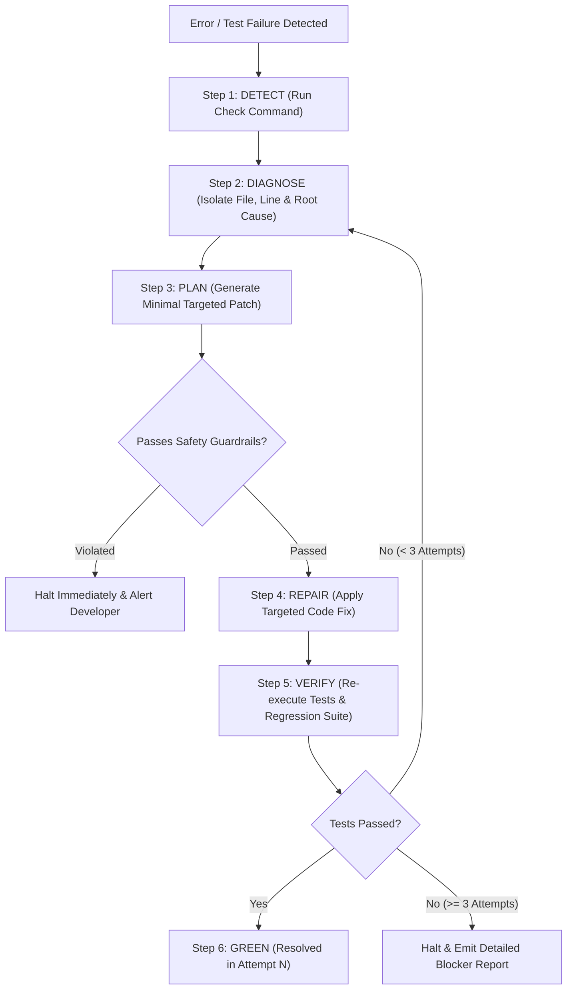

# SR24PLUS SELF-HEALING ENGINEER (`sr24-self-healing-engineer`)
### Autonomous 6-Step Closed Loop Debugging & Repair Engine with Safety Guardrails

> **Toolkit Subsystem**: Core Intelligence Layer (v3.0)  
> **Status**: Verified & Operational • **CLI / API Supported**  
> **Loop Cap**: Maximum 3 Controlled Repair Cycles

---

## 1. Overview & Operational Mandate
The **SR24 Self-Healing Engineer** automates defect diagnosis, targeted code patching, and regression verification for compilation errors, broken tests, failed builds, and runtime exceptions. It strictly adheres to a closed 6-step loop and enforces non-destructive production safety guardrails.



---

## 2. The 6-Step Closed Loop
1. **Detect**: Executes test suite, linter, or build (`npm test`, `pytest`, `tsc --noEmit`, [Playwright](https://github.com/microsoft/playwright)).
2. **Diagnose**: Parses compiler and runtime stack traces, extracting affected file, line number, and error type.
3. **Plan**: Formulates a surgical patch prioritizing critical errors without altering unaffected logic.
4. **Repair**: Applies the minimal targeted code fix directly to the source file.
5. **Verify**: Re-runs the failing command and ensures zero regressions in existing tests.
6. **Pass / Escalate**: Loops up to 3 times; if still unresolved, halts safely and produces an escalation report.

---

## 3. Strict Safety Guardrails
- **Zero Data Loss**: Rejects any patch containing destructive database operations (`DROP TABLE`, unbacked data truncates).
- **Zero Secret Exposure**: Blocks logging or emitting environment variable credentials.
- **Zero Force Pushes**: Strictly forbids `git push --force`.
- **Zero Test Disabling**: Refuses to comment out, skip, or delete failing tests to fabricate passes.

---

## 4. CLI Execution
```bash
python skills/sr24-custom-engineering/sr24-self-healing-engineer/scripts/self_healing_engineer.py "[test_command]"
```