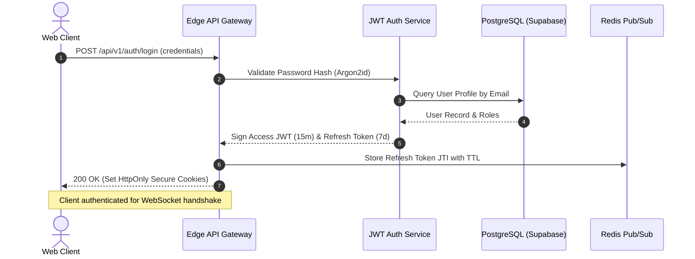

# Mermaid.js Diagram Architecture & Technical Specs

## 1. When to Activate
Activate this skill whenever a project or prompt requires specialist in mermaid.js diagram generation for technical specifications, sequence flows, state machines, entity-relationship diagrams, and architecture flowcharts.. It is assigned to official engineering phases in the **SR24Plus Engineering Toolkit**.

## 2. When Not to Activate
- Do not activate when the task does not involve mermaid-diagrams.
- Do not activate as a substitute for simple static mockups where deeper engineering is unnecessary.

## 3. Core Capabilities
- Sequence diagram authoring for OAuth2 flows, payment webhooks, and multi-step state sync
- State diagram modeling for payment states (Created ➔ Authorized ➔ Captured ➔ Settled)
- Entity-Relationship Diagrams (ERD) detailing foreign keys, cardinality, and data types
- Git graph and CI/CD pipeline flow visual representations
- Syntax validation eliminating rendering bugs (unquoted labels, unsupported characters)

## 4. Engineering Workflow
1. **Discovery & Architecture**: Inspect technical constraints, performance requirements, and data contracts.
2. **Setup & Configuration**: Install official package dependencies and configure environment variables.
3. **Implementation**: Author production-grade code using clean architecture, strict TypeScript types, and error handling.
4. **Validation & Testing**: Run unit and integration tests confirming zero regressions.
5. **Production Deployment**: Verify build bundle impact, tree-shaking, and observability telemetry.

## 5. Implementation Instructions & Code Patterns

```typescript

```

## 6. Best Practices
- **Strict Typing**: Never use `any`; use strict interface and generic contracts.
- **Error Boundaries**: Handle all edge cases, offline drops, and network timeouts gracefully.
- **Performance Budget**: Avoid blocking main thread operations; optimize bundle sizes and lazy-load where appropriate.
- **Security**: Never expose private keys, credentials, or sensitive customer data in client-side bundles.

## 7. Common Anti-Patterns to Avoid
- Hardcoding credentials or API endpoints directly into source files.
- Ignoring promise rejections and async exceptions.
- Creating monolithic un-testable files instead of modular single-responsibility units.
- Introducing layout shifts or un-optimized re-renders.

## 8. Verification & Testing Checklist
- [ ] TypeScript compiles cleanly with zero errors (`tsc --noEmit`).
- [ ] Unit tests pass verifying expected behavior and edge cases.
- [ ] Environment variables documented in `.env.example`.
- [ ] Build artifact size verified with tree-shaking confirmed.

## 9. Official Source Repository & Upstream Reference
- **Repository**: [https://github.com/mermaid-js/mermaid](https://github.com/mermaid-js/mermaid)
- **Category**: SR24-WEB-DEV Canonical Engineering Skill

## 10. License & Attribution
- **License**: MIT
- **Maintained By**: SR24Plus Autonomous Engineering Architecture
